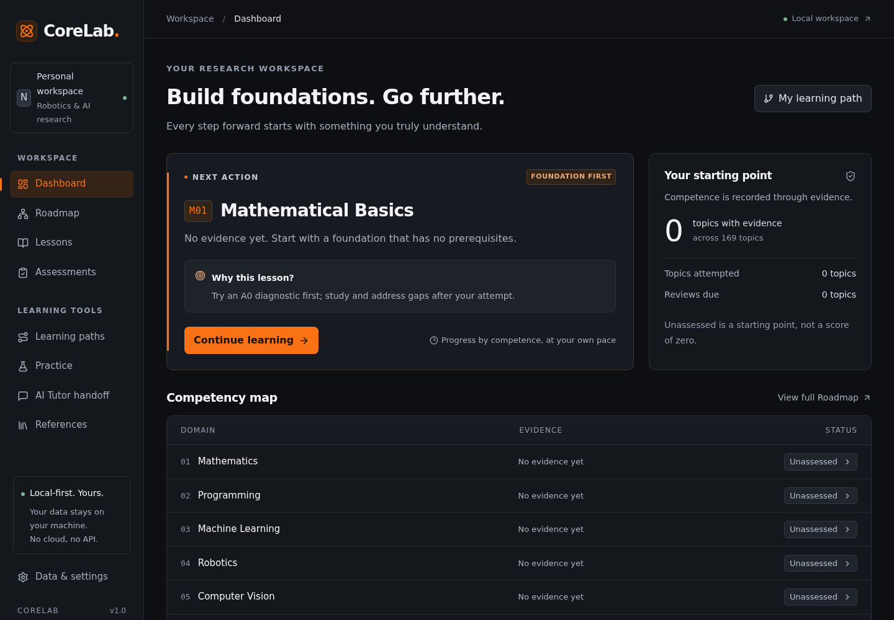
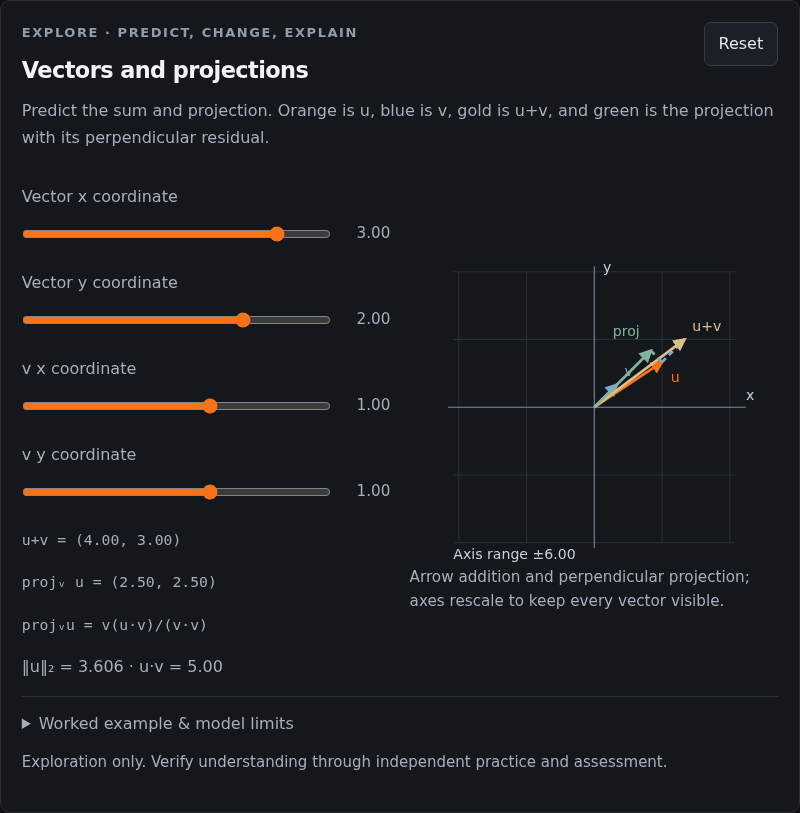

<div align="center">

# CoreLab — Learn. Build. Prove.

**Learn Robotics & AI from first principles.**

[](package.json)
[](LICENSE)
[](LICENSE-CONTENT)

[Quick Start](#quick-start) · [Learning workflow](#how-to-learn-effectively-with-corelab) · [User guide](docs/guide.md) · [Contributing](CONTRIBUTING.md)

</div>

CoreLab is a local, single-user learning workspace that connects a prerequisite-based Robotics & AI curriculum with lessons, interactive explanations, independent exercises and evidence-based assessment. It helps you decide what to study next—and distinguish what you have read from what you can independently explain, calculate and implement.



_Real application screenshot from an isolated, empty workspace. No personal learning data is included._

## Key features

|                            | What you can do                                                                                                                                                                                                      |
| -------------------------- | -------------------------------------------------------------------------------------------------------------------------------------------------------------------------------------------------------------------- |
| **Follow the foundations** | Explore a 169-topic prerequisite graph through searchable list and graph views, learning paths and explained next-step recommendations.                                                                              |
| **Watch and experiment**   | Study 31 complete lessons, 28 curated video resources and eight interactive models—from vector projection and robot kinematics to CNN filters and Q-learning. Video coverage currently reaches 25 of the 31 lessons. |
| **Build independently**    | Use Python and C++ starters, numerical exercises and reproducible experiment templates. Fixed local Python verifiers support M02 and PY01.                                                                           |
| **Prove what you know**    | Track conceptual understanding, mathematical reasoning, implementation and transfer/retention separately. Assistance, diagnostic contracts and evidence stay inspectable.                                            |
| **Learn from mistakes**    | Practice weak skills using authored question variants, inspect feedback and prerequisites, and revisit topics on a 1/3/7/21-day review schedule.                                                                     |
| **Keep control**           | Store notes and progress in local SQLite, export backups, and optionally copy context to ChatGPT manually. No AI API, account or cloud subscription is required.                                                     |

<details>
<summary>See an interactive lesson</summary>



_Real browser-test capture. The model runs locally; changing a parameter does not award mastery._

</details>

## Quick Start

Install **Node.js 24 or newer**, npm and Git. Python 3 is needed for the optional verified Python labs; a C++17 compiler is needed only for C++ exercises.

```bash
git clone https://github.com/trongnghia-le/corelab-robotics-ai.git
cd corelab-robotics-ai
npm ci
npm run dev
```

Open **http://127.0.0.1:3000**. The database is created automatically. For a production build:

```bash
npm run build
npm start
```

Keep the local server running while studying. After dependencies are installed, lessons, equations, visualizations, assessments and notes work without Internet. External references and video playback need a connection. YouTube players load only after a click, without autoplay, and always offer an original-source link.

**Local use only:** CoreLab has no user authentication and is designed to bind to loopback. Do not expose its server to a network or deploy it as a public multi-user service. The public repository is source code, not a hosted learning service.

## Cross-Platform Installation

CoreLab is designed for **Windows 10/11, macOS and Linux**, using Node.js 24+. Use a current browser and keep the local server running; no Docker, native app packaging or cloud service is needed.

| System             | Install once                                                                                                                                                                                                                       | Terminal                                                                                                                                                   |
| ------------------ | ---------------------------------------------------------------------------------------------------------------------------------------------------------------------------------------------------------------------------------- | ---------------------------------------------------------------------------------------------------------------------------------------------------------- |
| **Windows 10/11**  | Install [Node.js 24+](https://nodejs.org/en/download), [Git](https://git-scm.com/downloads) and, for Python labs, [Python 3](https://www.python.org/downloads/). Enable Python's PATH option if offered, then reopen the terminal. | PowerShell or Command Prompt. If PowerShell blocks `npm.ps1`, use `npm.cmd` in place of `npm` or use Command Prompt; no execution-policy change is needed. |
| **macOS**          | Install a Node.js 24+ release compatible with your macOS version, Git and optional Python 3. Match Apple Silicon/Intel downloads to your machine.                                                                                  | Terminal; confirm `node --version`, `npm --version` and `git --version`.                                                                                   |
| **Linux / Ubuntu** | Install Node.js 24+ from the official installation instructions; a distribution's default `nodejs` package may be older. On Ubuntu, Git and optional Python can be installed with `sudo apt install git python3`.                  | Your usual terminal; confirm the Node version before `npm ci`.                                                                                             |

Then run the same **Quick Start** commands above on every platform. To use port 3001, run `npm run dev -- --port 3001`. Stop the server with **Ctrl+C**. Python labs automatically detect `python3`, `python`, or Windows `py -3`; Python is optional for studying and running the web app. A C++17 compiler is optional for C++ exercises. Quote file paths containing spaces, and run npm commands from the repository folder.

**Platform checks:** Linux is tested locally. The [validation workflow](.github/workflows/validate.yml) runs clean installation, tests and a build with Node 24 on Linux, Windows and macOS when GitHub Actions is enabled; Chromium desktop/mobile viewport tests run on Linux. Windows and macOS have not been run interactively in this workspace. Consult actual workflow results before treating those platforms as verified.

A local installation runs on **your own computer** and keeps its data there. A hosted website runs on someone else's server: making this repository public does not host CoreLab or sync progress. Mobile layouts are browser-responsive; there is no Android/iOS native app or cross-device synchronization. Do not expose the local server to access it from a phone.

## How CoreLab works

The Dashboard and prerequisite graph guide topic selection; lessons build understanding; assessments and supported local tests record evidence. Notes, review dates and backups stay in a local SQLite workspace. Its competency framework separates **C** conceptual understanding, **M** mathematical reasoning, **I** independent implementation and **T** transfer/retention.

## How to Learn Effectively with CoreLab

**Diagnostic → Watch → Visualize → Understand → Derive → Implement → Verify → Review**

| Step                    | A practical action                                                                                                                                                                                                                            |
| ----------------------- | --------------------------------------------------------------------------------------------------------------------------------------------------------------------------------------------------------------------------------------------- |
| **Start**               | Follow a Dashboard recommendation or a prerequisite-based Learning Path. Check the topic's prerequisites and choose one achievable objective.                                                                                                 |
| **Diagnostic**          | Try the full diagnostic before studying when available. Record assistance honestly: **A0** none; **A1** conceptual hint; **A2** specific hint/example; **A3** supplied solution. Only independent A0 evidence can satisfy verification gates. |
| **Watch & Visualize**   | Use a curated video or local demonstration to build intuition. Pause, predict the next result, change one parameter, and compare what happened with your prediction. If no video/demo is mapped, use the worked example.                      |
| **Understand & Derive** | Read the foundations, state assumptions and units, reconstruct the equation on a blank page, and explain why each term is present without looking at the solution.                                                                            |
| **Implement**           | Solve the exercise and write the algorithm from scratch. Keep copied or AI-generated solutions as assisted practice, then attempt a fresh task independently.                                                                                 |
| **Verify**              | Compare hand calculations with tests, try boundaries and deliberately broken cases, then use the assessment and supported local verifier. Inspect the C/M/I/T evidence instead of relying on one score.                                       |
| **Fix Weaknesses**      | Open **Practice → My Weaknesses**, inspect recurring objective errors, review the linked concept, and practice the weak skill. A repaired mistake is not automatically full-topic mastery.                                                    |
| **Review**              | Follow due reviews, note unresolved gaps in the topic notebook, and reconstruct the result after a delay. Then continue with the next recommended topic. Review suggestions use 1/3/7/21-day intervals.                                       |

**Beginner study order:** **M01 → M02 → PY01 → M03**—notation and units, vectors, Python fundamentals, then matrices. These are existing topic IDs, not new prerequisite edges: PY01 has no prerequisites and can run alongside mathematics; M03 depends on M02. Return to M02's coding exercise after learning basic Python.

**Example: a 75-minute M02 session, once basic Python is familiar**

| Minutes | Focus                                                                                       |
| ------- | ------------------------------------------------------------------------------------------- |
| 0–10    | Check prerequisites and attempt the diagnostic at your actual assistance level.             |
| 10–25   | Watch the vector lecture; predict a projection and test it with the sliders.                |
| 25–40   | Reconstruct the dot-product/projection equations and explain the zero-vector edge case.     |
| 40–60   | Implement the dot product independently and write boundary/property checks.                 |
| 60–70   | Run the fixed M02 verifier, inspect any failures and use targeted practice where available. |
| 70–75   | Save assumptions and remaining gaps in the notebook; check the next review/recommendation.  |

Adjust this to **60–90 minutes** by shortening the video or extending independent work. A diagnostic retry counts as A0 only if it is genuinely independent; just seeing the solution is not fresh evidence.

**Use ChatGPT as a Socratic tutor:** choose **Copy Learning Context** on a topic or **AI Tutor handoff**, preview what will be shared, then paste it into ChatGPT yourself. Ask: _“Ask one question at a time. Let me predict and derive first. Offer the smallest hint I need; do not give a complete solution unless I ask.”_ Record any assistance accurately. Paste structured feedback back into CoreLab as unverified notes using the [manual handoff format](docs/guide.md#chatgpt-project-workflow-no-api); there is no automatic account connection or chat synchronization.

Reading, watching videos, clicking checkoffs and AI-generated solutions do **not** automatically establish verified mastery. A full A0 diagnostic needs at least **80%** and every critical item correct for its L1 gates. L2 also requires independent implementation evidence from a supported fixed contract, currently M02 or PY01. Open answers use rubrics and remain unverified; focused practice does not replace full diagnostic gates. L3/L4 certification is not implemented. See the [assessment policy](docs/guide.md#assessment-and-mastery).

> **Progress is measured by what you can independently explain, implement, and verify — not by how many videos you watch.**

## Curriculum overview

| Domain                         |  Topics | Includes                                                            |
| ------------------------------ | ------: | ------------------------------------------------------------------- |
| Mathematics                    |      16 | Linear algebra, calculus, probability, optimization and geometry    |
| Programming                    |      30 | Python, C++, testing and development tools                          |
| Machine Learning               |      12 | Problem formulation, classical ML, neural networks and training     |
| Robotics                       |      42 | Mechanics, kinematics, dynamics, control and simulation/systems     |
| Computer Vision                |      20 | Images, geometry and visual learning                                |
| Reinforcement & Robot Learning |      24 | MDPs, value learning, policies and robot learning                   |
| Embodied & Cognitive Robotics  |      15 | Embodied intelligence and cognitive robotics                        |
| Scientific Research            |      10 | Experimental design, reproducibility and critical evaluation        |
| **Total**                      | **169** | A long-term map, not a claim that every topic has a complete course |

There are **31 complete lessons with versioned diagnostics** and structured overviews for every topic. The initial focused practice bank contains **42 questions across seven topics**; unavailable video, lesson, assessment and practice coverage is stated explicitly. The [curriculum data](corelab/curriculum_graph_v1.json) is the source of truth for topic IDs and prerequisites.

## Technology stack

| Layer                  | Technology                                                                         |
| ---------------------- | ---------------------------------------------------------------------------------- |
| Application            | Next.js App Router, React, strict TypeScript                                       |
| Interface              | Tailwind CSS, shared CSS, Lucide icons; English interface with dark/orange styling |
| Learning content       | Markdown, GFM, KaTeX, React/SVG visualizations                                     |
| Knowledge graph        | React Flow (`@xyflow/react`)                                                       |
| Storage and validation | SQLite through Node's built-in `node:sqlite`, Zod                                  |
| Verification           | Vitest, Playwright and fixed local Python lab tests                                |

**Your data:** progress lives in `.local/corelab.sqlite`. Export a backup through **Data & settings** before replacing or moving it. Restore validates and replaces progress transactionally; it does not merge records. Stop the app before copying the entire `.local/` directory, which also holds lab-signing keys. Keep databases, exports, keys and personal notes out of Git. See [backup and restore](docs/guide.md#progress-backup-and-restore).

CoreLab includes no analytics, remote UI fonts, AI requests or cloud synchronization. Loading an optional external video connects to its provider. Copying context to a tutor shares the selected notes with that service; review the preview first.

## Contributing

Contributions to lessons, exercises, visualizations, accessibility and bug fixes are welcome. Start with [CONTRIBUTING.md](CONTRIBUTING.md) for content quality, attribution, contract versioning and validation requirements. Detailed setup, architecture and troubleshooting are in the [user and maintainer guide](docs/guide.md).

```bash
npm run check                    # lint, types, content, unit/integration tests, build
npx playwright install chromium  # once, for browser tests
npm run test:e2e                  # isolated test database and production server
```

## License and acknowledgments

**Original source code and technical documentation:** [MIT](LICENSE), copyright © 2026 Le Trong Nghia. **Original educational prose, curriculum and assessment content:** [CC BY 4.0](LICENSE-CONTENT). Executable examples remain MIT. See the [licensing scope](LICENSING.md) for exact boundaries, attribution and exclusions.

External videos, books, course materials, images, trademarks and dependencies remain the property of their respective rights holders under their own terms. A link or working embed does not grant permission to redistribute the underlying material.

Thank you to the maintainers of the [open-source dependencies and educational resources](THIRD_PARTY_NOTICES.md), including 3Blue1Brown, MIT OpenCourseWare, Modern Robotics, Stanford CS231n, David Silver / Google DeepMind, Enthought and CppCon. Their inclusion does not imply endorsement.
