<div align="center">

# 🤖 CoreLab

### Learn Robotics & AI from first principles — on your own machine.

**193 topics · 2,405 exercises · 391 fully worked solutions · 92 interactive 2D/3D explorations · 386 original figures · 3,967 quiz questions · 318 curated videos · 1 graduation capstone**

🇻🇳 _Học Robotics & AI từ nền tảng: miễn phí, chạy ngay trên máy bạn, giao diện và bài học có tiếng Việt._

[](https://github.com/trongnghia-le/corelab-robotics-ai/stargazers)
[](package.json)
[](https://nextjs.org/)
[](tsconfig.json)
[](LICENSE)
[](LICENSE-CONTENT)
[](CONTRIBUTING.md)

[**Quick start**](#-quick-start) · [**What's inside**](#-whats-inside-a-lesson) · [**Study desk**](#-study-desk-notes-exercises-and-code-beside-the-lesson) · [**Curriculum**](#-the-curriculum) · [**How to study**](#-how-to-study-with-corelab) · [**User guide**](docs/guide.md) · [**Contributing**](CONTRIBUTING.md)

<br/>

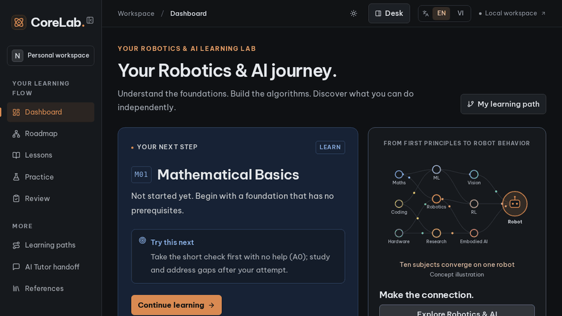

<sub>Dashboard → roadmap → lesson → interactive 3D block → worked solution → Vietnamese → study desk</sub>

</div>

<br/>

CoreLab is a **free, local-first learning workspace** that takes you from vectors and Python to Kalman filters, inverse kinematics, motor sizing, embedded firmware, computer vision and reinforcement learning, and ends with a graduation robot project. Everything sits on a prerequisite map, so you always know what to learn next. Each topic follows the same loop: **predict → explore → derive → implement → verify → review.** Your progress lives on your computer: no accounts, no subscriptions, no cloud.

> **Progress is measured by what you can independently explain, implement and verify — not by how many videos you watch.**

## ✨ Why CoreLab?

- 🗺️ **A real roadmap, not a playlist.** A 193-topic prerequisite graph covers mathematics, programming, ML, robotics, hardware and embedded systems, vision, RL, embodied AI and research methods, and explains why each next step is recommended.
- 🎛️ **Move it and see.** 92 interactive blocks inside the lessons: drag a slider and the plot, the 2D construction or the **3D scene** updates live. Turn a robot frame, roll down a cost surface, push a PID loop into windup, project a point through a camera.
- 🧮 **Every example comes with its solution.** 391 worked cases with numbered steps, an independent check and a takeaway, plus 547 solved examples inside the theory of the deepened lessons. Solutions are folded until you open them, so you can try first.
- 🔬 **22 core lessons dug to the root.** The ideas engineers use every day (rotations, Jacobians, optimization, PID, Kalman filters, sensor fusion, backpropagation, camera models…) are derived from definitions, with 93 proofs, four views of each key idea and a from-scratch implementation tested against a library, then **checked by an independent reviewer** who recomputed every number.
- 🔌 **Hardware you can recognise.** Sensors, motors and drivers, power and buses, motor families and their datasheets, motor sizing, then Arduino/ESP32 firmware up to micro-ROS, with **real photos of the components** and optional free [Wokwi](https://wokwi.com) simulator projects.
- 🗒️ **A study desk beside every lesson.** Markdown notes with a formula palette, every exercise with room for your working, and a code editor that runs Python and C++ on your machine.
- 🎓 **A graduation capstone.** Nine milestones build one simulated mobile manipulator that takes a text command, localises, navigates, grasps and delivers.
- 🇻🇳 **English or Vietnamese, light or dark.** One click switches the interface and every lesson, exercise, quiz and figure; another switches the theme.
- 🔒 **Yours.** Local SQLite, exportable backups, no analytics, no AI API keys.

## 🎯 Who is it for?

- **Students** in mechatronics, electronics, automation or computer science who want the maths behind robots to finally click.
- **Self-learners and career switchers** who need a clear order of topics instead of scattered tutorials.
- **Software engineers moving into robotics or AI**, who want derivations and tested implementations rather than black boxes.
- **Teachers and club mentors** looking for free, openly licensed lessons, exercises and figures to reuse.

## 🚀 Quick start

You need **Node.js 24+** and Git. Python 3 is used by most labs; a C++ compiler is only needed for the C++ track.

```bash
git clone https://github.com/trongnghia-le/corelab-robotics-ai.git
cd corelab-robotics-ai
npm ci
npm run app      # builds once (~30 s), then opens CoreLab in its own window
```

Click **VI** in the top bar for Vietnamese and the ☀ / ☾ button for the light or dark theme. The local database is created automatically. Dependency versions are pinned in `package-lock.json`, so `npm ci` installs the same versions on every machine.

Most labs need only the Python standard library. The optional **Library track** in each lab uses real tools; install the ones you need:

```bash
python3 -m pip install numpy scipy matplotlib scikit-learn torch opencv-python gymnasium
```

<details>
<summary><b>Open CoreLab like an app, other modes, and Windows / macOS / Linux notes</b></summary>

<br/>

```bash
npm run app           # open CoreLab (starts the background server if needed)
npm run app:install   # Linux: add CoreLab to the app menu
npm run app:stop      # stop the background server
npm run dev           # development server on http://127.0.0.1:3000
npm run dev:v2        # also enable the objective-based Extra practice lab at /objectives
```

1. **Linux (GNOME, KDE, ...):** after `npm run app:install`, press the Super key, type **CoreLab** and click it. Right-click the icon and choose **Add to Favorites** to pin it.
2. **macOS / Windows:** run `npm run app`. It opens in your browser; in Chrome or Edge choose **⋮ → Cast, save and share → Install page as app** for a desktop icon.

The launcher keeps a light production server on **http://127.0.0.1:3210** and opens CoreLab in an app window (Chrome, Chromium, Brave or Edge if installed). Later launches take under a second, it rebuilds by itself whenever the code changes (for example after a `git pull`), and it shares the same progress database as `npm run dev`. Set `CORELAB_APP_PORT` for another port; if something goes wrong, check `.local/app.log`.

| System             | Install once                                                                                                                                                           | Terminal                                                                                       |
| ------------------ | ---------------------------------------------------------------------------------------------------------------------------------------------------------------------- | ---------------------------------------------------------------------------------------------- |
| **Windows 10/11**  | [Node.js 24+](https://nodejs.org/en/download), [Git](https://git-scm.com/downloads) and optionally [Python 3](https://www.python.org/downloads/) (tick "Add to PATH"). | PowerShell or Command Prompt. If PowerShell blocks `npm.ps1`, use `npm.cmd` or Command Prompt. |
| **macOS**          | Node.js 24+ (matching Apple Silicon/Intel), Git and optional Python 3.                                                                                                 | Terminal. Check `node --version` first.                                                        |
| **Linux / Ubuntu** | Node.js 24+ from the official instructions (distribution packages are often older); `sudo apt install git python3`.                                                    | Any terminal. Check the Node version before `npm ci`.                                          |

After `npm ci`, lessons, equations, figures, interactive blocks, quizzes and notes work offline; videos and external links need a connection.

**Local use only.** CoreLab has no authentication and binds to loopback. Don't expose the server to a network or host it as a public multi-user service.

</details>

## 🧩 What's inside a lesson

### Predict, move, explain: interactive 2D and 3D

Each interactive block asks you to **predict first**, then lets you move the parameters and read the exact values. 3D scenes can be turned by dragging or with the arrow keys. The blocks use the lesson's own formulas and numbers, and an automated test evaluates every block at its defaults and at every combination of slider ends.

<table>
<tr>
<td width="50%" valign="top">

**A cost surface in 3D.** Gradient descent on $J = x^2 + 10y^2$: raise the step size and watch the path zig-zag, then blow up.

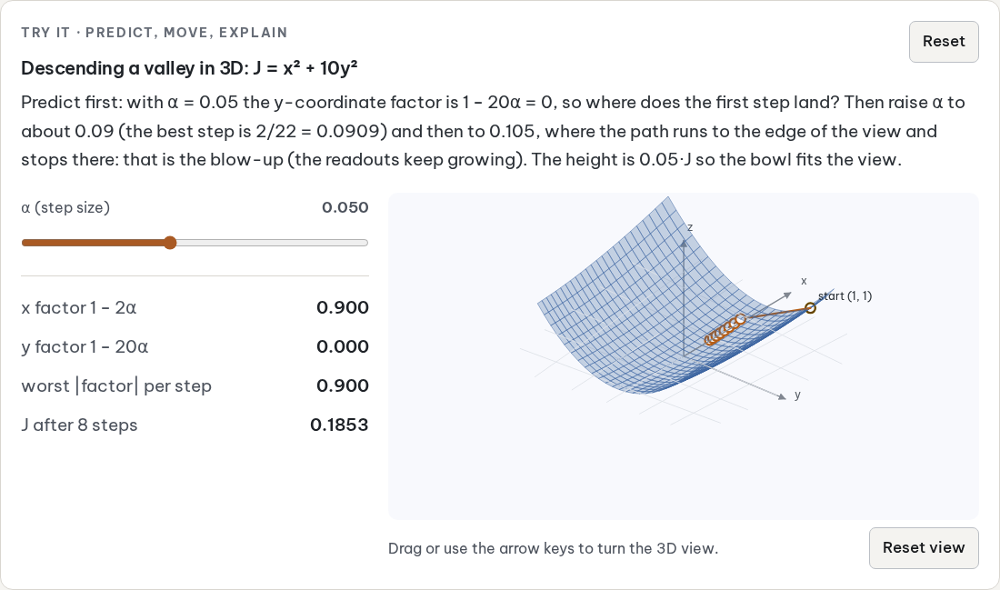

</td>
<td width="50%" valign="top">

**A control loop you can break.** PID with an actuator limit: compare a plain integrator with a clamped one and see the windup overshoot appear.

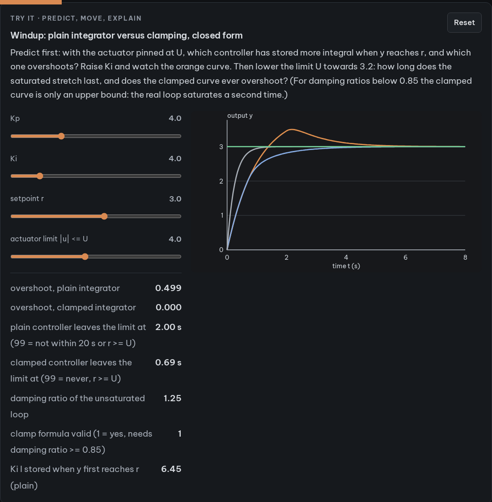

</td>
</tr>
</table>

### Worked solutions you open when you are ready

Every lesson has worked cases written as **Problem → Solution (numbered steps) → Check → Takeaway**, and in the 53 deepened lessons each piece of theory is followed by its own solved example. Solutions stay folded until you open them; **Show all solutions** opens a whole section at once. Each step names the equation it uses and shows the substitution with units, and every number was recomputed in Python.

<p align="center">
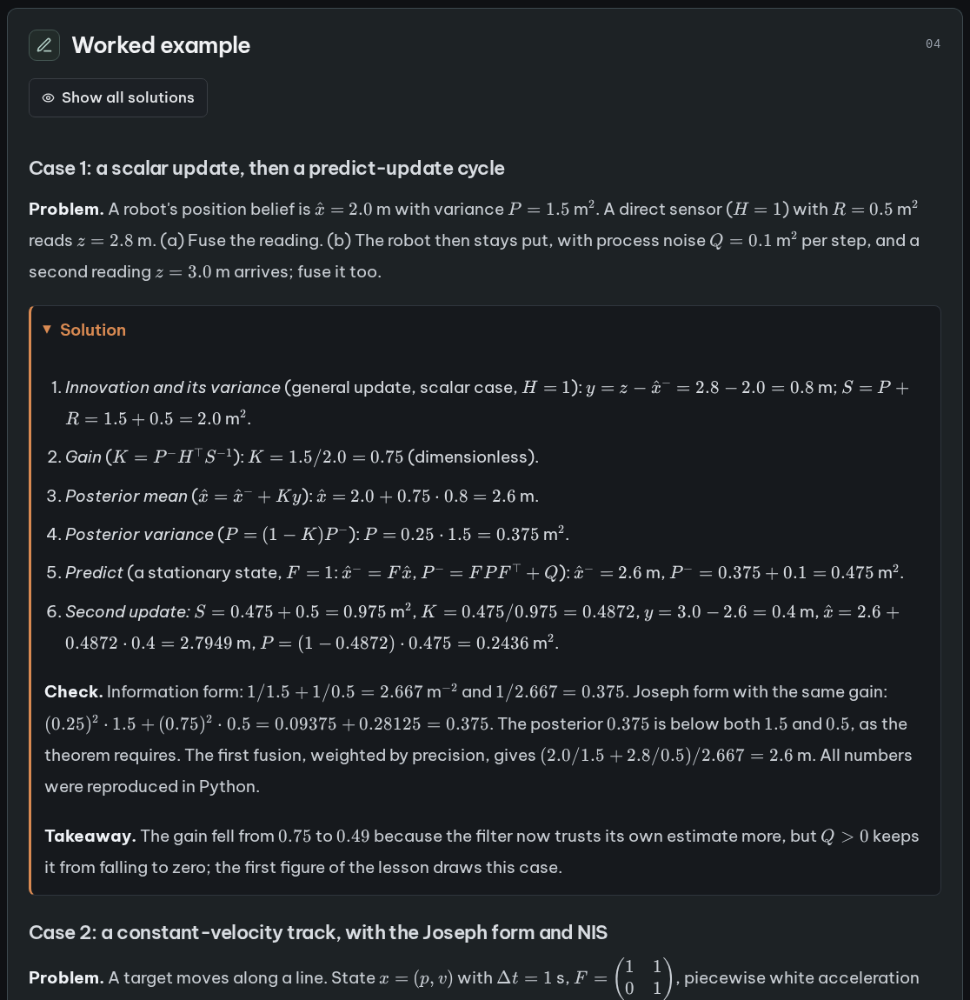
</p>

### Core lessons, from the definitions up

The 22 lessons that carry most of everyday robotics and AI go deeper: every result is derived step by step from its definition, the key theorems are proved, the point where each result stops being true is computed, each central idea is shown in **four views** (algebra, geometry, code, physical meaning), and the core algorithm is built from scratch and tested against a library.

<p align="center">
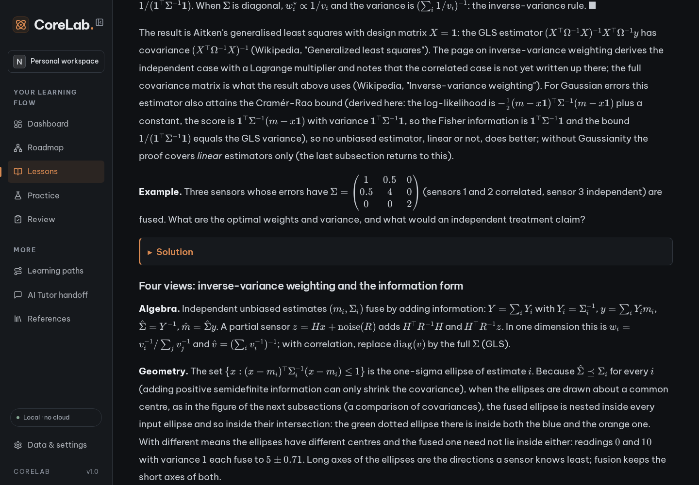
</p>

<details>
<summary><b>The 22 core lessons</b></summary>

<br/>

| Area        | Lessons                                                                                                                                          |
| ----------- | ------------------------------------------------------------------------------------------------------------------------------------------------ |
| Mathematics | M02 vectors · M03 matrices · M04 linear systems · M05 derivatives · M06 Jacobians · M08 probability · M10 optimization · M12 rigid-body geometry |
| Programming | PY04 NumPy                                                                                                                                       |
| Robotics    | R03 rotations and transforms · R04 forward kinematics · R05 inverse kinematics · R06 velocity kinematics                                         |
| Control     | C03 PID · C07 Kalman filtering · C08 sensor fusion                                                                                               |
| Software    | S03 ROS 2 nodes, topics and QoS                                                                                                                  |
| Learning    | ML04 neural networks · ML05 backpropagation · ML06 training deep networks                                                                        |
| Vision      | V03 camera models · V08 object detection                                                                                                         |

Each one has at least 2,500 words of derivation, several proofs, four views of each key idea, at least one interactive block and a from-scratch implementation, and each passed an independent review that re-derived the proofs, recomputed every number and opened every cited source.

</details>

### Real components, not just symbols

The hardware track shows what the parts look like. Motor families, their insides, drivers, encoders and transmissions appear as openly licensed photos from Wikimedia Commons, side by side, with what to look for and the credit under each gallery.

<p align="center">
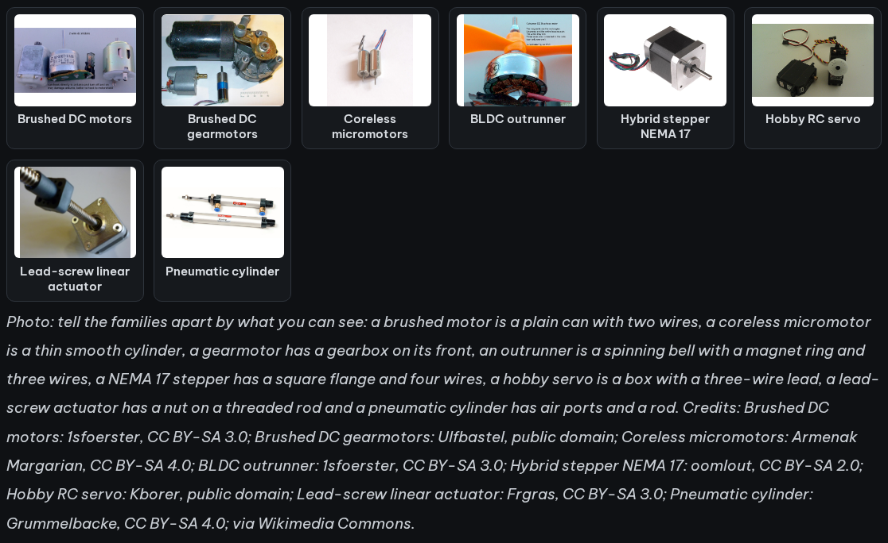
</p>

### And everything a lesson always had

| Section                        | What it gives you                                                                             |
| ------------------------------ | --------------------------------------------------------------------------------------------- |
| Why this matters · Intuition   | Where the idea shows up in real robots and AI systems, with a predict-first question          |
| Theory and derivation          | The math step by step, assumptions and units stated (solved examples in the deepened lessons) |
| Worked example                 | One or more cases with full solutions, an independent check and a takeaway                    |
| **Exercises** (10–17)          | Easy → challenge, with sources and worked answers                                             |
| Reference implementation       | Short, runnable code with a self-test                                                         |
| **Independent practice (lab)** | Goal, tasks, starter code, tests, expected output, extension and a library track              |
| Verification · Failure modes   | How to check your result, and the mistakes people really make                                 |
| Alternatives and trade-offs    | When to pick which method                                                                     |
| Further reading                | The exact book sections, papers and documentation pages used                                  |

Each lesson is split into **Learn → Practice → Build → Review** sessions with a realistic time estimate, and comes with a diagnostic quiz, a practice bank that targets your weak skills, and one to three curated videos that load only when you ask for them.

## 🗒️ Study desk: notes, exercises and code beside the lesson

Click **Desk** in the top bar or press **Ctrl+\\** to dock the desk on the right of the page; drag its left edge to resize it. Fold the sidebar into an icon rail for more room. On a narrow screen the desk slides up from the bottom, and the ↗ button moves it to its own window, for a second monitor.

<p align="center">
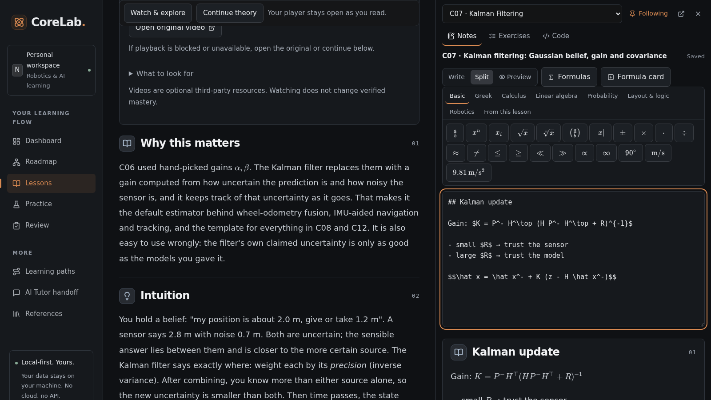
</p>

<table>
<tr>
<td width="33%" valign="top">

**Notes with a formula palette.** Write, Split or Preview, seven groups of LaTeX snippets plus the equations of the current lesson, and Ctrl+M for inline math.

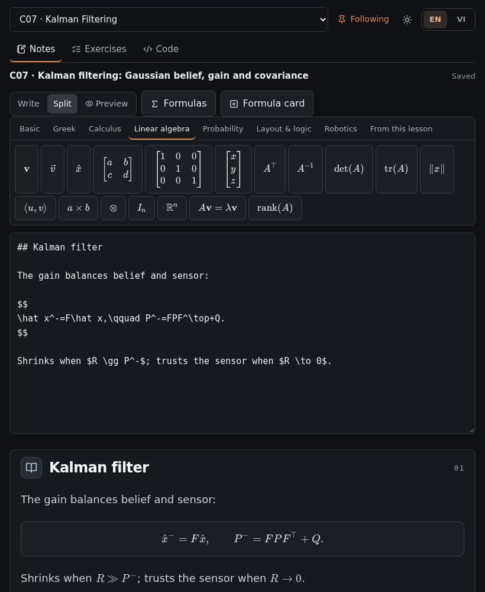

</td>
<td width="33%" valign="top">

**Every exercise, with room to work.** A box for your working under each exercise, a done tick and the worked answer hidden until you open it.

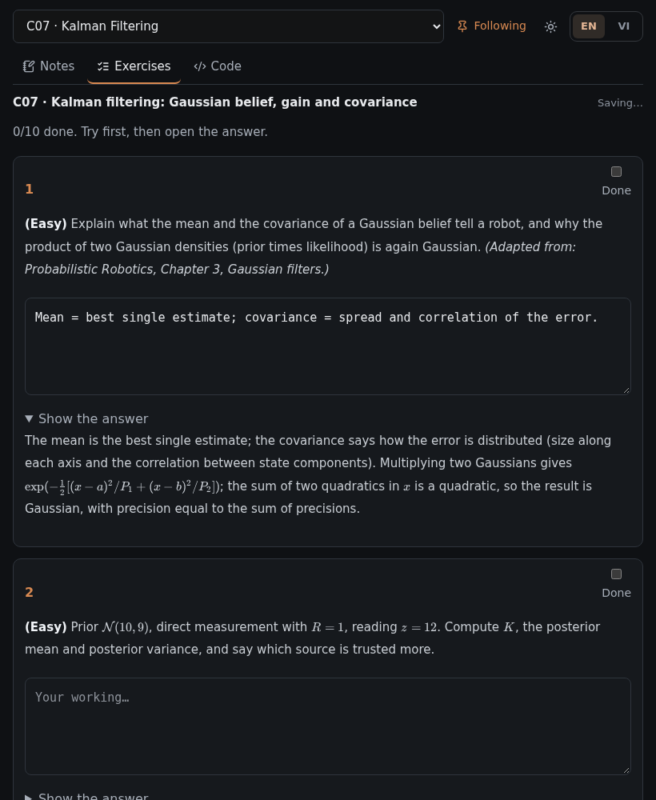

</td>
<td width="33%" valign="top">

**Code that runs.** **Load lab code** puts the lesson's starter and tests in one file, and **Run** (Ctrl+Enter) uses your own Python 3 or C/C++ compiler.

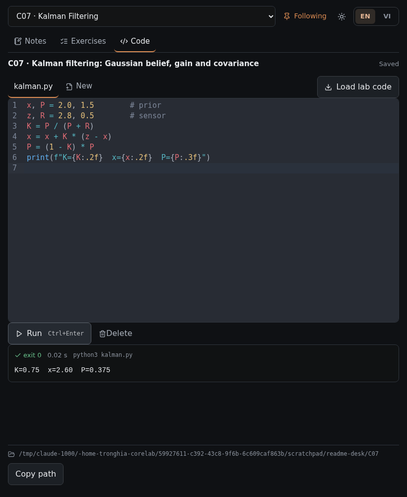

</td>
</tr>
</table>

Everything is saved as plain files in `.local/desk/<TOPIC>/`, so you can also open them in VS Code. Code runs on your machine with your rights, exactly like in a terminal; the desk only accepts requests from CoreLab's own pages.

## 🧭 A tour of the app

<table>
<tr>
<td width="50%" valign="top">

### Ten subjects, one map

The dashboard recommends your next step and why, and opens each subject from its own card.

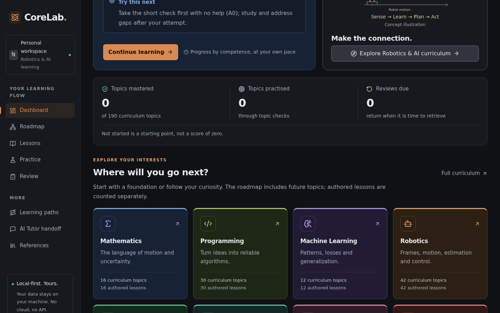

</td>
<td width="50%" valign="top">

### A graph of connected topics

Search or filter the roadmap, or switch to the graph: every subject has its own colour, and hovering a topic highlights its prerequisites.


</td>
</tr>
<tr>
<td width="50%" valign="top">

### Original figures in every lesson

386 original SVG figures, each drawn for one idea and labelled with the lesson's own numbers, in English and Vietnamese.


</td>
<td width="50%" valign="top">

### Check what you know

Quizzes mix concept, calculation and open questions and point you to the prerequisites to revisit.


</td>
</tr>
<tr>
<td width="50%" valign="top">

### Học bằng tiếng Việt

The **EN/VI** switch translates the interface and every lesson, exercise, quiz, figure and interactive block. Code and math stay identical.


</td>
<td width="50%" valign="top">

### Dark or light

The ☀ / ☾ button switches every page; the study desk, the figures and the interactive blocks follow.

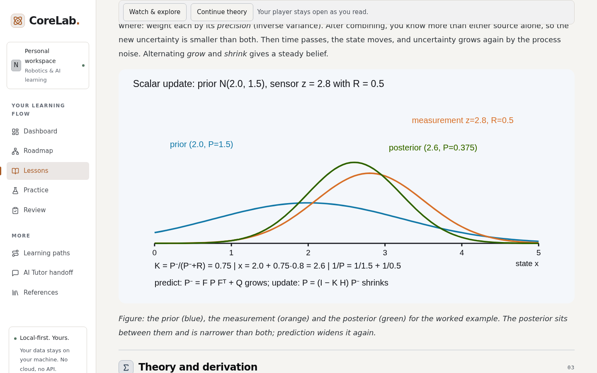

</td>
</tr>
</table>

<div align="center">


</div>

## 📚 The curriculum

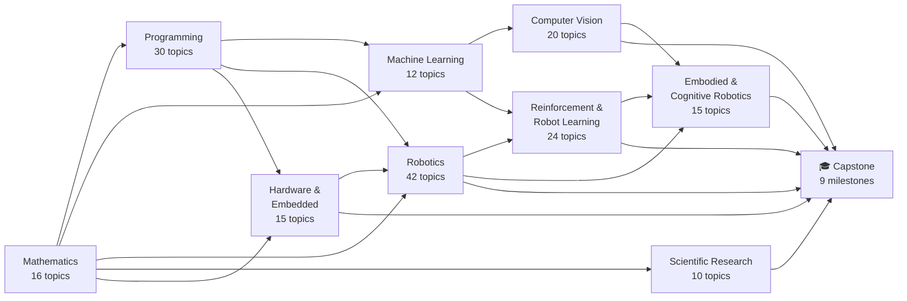

| Domain                         |  Topics | A taste of what's inside                                                                                            |
| ------------------------------ | ------: | ------------------------------------------------------------------------------------------------------------------- |
| Mathematics                    |      16 | Vectors, matrices, calculus, Jacobians, probability, statistics, optimization, Lie groups                           |
| Programming                    |      30 | Python, NumPy, testing, modern C++ (RAII, templates, concurrency, numerics), Git, Linux, Docker, ROS 2              |
| Machine Learning               |      12 | Regression, classification, neural networks, backpropagation, training and evaluation                               |
| Robotics                       |      42 | Frames, kinematics, inverse kinematics, dynamics, PID/LQR/MPC, Kalman filters, sensor fusion                        |
| Hardware & Embedded            |      15 | Sensors, motors and drivers, power and safety, buses, motor families, datasheets, motor sizing, firmware, micro-ROS |
| Computer Vision                |      20 | Camera models, calibration, features, CNNs, detection, tracking, visual odometry & SLAM                             |
| Reinforcement & Robot Learning |      24 | MDPs, TD learning, Q-learning, policy gradients, PPO, offline RL, imitation, sim-to-real                            |
| Embodied & Cognitive Robotics  |      15 | Task & motion planning, world models, diffusion policies, vision-language-action models                             |
| Scientific Research            |      10 | Experimental design, reproducibility, ablations, reading and writing papers                                         |
| Capstone                       |       9 | One robot, nine milestones: firmware, localisation, navigation, grasping, RL, language, evaluation                  |
| **Total**                      | **193** | **Every topic has a full lesson, worked solutions, a diagnostic, a practice bank, a lab and video**                 |

**Beginner path:** `M01 → M02 → PY01 → M03` (notation, vectors, Python, matrices). From there, follow the dashboard. Prerequisites are suggestions, never locks.

### 🔌 Hardware & Embedded

**Path:** `HW01 → HW02 → HW06 → HW04 → HW03 → HW05` for the overview (what each part is, how to choose it, what the datasheet numbers mean), then **`HW13 → HW14 → HW15`** for actuators in depth (every motor family and where it fits, reading motor and gearhead datasheets line by line, sizing a motor, gearbox and driver from the task), then `HW07 → HW12` for embedded programming: GPIO/ADC/PWM, interrupts and encoders, I²C/SPI sensors, closed-loop motor control, a CRC-checked serial link and micro-ROS, and bring-up. Labs run in Python with no parts; programming topics also have Wokwi simulator projects, and an optional cheap starter kit if you want real hardware.

### 🎓 Graduation capstone: CoreBot Tidy

The course ends with one project that uses all ten domains. You build a simulated mobile manipulator in MuJoCo that hears _"put the red block in the blue bin"_, localises, drives to the table, finds the block with its camera, grasps it and drops it in the bin, while a safety supervisor can stop it at any time.

| Milestone | What you build                                                         | Hours |
| --------- | ---------------------------------------------------------------------- | ----: |
| CAP01     | Spec, repository, robot and world model                                |    22 |
| CAP02     | Firmware-in-the-loop base: C speed loop, CRC-8 protocol, odometry      |    28 |
| CAP03     | State estimation and localisation (EKF, landmarks, camera calibration) |    26 |
| CAP04     | Mapping, planning and navigation                                       |    26 |
| CAP05     | Perception-driven grasping                                             |    30 |
| CAP06     | Learned skills with RL/imitation and domain randomisation              |    32 |
| CAP07     | Language-conditioned task layer and safety supervisor                  |    26 |
| CAP08     | Full-system integration, sim-to-real gap and evaluation                |    34 |
| CAP09     | Demo, technical report, reproducible release and graduation            |    16 |

Each milestone is a lesson whose lab is the milestone brief, with a pytest acceptance file, a rubric and a scoring weight. You graduate when every gate passes, every milestone scores at least 60 and the total reaches 70 (Merit at 80, Distinction at 90 plus a stretch goal). Everything runs in simulation for free; a real ESP32 or SO-101 tier is optional. Download the shared [`evalkit.py`](public/practice/capstone/evalkit.py) and [`make_skeleton.sh`](public/practice/capstone/make_skeleton.sh) to start.

## 🎯 How to study with CoreLab

**Diagnostic → Watch → Predict & explore → Derive → Implement → Verify → Review**

1. **Start** from the dashboard recommendation or a learning path, and check the prerequisites.
2. **Check what you know** first. Say honestly how much help you used, from _No help (A0)_ to _Saw the solution (A3)_.
3. **Learn session.** Answer each predict-first question before you move a slider or open a figure. Try every solved example before you open its solution. Keep notes and formulas in the study desk.
4. **Derive.** Rebuild the key equation on a blank page and explain every term.
5. **Practice and Build sessions.** Work each exercise in the desk before opening its answer, then implement the lab from scratch until the tests pass.
6. **Verify.** Use hand calculations, boundaries and deliberately broken cases, then re-take the diagnostic.
7. **Fix your weaknesses** in **Practice → My Weaknesses**, which targets the exact skills you missed.
8. **Review** on a 1/3/7/21-day schedule and reconstruct the result from memory.

**Use ChatGPT (or any assistant) as a Socratic tutor:** choose **Copy Learning Context**, check the preview, and paste it yourself. Ask it to _"ask one question at a time and give the smallest hint I need."_ There's no API connection or automatic sync. See the [guide](docs/guide.md#chatgpt-project-workflow-no-api).

<details>
<summary><b>How mastery and the next step are decided</b></summary>

<br/>

Reading, watching, ticking sessions and practising never count as mastery on their own. A topic is **passed** when you take its diagnostic with no help (A0), score **≥ 80 %** on the automatically checked questions and get every critical question right; open answers are rubric-guided and stay unverified. Concept (C), math (M), implementation (I, from a supported fixed lab contract) and retention (T, two A0 passes at least 7 days apart) are tracked separately. The dashboard only recommends topics whose prerequisites are passed, ranks due reviews, weak skills and foundations first, and schedules reviews after 1, 3, 7 and 21 days. Read the [assessment policy](docs/guide.md#assessment-and-mastery) for the details.

</details>

<p align="center"><br/><sub>Responsive down to phone width, with keyboard-friendly navigation.</sub></p>

## 🛠️ Tech stack

| Layer       | Technology                                                                                                      |
| ----------- | --------------------------------------------------------------------------------------------------------------- |
| App         | Next.js App Router, React, strict TypeScript                                                                    |
| UI          | Lucide icons, React Flow graph, CodeMirror 6, Be Vietnam Pro and Inter fonts                                    |
| Interactive | A safe expression language (no `eval`) with plots, 2D scenes and an orbitable SVG 3D renderer                   |
| Themes      | Dark-first CSS; the light theme is generated from it with PostCSS (`npm run theme`)                             |
| Content     | Markdown + GFM, KaTeX math, original SVG figures, openly licensed photos, versioned JSON contracts              |
| Storage     | SQLite via Node's built-in `node:sqlite`, Zod validation; desk files in `.local/desk/`                          |
| Quality     | Vitest, Playwright, content, translation and interactive-block validators, Python lab fixtures, CI on 3 systems |

```bash
npm run check                    # lint, types, content validation, tests, build
npx playwright install chromium  # once, for browser tests
npm run test:e2e                 # browser tests on an isolated database
```

## 🗺️ Status and honest limits

- ✅ All 193 topics have a lesson with worked solutions, exercises with answers, a lab, a diagnostic, a practice bank and curated video; all 22 core lessons passed an independent review.
- ⚠️ **The content was written with AI assistance.** Every worked solution was recomputed in Python, every interactive block is evaluated by a test, the 22 core lessons were re-derived by a separate reviewer that also opened every cited source, lab tests were run, links checked and figures rendered. It has **not** been reviewed by a human expert. Spotted a mistake? Please [open an issue](https://github.com/trongnghia-le/corelab-robotics-ai/issues).
- ⚠️ **Hardware and capstone caveats.** Arduino/ESP32 sketches were syntax-checked and their logic simulated in Python, but not run on a board; capstone acceptance thresholds are provisional.
- ⚠️ The app does not run ROS 2, simulators or hardware for you. Some library tracks include optional ROS 2/MuJoCo code to run on your own machine. Automatic verification of your submitted code is limited to a few fixed contracts.
- 🧭 The browser UI is tested on Linux; CI runs the build and tests on Linux, Windows and macOS.

## 🤝 Contributing

Corrections, new exercises, better diagrams, accessibility fixes and translations are all welcome. Start with [CONTRIBUTING.md](CONTRIBUTING.md); the [user and maintainer guide](docs/guide.md) covers architecture, data and troubleshooting. Styles live in `app/globals.css`; run `npm run theme` after editing it to regenerate `app/theme.css`.

If CoreLab helps you learn, **a ⭐ on GitHub helps others find it.**

## 📄 License and acknowledgments

- **Code and technical docs:** [MIT](LICENSE) © 2026 Le Trong Nghia.
- **Educational content** (lessons, exercises, figures, assessments): [CC BY 4.0](LICENSE-CONTENT). Executable examples remain MIT. See [LICENSING.md](LICENSING.md) for the exact scope.
- **Component photos** come from Wikimedia Commons under their own licences (CC0, public domain, CC BY or CC BY-SA); the author and licence of each photo are given under its gallery.

Videos, books, courses and trademarks belong to their owners under their own terms. A link or embed is not a licence to redistribute them. Exercises marked _"Adapted from"_ are original restatements that credit the source that inspired them. Thank you to 3Blue1Brown, MIT OpenCourseWare, Modern Robotics, Stanford CS231n, David Silver / Google DeepMind, Steve Brunton, Cyrill Stachniss, CppCon, every Wikimedia Commons photographer credited in the lessons and every other educator listed in [THIRD_PARTY_NOTICES.md](THIRD_PARTY_NOTICES.md). Their inclusion does not imply endorsement.
