<div align="center">

# 🤖 CoreLab

### Learn Robotics & AI from first principles — on your own machine.

**169 topics · 169 full lessons · 1,746 worked exercises · 3,133 interactive questions · 169 hands-on labs · 270 curated videos**

[](package.json)
[](https://nextjs.org/)
[](tsconfig.json)
[](LICENSE)
[](LICENSE-CONTENT)
[](CONTRIBUTING.md)

[**Quick start**](#-quick-start) · [**Features**](#-what-you-get) · [**Curriculum**](#-the-curriculum) · [**How to study**](#-how-to-study-with-corelab) · [**User guide**](docs/guide.md) · [**Contributing**](CONTRIBUTING.md)

<br/>

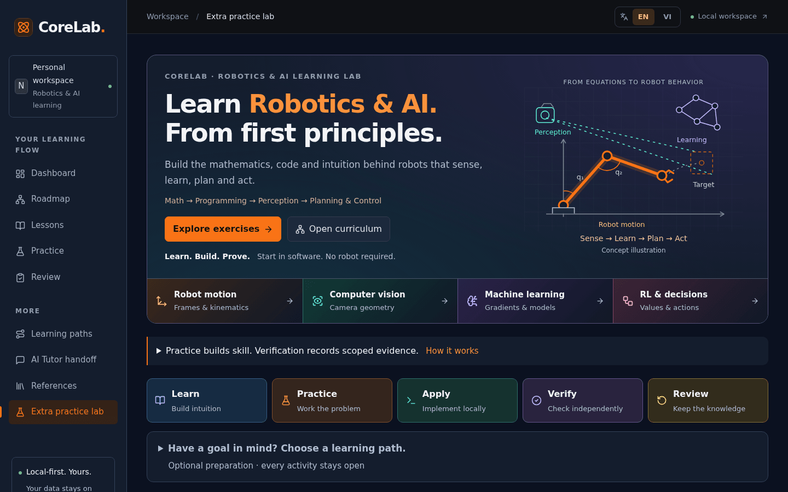

</div>

<br/>

CoreLab is a **free, local-first learning workspace** that takes you from vectors and Python to Kalman filters, inverse kinematics, computer vision and reinforcement learning. All of it is arranged on a prerequisite map, so you always know what to learn next. Each topic follows the same loop: **watch → understand → derive → implement → verify → review.** Your progress lives on your computer. There are no accounts, no subscriptions and no cloud.

> **Progress is measured by what you can independently explain, implement and verify — not by how many videos you watch.**

## ✨ Why CoreLab?

- 🗺️ **A real roadmap, not a playlist.** A 169-topic prerequisite graph covers mathematics, programming, ML, robotics, vision, RL, embodied AI and research methods. It explains why each next step is recommended.
- 📖 **Complete lessons for every topic.** Each one has intuition, derivation, a fully worked example, a reference implementation, failure modes, trade-offs and further reading. Mathematics renders with KaTeX.
- ✍️ **Practice that builds real skill.** Every lesson has 10–12 graded exercises with worked answers, including problems adapted from well-known textbooks and courses. There are also interactive diagnostics and a targeted practice bank that finds your weak skills.
- 🧪 **Labs you actually run.** Every topic has a hands-on lab with starter code, runnable tests and expected output. You code it yourself, on your own machine.
- 🎬 **Curated videos for every topic.** There are 270 videos from 3Blue1Brown, MIT OpenCourseWare, Stanford, Steve Brunton, Cyrill Stachniss, CppCon and others. The player loads only when you click: no autoplay, with an original-source link.
- 🖼️ **160 original diagrams.** Purpose-drawn figures explain the idea: feedback loops, Kalman updates, capture points, PPO clipping, friction cones and more.
- 🇻🇳 **English or Vietnamese.** One click switches the whole interface — lessons, exercises, quizzes and practice — between English and Vietnamese. Code and math stay identical.
- ⏱️ **Honest time plans.** Every lesson is split into four study sessions (Learn, Practice, Build, Review) with realistic time estimates, tick-off progress, and answers that stay hidden until you ask for them.
- 🔒 **Yours.** Local SQLite, exportable backups, no analytics, no AI API keys. Copying context to an AI tutor is optional and manual, with a preview first.

## 🚀 Quick start

You need **Node.js 24+** and Git. Python 3 is used by most labs; a C++17 compiler is only needed for the C++ track.

```bash
git clone https://github.com/trongnghia-le/corelab-robotics-ai.git
cd corelab-robotics-ai
npm ci
npm run dev
```

Open **http://127.0.0.1:3000**. The local database is created automatically. Click **VI** in the top bar for Vietnamese.

Most labs need only the Python standard library. The optional **Library track** in each lab uses real tools; install the ones you need:

```bash
python3 -m pip install numpy scipy matplotlib scikit-learn torch opencv-python gymnasium
```

### Open CoreLab like an app (no terminal each time)

`npm run dev` recompiles pages as you open them. For daily study, use the one-click launcher instead:

```bash
npm run app           # first time: builds once (~30 s), then opens CoreLab
npm run app:install   # Linux: adds CoreLab to the app menu
```

1. **Linux (GNOME, KDE, ...):** after `npm run app:install`, press the Super key, type **CoreLab** and click it. Right-click the icon and choose **Add to Favorites** to pin it to the dock.
2. **macOS / Windows:** run `npm run app`. It opens in your browser; in Chrome or Edge choose **⋮ → Cast, save and share → Install page as app** to get a desktop/Start-menu icon. Clicking that icon works while the server is running; run `npm run app` again after a restart.

How it works: the launcher keeps a light production server running in the background on **http://127.0.0.1:3210** and opens a standalone window (Chrome, Chromium, Brave or Edge if installed). Later launches take under a second, it rebuilds by itself whenever the code changes (for example after a `git pull`), and it shares the same progress database as `npm run dev`. Stop the background server with `npm run app:stop`; set `CORELAB_APP_PORT` to use another port. If something goes wrong, check `.local/app.log`.

Other modes:

```bash
npm run build && npm start   # production mode
npm run dev:v2               # also enable the objective-based Extra practice lab at /objectives
```

<details>
<summary><b>Windows, macOS and Linux notes</b></summary>

<br/>

| System             | Install once                                                                                                                                                           | Terminal                                                                                       |
| ------------------ | ---------------------------------------------------------------------------------------------------------------------------------------------------------------------- | ---------------------------------------------------------------------------------------------- |
| **Windows 10/11**  | [Node.js 24+](https://nodejs.org/en/download), [Git](https://git-scm.com/downloads) and optionally [Python 3](https://www.python.org/downloads/) (tick "Add to PATH"). | PowerShell or Command Prompt. If PowerShell blocks `npm.ps1`, use `npm.cmd` or Command Prompt. |
| **macOS**          | Node.js 24+ (matching Apple Silicon/Intel), Git and optional Python 3.                                                                                                 | Terminal. Check `node --version` first.                                                        |
| **Linux / Ubuntu** | Node.js 24+ from the official instructions (distribution packages are often older); `sudo apt install git python3`.                                                    | Any terminal. Check the Node version before `npm ci`.                                          |

Use another port with `npm run dev -- --port 3001` and stop the server with **Ctrl+C**. After `npm ci`, lessons, equations, diagrams, quizzes and notes work offline; videos and external links need a connection.

**Local use only.** CoreLab has no authentication and binds to loopback. Don't expose the server to a network or host it as a public multi-user service.

</details>

## 🧭 What you get

<table>
<tr>
<td width="50%" valign="top">

### Your next step, explained

The dashboard recommends one next topic and says why, and it counts the topics you have mastered, the ones you have practised and the reviews that are due.

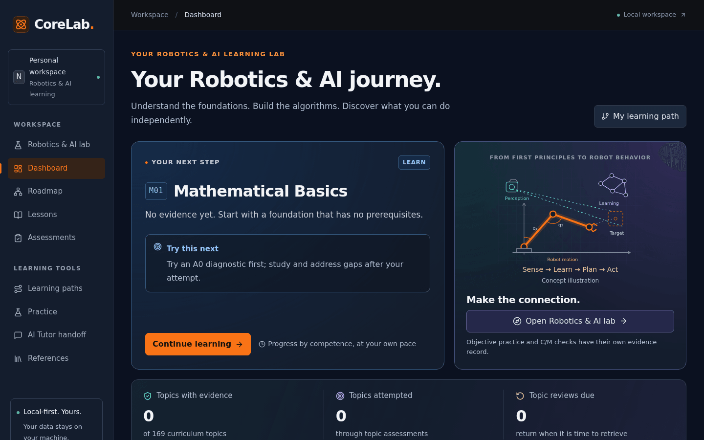

</td>
<td width="50%" valign="top">

### A map of 169 connected topics

Search the map or filter it by domain or status. You can also switch to an interactive graph to see how the prerequisites connect.

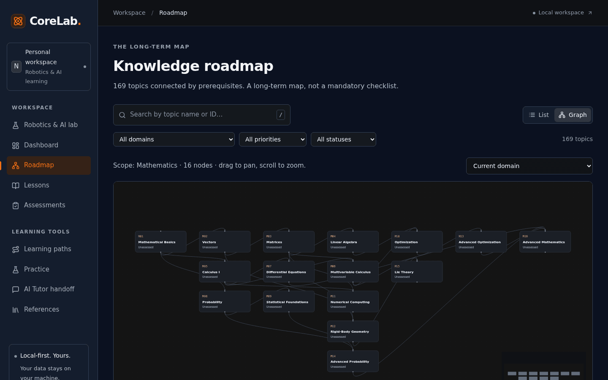

</td>
</tr>
<tr>
<td width="50%" valign="top">

### Four study sessions per lesson

Each lesson is split into Learn → Practice → Build → Review, and every session shows a realistic time estimate. You tick sessions off as you finish them, and a progress bar tracks how far you are.

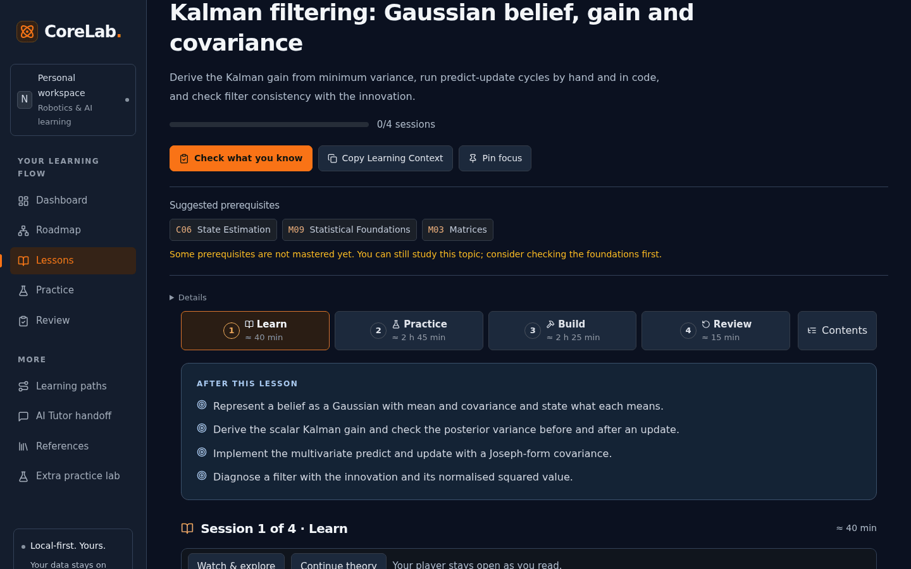

</td>
<td width="50%" valign="top">

### Original diagrams and rendered math

Each lesson has a long-form text with rendered math and a figure drawn for its idea. Shown here: the Kalman update.

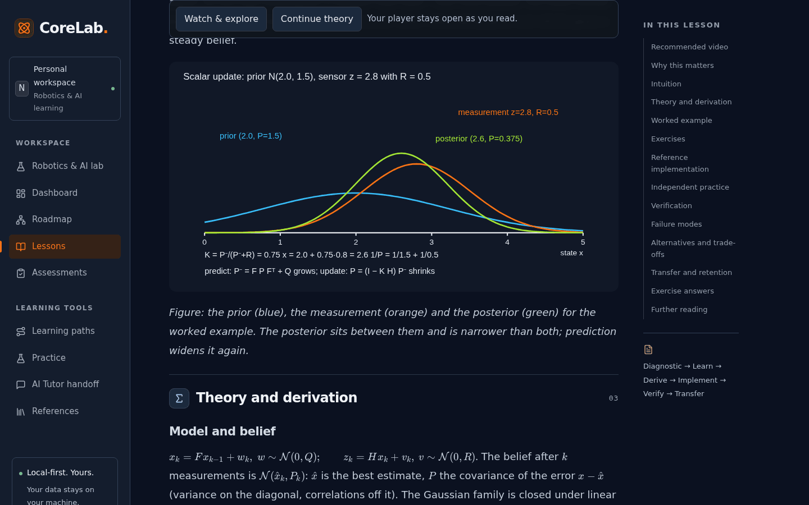

</td>
</tr>
<tr>
<td width="50%" valign="top">

### Hands-on labs with tests

Each lab gives you:

- a goal, setup and tasks;
- starter code with a clear contract;
- runnable tests and the expected output;
- an extension challenge;
- a **Library track** that redoes the lab with real tools.

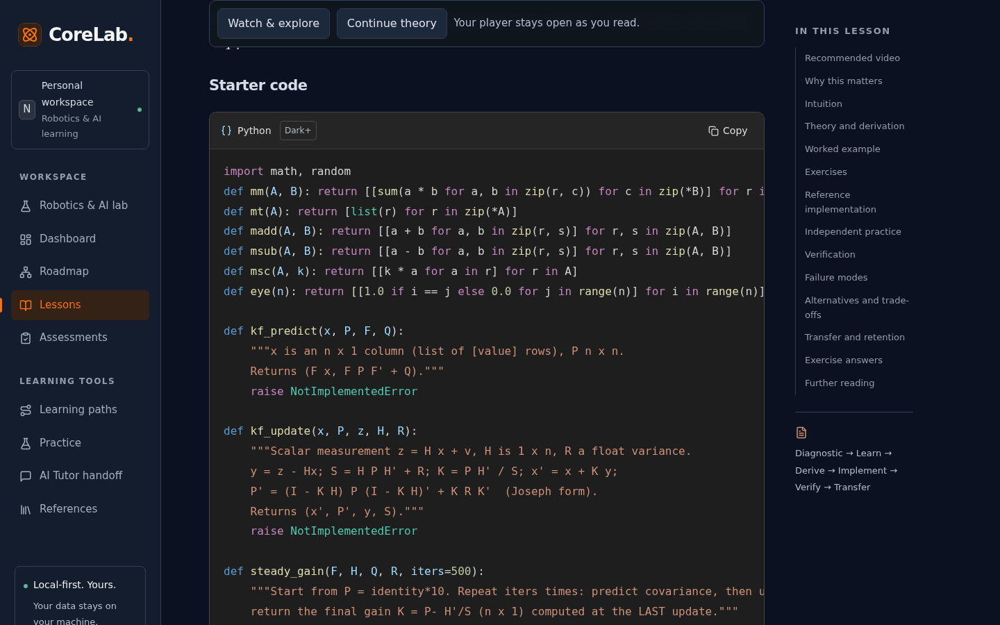

</td>
<td width="50%" valign="top">

### Curated video, on your terms

Each topic has one to three verified videos. A video loads only when you ask for it, nothing autoplays, and every video links to its original source.

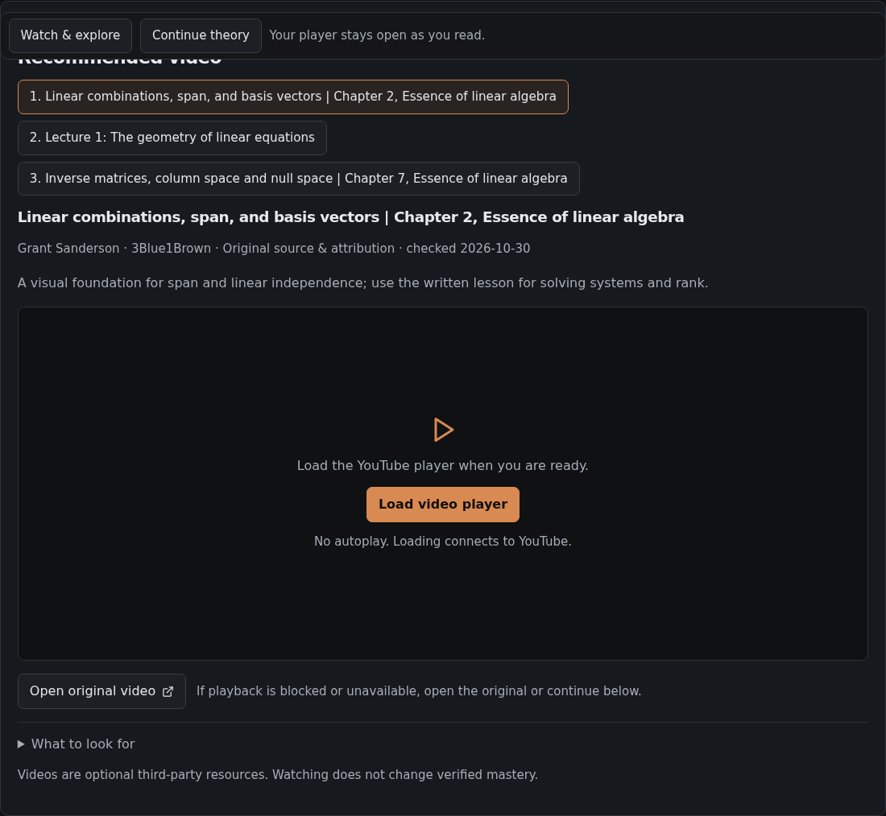

</td>
</tr>
<tr>
<td width="50%" valign="top">

### Check what you know

The quizzes mix concept, calculation and open questions, and they point you to the prerequisites. The detailed C/M/I/T tracking is still there, folded under **Details**.

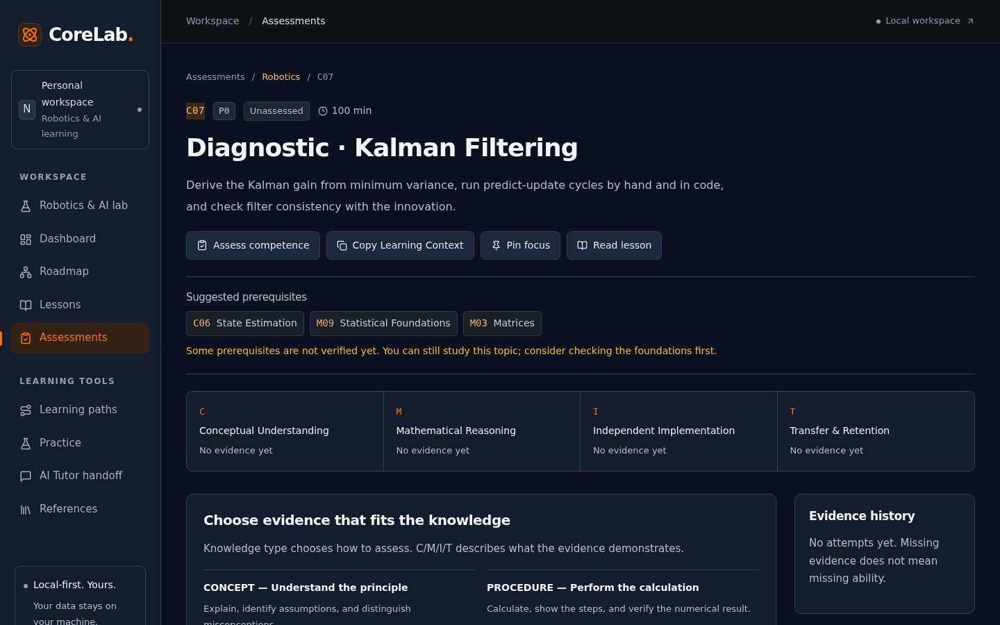

</td>
<td width="50%" valign="top">

### Học bằng tiếng Việt

The **EN/VI** switch translates the interface and every lesson, exercise and quiz. Code and math stay identical.

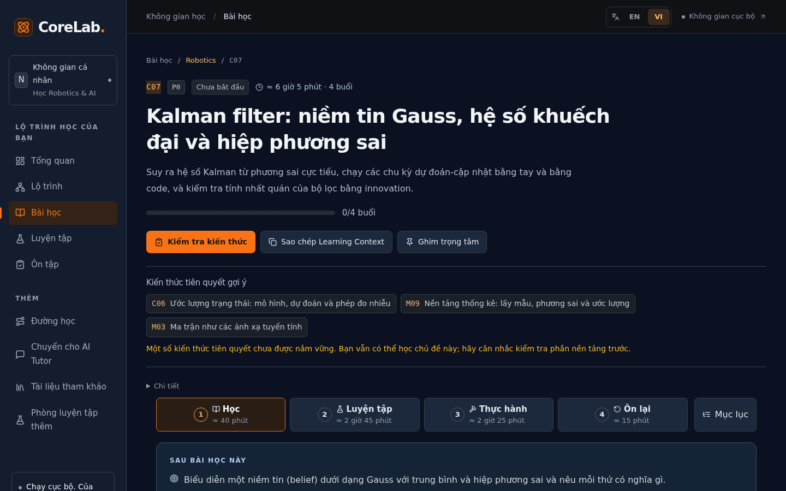

</td>
</tr>
</table>

<div align="center">

**160 original teaching diagrams across the curriculum**

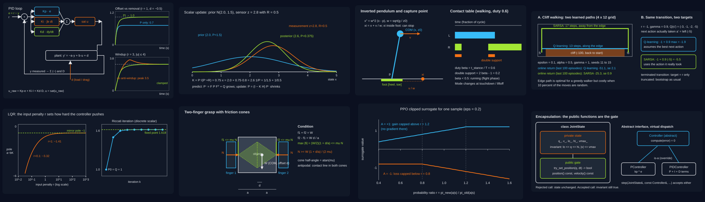

</div>

## 📚 The curriculum

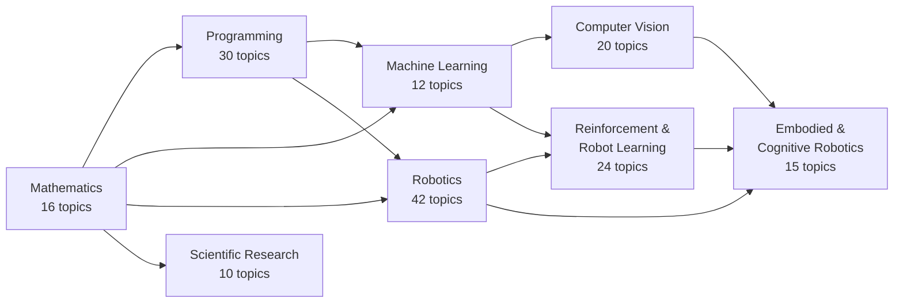

| Domain                         |  Topics | A taste of what's inside                                                                     |
| ------------------------------ | ------: | -------------------------------------------------------------------------------------------- |
| Mathematics                    |      16 | Vectors, matrices, calculus, probability, statistics, optimization, Lie groups               |
| Programming                    |      30 | Python, NumPy, testing, modern C++ (RAII, templates, concurrency), Git, Linux, Docker        |
| Machine Learning               |      12 | Regression, classification, neural networks, backpropagation, training and evaluation        |
| Robotics                       |      42 | Frames, kinematics, inverse kinematics, dynamics, PID/LQR/MPC, Kalman filters, MuJoCo, ROS 2 |
| Computer Vision                |      20 | Camera models, calibration, features, CNNs, detection, tracking, visual odometry & SLAM      |
| Reinforcement & Robot Learning |      24 | MDPs, TD learning, Q-learning, policy gradients, PPO, offline RL, imitation, sim-to-real     |
| Embodied & Cognitive Robotics  |      15 | Task & motion planning, world models, diffusion policies, vision-language-action models      |
| Scientific Research            |      10 | Experimental design, reproducibility, ablations, reading and writing papers                  |
| **Total**                      | **169** | **Every topic has a full lesson, a diagnostic, a practice bank, a lab and video**            |

**Beginner path:** `M01 → M02 → PY01 → M03` (notation, vectors, Python, matrices). From there, follow the dashboard. Prerequisites are suggestions, never locks.

### Anatomy of a lesson

| Section                            | What it gives you                                                              |
| ---------------------------------- | ------------------------------------------------------------------------------ |
| Why this matters · Intuition       | Where the idea shows up in real robots and AI systems, with an original figure |
| Theory and derivation              | The math step by step, with assumptions and units stated                       |
| Worked example                     | A fully worked numeric example you can check by hand                           |
| **Exercises** (10–12)              | Easy → mini-project: conceptual, numeric, find-the-bug, predict, design, proof |
| Reference implementation           | Short, runnable code with a self-test                                          |
| **Independent practice (lab)**     | Goal, tasks, starter code, tests, expected output, extension, library track    |
| Verification · Failure modes       | How to check your result, and the mistakes people really make                  |
| Alternatives and trade-offs        | When to pick which method                                                      |
| Exercise answers · Further reading | Worked solutions, sources and links to official problem sets for more practice |

## 🎯 How to study with CoreLab

**Diagnostic → Watch → Visualize → Understand → Derive → Implement → Verify → Review**

1. **Start** from the dashboard recommendation or a learning path, and check the prerequisites.
2. **Check what you know** first. Say honestly how much help you used, from _No help (A0)_ to _Saw the solution (A3)_.
3. **Learn session.** Watch and explore, predicting before you press play or move a slider.
4. **Derive.** Rebuild the key equation on a blank page and explain every term.
5. **Practice and Build sessions.** Do the exercises before opening the answers, then implement the lab from scratch until the tests pass. Treat copied or AI-written code as assisted practice.
6. **Verify.** Use hand calculations, boundaries and deliberately broken cases, then re-take the diagnostic.
7. **Fix your weaknesses** in **Practice → My Weaknesses**, which targets the exact skills you missed.
8. **Review** on a 1/3/7/21-day schedule and reconstruct the result from memory.

**Use ChatGPT (or any assistant) as a Socratic tutor:** choose **Copy Learning Context**, check the preview, and paste it yourself. Ask it to _"ask one question at a time and give the smallest hint I need."_ There's no API connection or automatic sync. See the [guide](docs/guide.md#chatgpt-project-workflow-no-api).

<details>
<summary><b>How mastery is measured</b></summary>

<br/>

Reading, watching and clicking never count as mastery. A full independent (A0) diagnostic needs **≥ 80 %** with every critical item correct. Implementation evidence needs a supported fixed contract. Open answers are rubric-guided and stay unverified. Read the [assessment policy](docs/guide.md#assessment-and-mastery) for the details.

</details>

<p align="center">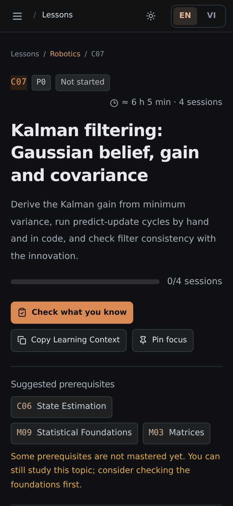<br/><sub>Responsive down to phone width, with keyboard-friendly navigation.</sub></p>

## 🧪 Extra practice lab (V2 preview)

Run `npm run dev:v2` to open `/objectives`. This adds an **objective-based workspace** next to the curriculum:

- 43 versioned objectives
- 39 exercise families with 266 practice items, each with two distinct application routes
- 22 numerical lab kits (frames, FK/IK, odometry, PID, trajectories, Kalman, A\*, URDF/TF, camera calibration, visual servoing, grasping, RL, system identification, belief-space planning, and more)
- Scoped concept/math checks (C/M) with spaced retention reviews

These kits are numerical and replay-based. Parts that need ROS 2, a physics engine or real hardware are listed as _unavailable_ rather than imitated. See the [implementation report](implementation-plan/IMPLEMENTATION_REPORT.md) for the exact coverage.

## 🛠️ Tech stack

| Layer   | Technology                                                                 |
| ------- | -------------------------------------------------------------------------- |
| App     | Next.js App Router, React, strict TypeScript                               |
| UI      | Tailwind CSS, Lucide icons, React Flow graph, Dark+ syntax highlighting    |
| Content | Markdown + GFM, KaTeX math, original SVG figures, versioned JSON contracts |
| Storage | SQLite via Node's built-in `node:sqlite`, Zod validation                   |
| Quality | Vitest, Playwright, content validators, Python lab fixtures                |

```bash
npm run check                    # lint, types, content validation, tests, build
npx playwright install chromium  # once, for browser tests
npm run test:e2e                 # browser tests on an isolated database
```

## 🗺️ Status and honest limits

- ✅ All 169 topics have a lesson, exercises with answers, a lab, a diagnostic, a practice bank and curated video.
- ⚠️ **The content was drafted with AI assistance.** It then went through a second, independent AI review pass that re-derived every answer key, recomputed the numbers, re-ran the code and fixed the errors it found. Lab tests were also run, links checked and figures rendered. It has **not** been reviewed by a human expert. Spotted a mistake? Please [open an issue](https://github.com/trongnghia-le/corelab-robotics-ai/issues).
- ⚠️ The app does not run ROS 2, simulators or hardware for you. Some library tracks include optional ROS 2/MuJoCo code to run on your own machine. Automatic verification of your submitted code is limited to a few fixed contracts.
- 🧭 The browser UI is tested on Linux; CI runs the build and tests on Linux, Windows and macOS.

## 🤝 Contributing

Corrections, new exercises, better diagrams, accessibility fixes and translations are all welcome. Start with [CONTRIBUTING.md](CONTRIBUTING.md); the [user and maintainer guide](docs/guide.md) covers architecture, data and troubleshooting.

If CoreLab helps you learn, **a ⭐ on GitHub helps others find it.**

## 📄 License and acknowledgments

- **Code and technical docs:** [MIT](LICENSE) © 2026 Le Trong Nghia.
- **Educational content** (lessons, exercises, figures, assessments): [CC BY 4.0](LICENSE-CONTENT). Executable examples remain MIT. See [LICENSING.md](LICENSING.md) for the exact scope.

Videos, books, courses and trademarks belong to their owners under their own terms. A link or embed is not a licence to redistribute them. Exercises marked _"Adapted from"_ are original restatements that credit the source that inspired them. Thank you to 3Blue1Brown, MIT OpenCourseWare, Modern Robotics, Stanford CS231n, David Silver / Google DeepMind, Steve Brunton, Cyrill Stachniss, CppCon and every other educator listed in [THIRD_PARTY_NOTICES.md](THIRD_PARTY_NOTICES.md). Their inclusion does not imply endorsement.
