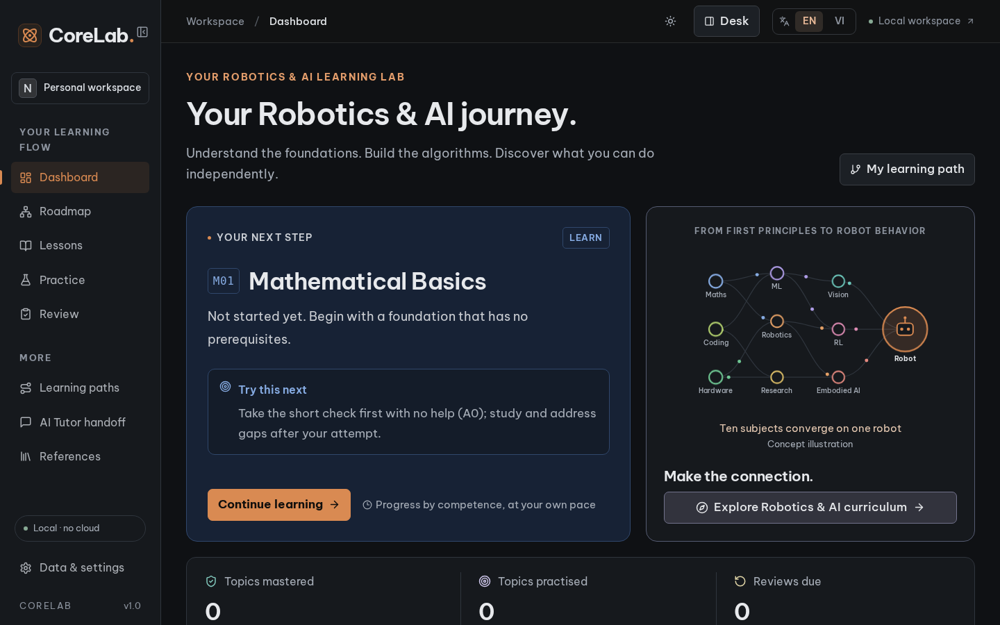
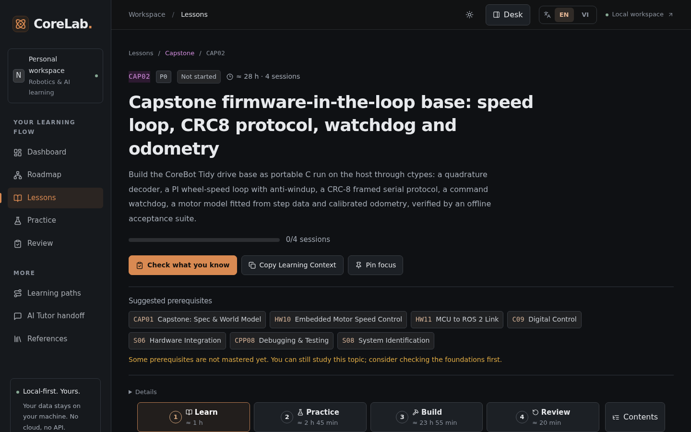
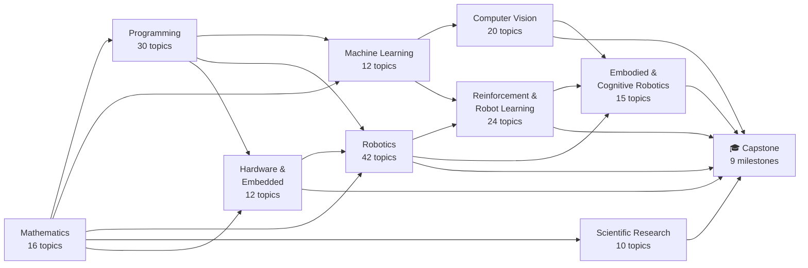
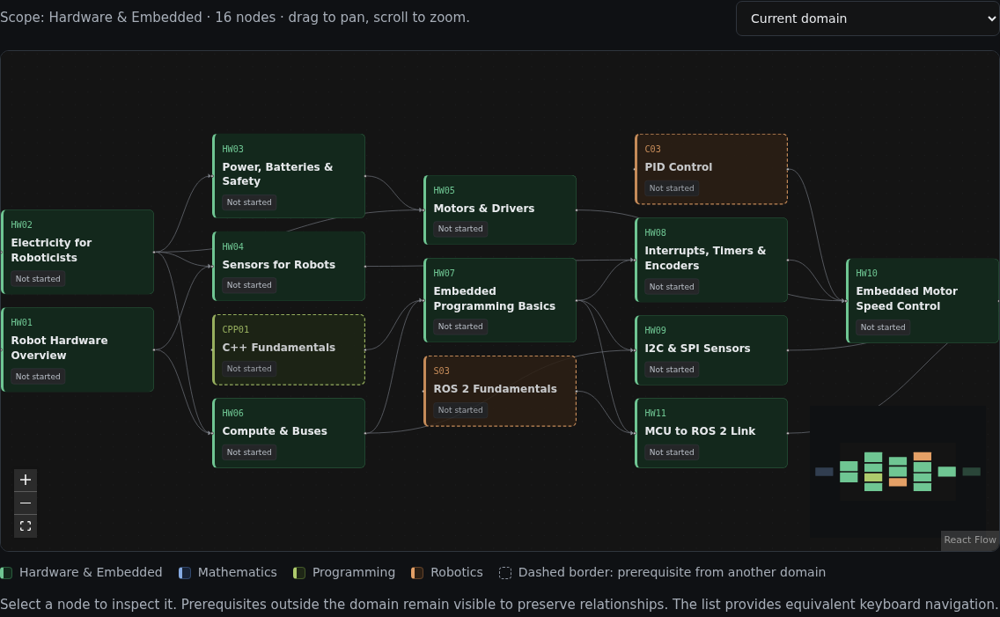

<div align="center">

# 🤖 CoreLab

### Learn Robotics & AI from first principles — on your own machine.

**190 topics · 190 full lessons · 1,981 worked exercises · 3,625 interactive questions · 190 hands-on labs · 309 curated videos · 1 graduation capstone**

[](package.json)
[](https://nextjs.org/)
[](tsconfig.json)
[](LICENSE)
[](LICENSE-CONTENT)
[](CONTRIBUTING.md)

[**Quick start**](#-quick-start) · [**Study desk**](#-study-desk-notes-exercises-and-code-beside-the-lesson) · [**Features**](#-what-you-get) · [**Curriculum**](#-the-curriculum) · [**How to study**](#-how-to-study-with-corelab) · [**User guide**](docs/guide.md) · [**Contributing**](CONTRIBUTING.md)

<br/>



</div>

<br/>

CoreLab is a **free, local-first learning workspace** that takes you from vectors and Python to Kalman filters, inverse kinematics, embedded firmware, computer vision and reinforcement learning, and ends with a graduation robot project. Everything sits on a prerequisite map, so you always know what to learn next. Each topic follows the same loop: **watch → understand → derive → implement → verify → review.** Your progress lives on your computer: no accounts, no subscriptions, no cloud.

> **Progress is measured by what you can independently explain, implement and verify — not by how many videos you watch.**

## ✨ Why CoreLab?

- 🗺️ **A real roadmap, not a playlist.** A 190-topic prerequisite graph covers mathematics, programming, ML, robotics, hardware and embedded systems, vision, RL, embodied AI and research methods, and explains why each next step is recommended.
- 📖 **Complete lessons for every topic.** Intuition, derivation, a fully worked example, a reference implementation, failure modes, trade-offs and further reading, with KaTeX math and an original figure.
- ✍️ **Practice that builds real skill.** 10–12 graded exercises with worked answers per lesson, including problems adapted from well-known textbooks and courses, plus interactive diagnostics and a practice bank that targets your weak skills.
- 🗒️ **A study desk beside every lesson.** A resizable panel docked next to the lesson (or its own window) with Markdown notes and a formula palette, every exercise with a box for your working, and a code editor that runs Python and C++ on your machine.
- 🔌 **Hardware, not just theory.** Sensors, motors and drivers, power, buses, then Arduino/ESP32 and MicroPython firmware up to a micro-ROS link to ROS 2. No parts needed: optional free [Wokwi](https://wokwi.com) simulator projects.
- 🎓 **A graduation capstone.** Nine milestones build one simulated mobile manipulator that takes a text command, localises, navigates, grasps and delivers, with firmware-in-the-loop, learned skills, a safety supervisor and a reproducible report.
- 🎬 **Curated videos for every topic.** 309 videos from 3Blue1Brown, MIT OpenCourseWare, Stanford, Steve Brunton, Cyrill Stachniss, CppCon and others. Nothing autoplays; every video links to its source.
- 🇻🇳 **English or Vietnamese, light or dark.** One click switches the whole interface and every lesson, exercise and quiz between English and Vietnamese; another switches between a calm dark theme and a light one.
- ⚡ **Opens like an app.** One command builds once, then CoreLab opens in its own window in under a second.
- 🔒 **Yours.** Local SQLite, exportable backups, no analytics, no AI API keys. Copying context to an AI tutor is optional and manual, with a preview first.

## 🚀 Quick start

You need **Node.js 24+** and Git. Python 3 is used by most labs; a C++17 compiler is only needed for the C++ track.

```bash
git clone https://github.com/trongnghia-le/corelab-robotics-ai.git
cd corelab-robotics-ai
npm ci
npm run app      # builds once (~30 s), then opens CoreLab in its own window
```

Click **VI** in the top bar for Vietnamese and the ☀ / ☾ button for the light or dark theme. The local database is created automatically.

Most labs need only the Python standard library. The optional **Library track** in each lab uses real tools; install the ones you need:

```bash
python3 -m pip install numpy scipy matplotlib scikit-learn torch opencv-python gymnasium
```

### Open CoreLab like an app (no terminal each time)

```bash
npm run app           # open CoreLab (starts the background server if needed)
npm run app:install   # Linux: add CoreLab to the app menu
npm run app:stop      # stop the background server
```

1. **Linux (GNOME, KDE, ...):** after `npm run app:install`, press the Super key, type **CoreLab** and click it. Right-click the icon and choose **Add to Favorites** to pin it to the dock.
2. **macOS / Windows:** run `npm run app`. It opens in your browser; in Chrome or Edge choose **⋮ → Cast, save and share → Install page as app** for a desktop/Start-menu icon. Run `npm run app` again after a restart.

The launcher keeps a light production server on **http://127.0.0.1:3210** and opens CoreLab in an app window (Chrome, Chromium, Brave or Edge if installed); `CORELAB_DESK=1` also opens the study desk as a second window beside it. Later launches take under a second, it rebuilds by itself whenever the code changes (for example after a `git pull`), and it shares the same progress database as `npm run dev`. Set `CORELAB_APP_PORT` for another port; if something goes wrong, check `.local/app.log`.

<details>
<summary><b>Other modes, and Windows / macOS / Linux notes</b></summary>

<br/>

```bash
npm run dev                  # development server on http://127.0.0.1:3000
npm run build && npm start   # production mode
npm run dev:v2               # also enable the objective-based Extra practice lab at /objectives
```

| System             | Install once                                                                                                                                                           | Terminal                                                                                       |
| ------------------ | ---------------------------------------------------------------------------------------------------------------------------------------------------------------------- | ---------------------------------------------------------------------------------------------- |
| **Windows 10/11**  | [Node.js 24+](https://nodejs.org/en/download), [Git](https://git-scm.com/downloads) and optionally [Python 3](https://www.python.org/downloads/) (tick "Add to PATH"). | PowerShell or Command Prompt. If PowerShell blocks `npm.ps1`, use `npm.cmd` or Command Prompt. |
| **macOS**          | Node.js 24+ (matching Apple Silicon/Intel), Git and optional Python 3.                                                                                                 | Terminal. Check `node --version` first.                                                        |
| **Linux / Ubuntu** | Node.js 24+ from the official instructions (distribution packages are often older); `sudo apt install git python3`.                                                    | Any terminal. Check the Node version before `npm ci`.                                          |

After `npm ci`, lessons, equations, diagrams, quizzes and notes work offline; videos and external links need a connection.

**Local use only.** CoreLab has no authentication and binds to loopback. Don't expose the server to a network or host it as a public multi-user service.

</details>

## 🗒️ Study desk: notes, exercises and code beside the lesson

Click **Desk** in the top bar or press **Ctrl+\\** to dock the desk on the right of the page; drag its left edge to resize it (double-click resets the width). On a narrow screen it slides up from the bottom. The ↗ button moves it to its own window, for a second monitor. The desk follows the lesson you have open; pin it to stay on one topic.

<p align="center">

</p>

<table>
<tr>
<td width="33%" valign="top">

**Notes with a formula palette.** Write, Split or Preview. Seven groups of LaTeX snippets (basic, Greek, calculus, linear algebra, probability, layout & logic, robotics) plus the equations of the current lesson, a formula-card template, and Ctrl+M for inline math.


</td>
<td width="33%" valign="top">

**Every exercise, with room to work.** A box for your working under each exercise, a done tick and a counter, and the worked answer hidden until you open it.


</td>
<td width="33%" valign="top">

**Code that runs.** A CodeMirror editor; **Load lab code** puts the lesson's starter and tests in one `lab.py` or `lab.cpp`, and **Run** (Ctrl+Enter) uses your own Python 3 or C/C++ compiler with a time limit.


</td>
</tr>
</table>

Everything is saved as plain files in `.local/desk/<TOPIC>/`, so you can also open them in VS Code. Code runs on your machine with your rights, exactly like in a terminal; the desk only accepts requests from CoreLab's own pages.

## 🧭 What you get

<table>
<tr>
<td width="50%" valign="top">

### Ten subjects, one map

The dashboard recommends your next step and why, counts what you have mastered and practised, and opens each subject from its own card.


</td>
<td width="50%" valign="top">

### A graph of 190 connected topics

Search or filter the roadmap, or switch to the graph: every subject has its own colour, and hovering a topic highlights its prerequisites.


</td>
</tr>
<tr>
<td width="50%" valign="top">

### Four study sessions per lesson

Learn → Practice → Build → Review, each with a realistic time estimate and a tick-off progress bar.


</td>
<td width="50%" valign="top">

### Original diagrams and rendered math

Long-form text with rendered math and a figure drawn for the idea. Shown here: the Kalman update.


</td>
</tr>
<tr>
<td width="50%" valign="top">

### Hands-on labs with tests

A goal, setup and tasks; starter code with a clear contract; runnable tests and the expected output; an extension challenge; and a **Library track** that redoes the lab with real tools.


</td>
<td width="50%" valign="top">

### Curated video, on your terms

One to three verified videos per topic. A video loads only when you ask for it and links to its original source.


</td>
</tr>
<tr>
<td width="50%" valign="top">

### Check what you know

Quizzes mix concept, calculation and open questions and point you to the prerequisites. The detailed C/M/I/T tracking is folded under **Details**.


</td>
<td width="50%" valign="top">

### Học bằng tiếng Việt

The **EN/VI** switch translates the interface and every lesson, exercise and quiz. Code and math stay identical.


</td>
</tr>
<tr>
<td width="50%" valign="top">

### A calm dark theme…

Graphite surfaces, a muted orange accent and subject colours that stay readable without glare.



</td>
<td width="50%" valign="top">

### …or a light one

The ☀ / ☾ button switches every page, the study desk follows, and figures adapt to the light background.


</td>
</tr>
</table>

<div align="center">

**182 original teaching diagrams across the curriculum**


</div>

## 📚 The curriculum



| Domain                         |  Topics | A taste of what's inside                                                                     |
| ------------------------------ | ------: | -------------------------------------------------------------------------------------------- |
| Mathematics                    |      16 | Vectors, matrices, calculus, probability, statistics, optimization, Lie groups               |
| Programming                    |      30 | Python, NumPy, testing, modern C++ (RAII, templates, concurrency), Git, Linux, Docker        |
| Machine Learning               |      12 | Regression, classification, neural networks, backpropagation, training and evaluation        |
| Robotics                       |      42 | Frames, kinematics, inverse kinematics, dynamics, PID/LQR/MPC, Kalman filters, MuJoCo, ROS 2 |
| Hardware & Embedded            |      12 | Sensors, motors and drivers, batteries and safety, buses, Arduino/ESP32 firmware, micro-ROS  |
| Computer Vision                |      20 | Camera models, calibration, features, CNNs, detection, tracking, visual odometry & SLAM      |
| Reinforcement & Robot Learning |      24 | MDPs, TD learning, Q-learning, policy gradients, PPO, offline RL, imitation, sim-to-real     |
| Embodied & Cognitive Robotics  |      15 | Task & motion planning, world models, diffusion policies, vision-language-action models      |
| Scientific Research            |      10 | Experimental design, reproducibility, ablations, reading and writing papers                  |
| Capstone                       |       9 | One robot, nine milestones: firmware, localisation, navigation, grasping, RL, language, eval |
| **Total**                      | **190** | **Every topic has a full lesson, a diagnostic, a practice bank, a lab and video**            |

**Beginner path:** `M01 → M02 → PY01 → M03` (notation, vectors, Python, matrices). From there, follow the dashboard. Prerequisites are suggestions, never locks.

### 🔌 Hardware & Embedded



**Path:** `HW01 → HW02 → HW06 → HW04 → HW03 → HW05` for the overview (what each part is, how to choose it, what the datasheet numbers mean), then `HW07 → HW12` for embedded programming: GPIO/ADC/PWM, interrupts and encoders, I²C/SPI sensors, closed-loop motor control, a CRC-checked serial link and micro-ROS, and bring-up and debugging. The overview half needs no coding and can run alongside mathematics. Labs run in Python with no parts; each programming topic also has a Wokwi simulator project, and an optional cheap starter kit if you want real hardware.

### 🎓 Graduation capstone: CoreBot Tidy

The course ends with one project that uses all ten domains. You build a simulated mobile manipulator in MuJoCo that hears _"put the red block in the blue bin"_, localises, drives to the table, finds the block with its camera, grasps it with an SO-101 arm and drops it in the bin, while a safety supervisor can stop it at any time.

| Milestone | What you build                                                         | Hours |
| --------- | ---------------------------------------------------------------------- | ----: |
| CAP01     | Spec, repository, robot and world model                                |    22 |
| CAP02     | Firmware-in-the-loop base: C speed loop, CRC-8 protocol, odometry      |    28 |
| CAP03     | State estimation and localisation (EKF, landmarks, camera calibration) |    26 |
| CAP04     | Mapping, planning and navigation                                       |    26 |
| CAP05     | Perception-driven grasping                                             |    30 |
| CAP06     | Learned skills with RL/imitation and domain randomisation              |    32 |
| CAP07     | Language-conditioned task layer and safety supervisor                  |    26 |
| CAP08     | Full-system integration, sim-to-real gap and evaluation                |    34 |
| CAP09     | Demo, technical report, reproducible release and graduation            |    16 |

Each milestone is a lesson whose lab is the milestone brief, with a pytest acceptance file, a rubric and a scoring weight. You graduate when every gate passes, every milestone scores at least 60 and the total reaches 70 (Merit at 80, Distinction at 90 plus a stretch goal). Everything runs in simulation for free; a real ESP32 or SO-101 tier is optional. Download the shared [`evalkit.py`](public/practice/capstone/evalkit.py) and [`make_skeleton.sh`](public/practice/capstone/make_skeleton.sh) to start. Acceptance thresholds are provisional starting values: tighten them once you have your own reference run.

### Anatomy of a lesson

| Section                            | What it gives you                                                              |
| ---------------------------------- | ------------------------------------------------------------------------------ |
| Why this matters · Intuition       | Where the idea shows up in real robots and AI systems, with an original figure |
| Theory and derivation              | The math step by step, with assumptions and units stated                       |
| Worked example                     | A fully worked numeric example you can check by hand                           |
| **Exercises** (10–12)              | Easy → mini-project: conceptual, numeric, find-the-bug, predict, design, proof |
| Reference implementation           | Short, runnable code with a self-test                                          |
| **Independent practice (lab)**     | Goal, tasks, starter code, tests, expected output, extension, library track    |
| Verification · Failure modes       | How to check your result, and the mistakes people really make                  |
| Alternatives and trade-offs        | When to pick which method                                                      |
| Exercise answers · Further reading | Worked solutions, sources and links to official problem sets for more practice |

## 🎯 How to study with CoreLab

**Diagnostic → Watch → Visualize → Understand → Derive → Implement → Verify → Review**

1. **Start** from the dashboard recommendation or a learning path, and check the prerequisites.
2. **Check what you know** first. Say honestly how much help you used, from _No help (A0)_ to _Saw the solution (A3)_.
3. **Learn session.** Watch and explore, predicting before you press play or move a slider. Keep notes and formulas in the study desk.
4. **Derive.** Rebuild the key equation on a blank page and explain every term.
5. **Practice and Build sessions.** Work each exercise in the desk before opening its answer, then implement the lab from scratch until the tests pass. Treat copied or AI-written code as assisted practice.
6. **Verify.** Use hand calculations, boundaries and deliberately broken cases, then re-take the diagnostic.
7. **Fix your weaknesses** in **Practice → My Weaknesses**, which targets the exact skills you missed.
8. **Review** on a 1/3/7/21-day schedule and reconstruct the result from memory.

**Use ChatGPT (or any assistant) as a Socratic tutor:** choose **Copy Learning Context**, check the preview, and paste it yourself. Ask it to _"ask one question at a time and give the smallest hint I need."_ There's no API connection or automatic sync. See the [guide](docs/guide.md#chatgpt-project-workflow-no-api).

<details>
<summary><b>How mastery and the next step are decided</b></summary>

<br/>

Reading, watching, ticking sessions and practising never count as mastery on their own. A topic is **passed** when you take its diagnostic with no help (A0), score **≥ 80 %** on the automatically checked questions and get every critical question right; open answers are rubric-guided and stay unverified. Concept (C), math (M), implementation (I, from a supported fixed lab contract) and retention (T, two A0 passes at least 7 days apart) are tracked separately. The dashboard only recommends topics whose prerequisites are passed, ranks due reviews, weak skills and foundations first, and schedules reviews after 1, 3, 7 and 21 days. Read the [assessment policy](docs/guide.md#assessment-and-mastery) for the details.

</details>

<p align="center"><br/><sub>Responsive down to phone width, with keyboard-friendly navigation.</sub></p>

## 🧪 Extra practice lab (V2 preview)

Run `npm run dev:v2` to open `/objectives`. This adds an **objective-based workspace** next to the curriculum:

- 43 versioned objectives
- 39 exercise families with 266 practice items, each with two distinct application routes
- 22 numerical lab kits (frames, FK/IK, odometry, PID, trajectories, Kalman, A\*, URDF/TF, camera calibration, visual servoing, grasping, RL, system identification, belief-space planning, and more)
- Scoped concept/math checks (C/M) with spaced retention reviews

These kits are numerical and replay-based. Parts that need ROS 2, a physics engine or real hardware are listed as _unavailable_ rather than imitated. See the [implementation report](implementation-plan/IMPLEMENTATION_REPORT.md) for the exact coverage.

## 🛠️ Tech stack

| Layer   | Technology                                                                                   |
| ------- | -------------------------------------------------------------------------------------------- |
| App     | Next.js App Router, React, strict TypeScript                                                 |
| UI      | Tailwind CSS, Lucide icons, React Flow graph, CodeMirror 6, Dark+ syntax highlighting        |
| Themes  | Dark-first CSS; the light theme is generated from it with PostCSS (`npm run theme`)          |
| Content | Markdown + GFM, KaTeX math, original SVG figures, versioned JSON contracts                   |
| Storage | SQLite via Node's built-in `node:sqlite`, Zod validation; desk files in `.local/desk/`       |
| Quality | Vitest, Playwright, content and translation validators, Python lab fixtures, CI on 3 systems |

```bash
npm run check                    # lint, types, content validation, tests, build
npx playwright install chromium  # once, for browser tests
npm run test:e2e                 # browser tests on an isolated database
```

## 🗺️ Status and honest limits

- ✅ All 190 topics have a lesson, exercises with answers, a lab, a diagnostic, a practice bank and curated video.
- ⚠️ **The content was drafted with AI assistance.** It then went through a second, independent AI review pass that re-derived every answer key, recomputed the numbers, re-ran the code and fixed the errors it found. Lab tests were also run, links checked and figures rendered. It has **not** been reviewed by a human expert. Spotted a mistake? Please [open an issue](https://github.com/trongnghia-le/corelab-robotics-ai/issues).
- ⚠️ **Hardware and capstone caveats.** Arduino/ESP32 sketches were syntax-checked and their logic simulated in Python, but not yet run inside Wokwi or on a board; capstone acceptance thresholds are provisional and were not calibrated against a full reference solution.
- ⚠️ The app does not run ROS 2, simulators or hardware for you. Some library tracks include optional ROS 2/MuJoCo code to run on your own machine. Automatic verification of your submitted code is limited to a few fixed contracts.
- 🧭 The browser UI is tested on Linux; CI runs the build and tests on Linux, Windows and macOS.

## 🤝 Contributing

Corrections, new exercises, better diagrams, accessibility fixes and translations are all welcome. Start with [CONTRIBUTING.md](CONTRIBUTING.md); the [user and maintainer guide](docs/guide.md) covers architecture, data and troubleshooting. Styles live in `app/globals.css`; run `npm run theme` after editing it to regenerate `app/theme.css`.

If CoreLab helps you learn, **a ⭐ on GitHub helps others find it.**

## 📄 License and acknowledgments

- **Code and technical docs:** [MIT](LICENSE) © 2026 Le Trong Nghia.
- **Educational content** (lessons, exercises, figures, assessments): [CC BY 4.0](LICENSE-CONTENT). Executable examples remain MIT. See [LICENSING.md](LICENSING.md) for the exact scope.

Videos, books, courses and trademarks belong to their owners under their own terms. A link or embed is not a licence to redistribute them. Exercises marked _"Adapted from"_ are original restatements that credit the source that inspired them. Thank you to 3Blue1Brown, MIT OpenCourseWare, Modern Robotics, Stanford CS231n, David Silver / Google DeepMind, Steve Brunton, Cyrill Stachniss, CppCon and every other educator listed in [THIRD_PARTY_NOTICES.md](THIRD_PARTY_NOTICES.md). Their inclusion does not imply endorsement.
