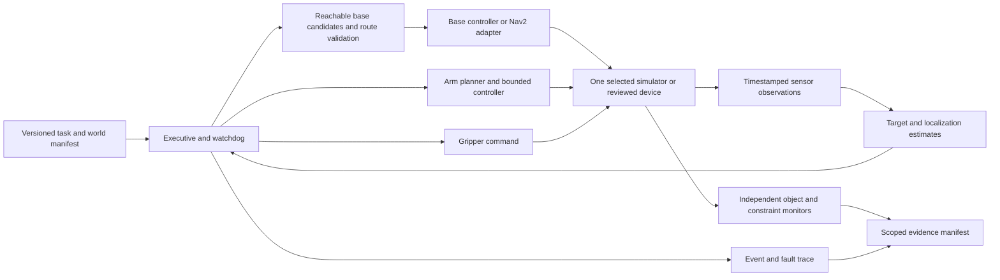

# CoreLab practical learning system — proposal for owner approval

**Run:** `corelab-labs-audit-20261031-01` · **Date:** 2026-10-31 (Asia/Ho_Chi_Minh) · **Baseline:** `38b6a1d8f0baae9a753882185da7bd4430d14277`.

**Status: design proposal only.** Both [Codex](codex_review.md) and [Claude](claude_review.md) completed three independent/debate rounds before this document was created. No production code, curriculum graph, lesson, assessment, historical evidence, external robot repository or repository visibility was changed. No implementation, commit, push or hardware purchase is authorized by this report.

## 1. Executive recommendation

Approve a small numerical-learning pilot: **frames and forward kinematics**, with independent correctness oracles, clear misconceptions and scoped evidence. Learners need a local computer and Python; they need no robot, GPU, ROS, Docker, account or cloud service for this pilot. Preserve CoreLab's Node 24+ local application and localhost restrictions.

Use complementary platforms rather than force 176 broad subjects onto one robot: numerical arm/base problems first, optional characterized physics, an optional ROS systems branch, and optional supervised hardware. Share evidence conventions and explicit units/frames, **not a universal robot middleware abstraction**. MUR5e is a valuable advanced source-reading and failure-analysis case, not the primary installation or a proven affordable mobile-manipulator curriculum.

Select an integrated backend only after a bounded feasibility spike. Neither reviewer established a combined affordable robot that drives, senses, grasps, transports and releases reliably in the proposed MuJoCo or Gazebo profile. Separate base/arm tasks remain valid deliverables if that spike fails. Design the full mobile-manipulation capstone, but do not promise it as a working feature today.

The 22-lab catalog below is a goal-dependent roadmap, not a commitment to build everything. Only two pilot labs and their necessary runner/scope design are proposed for the first approval. All learning/authoring hours are estimates; there is no measured CoreLab learning benefit or time saving.

## 2. Current CoreLab practical-learning gaps

The actual curriculum has **169 identities, 310 edges, 31 lessons/diagnostics and 138 overview-only topics**. [Curriculum v2](../curriculum-review/proposed_curriculum_v2.md) proposes seven additional identities: M17, R16–R20 and E16. They are not production topics yet. The full 169+7 inventory is retained in section 9.

Existing practice verifies only M02 **dot product** and PY01 **mean**, through the explicit local CLI and fixed version-1 contracts. It does not verify a whole robotics topic, grasp, controller, simulator experiment or ROS mission. `lib/labs.ts` accepts only two topic IDs, fixed group counts, the strict `corelab-lab/1` / `corelab-fixed-tests/1` formats, and the required local signing key on trusted import. `lib/engine.ts` currently awards I2 at topic granularity; it cannot safely interpret a new narrow robotics objective as broad topic mastery. Restore also calls the old validator, and legacy report strings are limited to 5000 characters in `lib/storage.ts`.

A reproduced harness defect needs a future fix: a learner file can print a crafted success JSON and exit successfully before tests finish. Codex independently ran the unchanged Python harness and observed that short-circuit; neither reviewer needed to sign/import evidence to establish it. Signing-CLI reachability was established by code inspection, **not an executed signed-report attack**. A plain exit without the crafted result is not the same reproduction. This does not enlarge the stated anti-cheat trust boundary, but a harness must fail closed before issuing stronger new evidence.

Missing capabilities include objective-scoped practical contracts, a parent-owned outcome channel, versioned simulator/environment manifests, independent experiment monitors, model-characterization records, durable reproduction artifacts and reviewed unfamiliar-transfer evidence. A launch command, pretty motion, supplied solution or AI explanation cannot fill those gaps.

Keep C/M/I/T, L0–L4 and A0–A3. A0 is self-attested independence; A1 conceptual hint, A2 specific hint/example and A3 supplied solution remain assisted practice. Signatures attest artifact integrity/provenance under the local-owner trust model, not unaided authorship. Existing reports retain their exact bytes, versions and narrow meanings. Do not retroactively mark everyone a cheater or upgrade old credit to new objectives.

## 3. Open-source platform comparison

All seven requested repositories were source-audited. Selected implementation, launch, model, test, manifest and license files were read, rather than relying on badges. Exact initial snapshot pointers are in the [pinned source index](codex_review.md#14-pinned-source-index). Later runtime claims use a separate snapshot where specified.

| Platform | Source/interface evidence | Runtime evidence and limits | Proposed role |
| --- | --- | --- | --- |
| [MUR5e `a35e3e8`](https://github.com/Mostafasaad1/ros2-mur5e-mobile-manipulator-stack/tree/a35e3e865e399f9ac7087934f2c334ee0bbbbc82) | Jazzy/Harmonic, Nav2 actions, MoveIt, arm/gripper ros2_control, Gazebo differential drive, BehaviorTree.CPP. Actual servo/optimizer/payload and test bodies inspected. | Claude reports clean build, nine selected passing tests and two missions aborting at step 4. Original logs/scripts lost; navigation and internal servo convergence were reported, full grasp/delivery not reproduced. This is not a universal failure or GPU diagnosis. | Optional advanced architecture/test-validity case. No turnkey primary capstone. |
| [OpenMANIPULATOR main `b83daec`](https://github.com/ROBOTIS-GIT/open_manipulator/tree/b83daec7b98c08d00adb856d7e31f2b0065d3be9) | Separate robot variants, URDF/MJCF, MoveIt configurations, Gazebo/controller launch, Jazzy CI/imported dependencies. Imported dependency branches must also be locked. | Claude later reports sequential build of six needed packages and active simulated controllers/simple trajectory success at **[Jazzy `17efe42bd1df178fa44d49c43250fc4304343dbb`](https://github.com/ROBOTIS-GIT/open_manipulator/tree/17efe42bd1df178fa44d49c43250fc4304343dbb)** with a modified headless launch. MoveIt/grasping/full collision package remain unverified. Initial compiler kill under a 9-GiB limit was not proof of an upstream defect. | Provisional ROS arm candidate, exact OMX-F variant; no cross-stack control/contact equivalence claimed. |
| [ROBOTIS MuJoCo Menagerie `d8344c0`](https://github.com/ROBOTIS-GIT/robotis_mujoco_menagerie/tree/d8344c0dbe7a00208d0301111523dde65efc174a) | MJCF models, per-model licenses. X model has four arm hinges plus gripper/mimic and five position actuators; TB3 has free base/two wheel actuators. | Codex parsed selected XML only. Claude provides rerun code for OMX FK/rotation and a TB3 wheel/displacement experiment; broader load/speed/contact observations have weaker artifact support. Model loading is not physical fidelity or a ready ROS stack. | Optional selected models after load, convention, contact and license checks; no dependency for learner pilot. |
| [Andino `8ee8408`](https://github.com/Ekumen-OS/andino/tree/8ee84089896b31a1d914fda05b63f5891ea12c8c) | Real serial/encoder ros2_control interfaces, controller YAML, xacro test, Humble/Jazzy CI, printable parts/22-row hardware BOM/assembly. Simulators are separate repos. | Read only; no runtime claim from either reviewer. A xacro processing test is not navigation testing. Main-repo CI does not establish a companion simulator's compatibility. | Strong DIY base/BOM candidate; not an already validated mounted arm/base. |
| [TurtleBot3 `fc817ce`](https://github.com/ROBOTIS-GIT/turtlebot3/tree/fc817ce3073af1d6032397c64504134882af5e9a) plus [simulations `9be186f`](https://github.com/ROBOTIS-GIT/turtlebot3_simulations/tree/9be186fb03d84ed4f293e5c0db71d8c05bbc91f3) | Nav2, ROS package imports, official `ros_gz_sim` world/spawn, Humble/Jazzy workflow definitions. | Claude reports one packaged Jazzy headless drive/Nav2-goal success using manually started components, not a broad reliability test. GUI-bearing official launch failed in that environment; logs are not in this repository. | Provisional default ROS navigation teaching profile, with a tested headless path required before release. |
| [Linorobot2 Jazzy `f6b0bd0`](https://github.com/linorobot/linorobot2/tree/f6b0bd0350c4a9d6b815ef4bb5c701a1e5129711) | Templated bases, sensors/EKF/Nav2, Gazebo launch, environment-selected robot base. CI builds container profiles; no independent physical mission result. | Read only. No clean local build, robot experiment or total hardware bill verified. | Alternative custom base, avoiding a second default support burden initially. |
| [LeRobot source `3f797de5`](https://github.com/huggingface/lerobot/tree/3f797de5952432284a7c77ad2760218cb74e2f26) | Robot/data/policy APIs, follower/LeKiwi implementations, mocked motor tests, dependency extras and workflows. Source declares **0.6.2**, Python ≥3.12, torch/NumPy/OpenCV base dependencies. | Claude's installed **PyPI 0.6.1** ran five ACT steps; this differs from the inspected source. It proves startup only; original logs were lost. Model/data/download and training costs remain. | Optional later dataset QA/BC/ACT tooling, pinned separately. No mandatory install, Hub upload or cloud account. |

Justified alternatives: [SO-ARM100/SO-101](https://github.com/TheRobotStudio/SO-ARM100) offers parameter/model/CAD/BOM material for an inexpensive separate arm; [LeKiwi](https://github.com/SIGRobotics-UIUC/LeKiwi) offers a three-omniwheel mobile arm/data route. LeKiwi is not differential drive and is not a ready Nav2/MoveIt substitute. Hardware/CAD provenance and delivered prices are not fully audited. XLeRobot is a future alternative, not deeply audited or selected here.

The official [TurtleBot3 manipulation snapshot](https://github.com/ROBOTIS-GIT/turtlebot3_manipulation/tree/91492d7af172c01e17a19a3ffda723f0181d44bc) has a Gazebo launch that references an absent bringup launch/world. Both reviewers confirmed that static gap; neither observed it as a runtime failure. It blocks treating that snapshot as a complete drop-in solution. Andino companion simulators were not runtime-tested; repeated connector transport failures limited additional source inspection of `andino_gz`. No compatibility is inferred from their existence.

## 4. Verified technical findings and source links

Evidence classes used throughout:

- **Independent:** inspected source or a test Codex actually reproduced.
- **Code available:** peer supplied rerun code; it is inspectable, but only explicitly identified portions were independently rerun.
- **Peer session:** Claude reports execution; some logs were lost or only locally retained. Do not use these as published acceptance thresholds.
- **Proposal/estimate:** argued design, not a built feature or measured learning result.

**MUR5e's actual twelve stages.** Pick pose input → pick-base optimization → navigation → open/preposition/approach/servo/advance/close → scene attach → stow → place-pose input → place-base optimization → navigation → place/open → detach → stow. Stages contain multiple actions, some stage indices repeat, and place can be skipped for pick-only goals. Failure fallback removes scene attachment, attempts stow and reports failure. [Actual BT XML](https://github.com/Mostafasaad1/ros2-mur5e-mobile-manipulator-stack/blob/a35e3e865e399f9ac7087934f2c334ee0bbbbc82/src/pick_place_orchestrator/behavior_trees/pick_place_mission.xml).

**Acquisition versus correction.** `TargetAcquisition` checks an input pose/nonempty frame; the caller supplies it. Default mission coordinates are parameterized, so “hardcoded forever” would also be inaccurate. A separate visual-servo action uses yellow HSV contour/depth/intrinsics, fixed geometric assumptions and TF to refine locally. It does not establish general initial search or semantic target identity. Iteration exhaustion can return best-effort SUCCESS; missing images/no contour can remain RUNNING without an inspected overall deadline. Its internal residual is not ground-truth target accuracy. [Acquisition](https://github.com/Mostafasaad1/ros2-mur5e-mobile-manipulator-stack/blob/a35e3e865e399f9ac7087934f2c334ee0bbbbc82/src/pick_place_orchestrator/src/behavior_tree_nodes/target_acquisition.cpp), [visual servo](https://github.com/Mostafasaad1/ros2-mur5e-mobile-manipulator-stack/blob/a35e3e865e399f9ac7087934f2c334ee0bbbbc82/src/pick_place_orchestrator/src/behavior_tree_nodes/visual_servo_action.cpp).

**Placement score and collision limits.** The optimizer samples candidate base radii/angles, runs IK/collision checks and combines manipulability with inverse **candidate-to-object Euclidean distance**. The field named `path_distance` is not a Nav2 planned path. The footprint check accepts a missing costmap and otherwise samples centre plus 20 boundary points; this is not every occupied cell in a polygon/swept volume. Codex constructed a synthetic interior-cell counterexample; inflation can help a particular scene but does not turn the function into a complete polygon oracle. The test named `FailsWhenObstacleBlocksArm` has goal/result-completion assertions but no expected unsuccessful-result assertion. [Optimizer](https://github.com/Mostafasaad1/ros2-mur5e-mobile-manipulator-stack/blob/a35e3e865e399f9ac7087934f2c334ee0bbbbc82/src/base_placement_optimizer/src/optimizer_node.cpp), [test](https://github.com/Mostafasaad1/ros2-mur5e-mobile-manipulator-stack/blob/a35e3e865e399f9ac7087934f2c334ee0bbbbc82/src/base_placement_optimizer/test/test_optimizer.cpp).

**Payload versus grasp.** Attach/detach updates a fixed-cylinder `AttachedCollisionObject` in MoveIt's scene. It does not establish object contacts, lift, slip or sustained transport. Gripper named-target execution is also insufficient. A recovery branch that changes scene state is not a general safe physical release policy. End-to-end action tests mock planners/navigation/execution/scene services; payload tests inspect service requests. [Payload code](https://github.com/Mostafasaad1/ros2-mur5e-mobile-manipulator-stack/blob/a35e3e865e399f9ac7087934f2c334ee0bbbbc82/src/pick_place_orchestrator/src/behavior_tree_nodes/payload_actions.cpp), [mocked mission test](https://github.com/Mostafasaad1/ros2-mur5e-mobile-manipulator-stack/blob/a35e3e865e399f9ac7087934f2c334ee0bbbbc82/src/pick_place_orchestrator/test/test_end_to_end_mission.cpp).

**Independent local reproductions.** Codex reproduced crafted-stdout early exit against the unchanged Python harness without signing/importing reports. Codex also executed only the reviewed pure-math odometry functions from [Claude's final rerun](claude_review.md#38-durable-rerun): six constant-motion fixtures, T=5 s, track=.16 m, |v|≤.3 m/s, |ω|≤2 rad/s, N=500 then 1000. Worst position errors were approximately 2e-14 m exact arc, 4.79e-6 m midpoint and 2.88e-3 m Euler; refinement ratios approximately 4 and 2 for midpoint/Euler. Swapped-wheel/no-motion mutations failed those fixtures. These results support **that fixture set**, not a universal 1-cm tolerance or every trajectory in the domain. Metres, wrapped radians, small motion and discretization order need distinct contracts.

**Peer model reruns and limits.** The supplied code makes the OMX FK orientation counterexample and a TB3 wheel experiment repeatable; Codex did not rerun MuJoCo. The tool-rotation mutation has nearly unchanged position but a 0.5-rad orientation error, so position-only FK is insufficient. The TB3 script compares one wheel's encoder travel with final XY displacement, not a full independent slip-isolation experiment or path-length estimate. Its reported mismatch motivates characterization, without proving a universal “29% odometry error” for that robot. Average both wheels, inspect heading/path/time traces and state the measured quantity before attributing mechanisms.

Claude additionally reports rerunning OMX-F/OMX joint-frame equivalence across 200 poses: position agrees, joint/effort limits differ, gripper/inertial/contact not compared. That comparison is **not included in the supplied rerun code**, so this synthesis records it as a peer-reported rerun, not an independently reproduced durable artifact. FK/Jacobian suitability does not establish controller/contact/hardware equivalence. No camera/ROS benchmark here proves an untested cross-platform lab works.

## 5. Accepted and rejected candidate platforms

**Accept provisionally:** original analytical primitives for entry; selected ROBOTIS models for characterization; TurtleBot3 for ROS navigation; exact OMX-F for ROS arm investigation; SO-101/Andino/LeKiwi as optional hardware research candidates; LeRobot for a narrow later data/policy branch. Each acceptance names a role and a release gate, not a complete working system.

**Reject as initial defaults:** MUR5e commercial robot stack; a vendor-independent robot abstraction layer; universal GPU/ROS/Docker requirements; all candidate simulators at once; a full untested TB3-arm combination; pretrained VLA training as foundation; or unverified asset bundles. Linorobot2 and Andino simulators remain alternatives rather than additional supported defaults until someone runs a pinned profile.

No platform is rejected merely because a constrained build ran out of memory, a grasp placement grid found no success, or one headless GUI launch failed. Failure causes remain separate from source defects and educational suitability. A low-cost arm cannot simply replace a six-axis industrial arm without changing the task, model and controls.

## 6. Recommended reference robot architecture

Use parameter tables and explicit function/action contracts with three complementary reference systems:

1. **Numerical arm:** planar 2R, then a declared spatial transform chain. Original simple geometry and hand fixtures avoid initial vendor assets. Learner implements the mathematics; a viewer is optional.
2. **Numerical mobile base:** differential-drive SE(2), then a bounded sensor/observation world. Exact kinematics is separated from slip/bias/calibration experiments. An omniwheel LeKiwi is a different later variant.
3. **Advanced bounded mobile manipulator:** selected base and fixed-mounted arm, limited allowed grasp orientations/table heights, parallel gripper, front range sensor and calibrated RGB-D camera. The exact model/backend is selected after the spike; an arbitrary SE(3) pose is not promised by a four-/five-axis arm.

Declare map/odom/base/arm/tool/camera-optical frames, SI units/radians, joint order/zeros/limits, timestamps/clock, stale-data policies, command timeout, observation uncertainty and allowed task distribution. Keep path, time law, controller, estimator, executive and monitors separable. Portable FK code does not make grippers, inertias, collision/contact, drivers or hardware interchangeable.

## 7. Simulation and optional hardware strategy

| Profile | Purpose | Installation / tested status | Claim boundary |
| --- | --- | --- | --- |
| Numerical | Pilot and exact algorithms | Separate small Python environment; supported interpreter/NumPy versions to be pinned. New packages not tested on Windows/macOS yet. | Analytical/numerical procedure, no physical realism. |
| Optional MuJoCo | Kinematics cross-check, dynamics/contact/model mismatch | Pin engine/model/config; learner pilot uses fixtures without installing it. Claude ran Linux; selected rerun code available. macOS viewer needs documented `mjpython`; new OS combinations untested. | This characterized model, solver and timestep only. |
| Optional ROS systems | DDS replay, TF/actions, Nav2/MoveIt/control | Selected Ubuntu 24.04/Jazzy/Harmonic profile. Claude's executions used Docker. Native Linux profile is a design candidate, not tested here; containers are optional for CoreLab. | Replay/interface/physics claims recorded separately. |
| Optional hardware | Device-specific calibration/validation | Itemized BOM, local quotes, supervised build and hazard review first. No hardware was verified. | Named device/calibration/object set only; simulation does not authorize it. |

Jazzy/Harmonic is chosen for candidate compatibility; it is not called the newest ROS/Gazebo pair. [Official guidance](https://gazebosim.org/docs/harmonic/ros_installation/) lists that pair and warns about nondefault combinations. Do not convert the host Humble installation into a Jazzy validation claim or require a novice to resolve conflicting Gazebo packages. [MuJoCo Python docs](https://mujoco.readthedocs.io/en/stable/python.html) explain bundled bindings and the macOS viewer launcher; these are upstream capabilities, not CoreLab OS test results.

Before shipping a selected asset, publish a model card: engine/model versions; units/coordinates/joint/actuator order; dt/solver/armature/friction; collision simplifications; sensors/cameras; independent kinematic checks; limited drive/contact results; headless/render hardware; known failures and license/provenance. Model cards are engineering characterization, never certificates of physical accuracy. Do not characterize every upstream model before two analytical labs.

## 8. Beginner-to-research progression

**Numerical pilot → core robot algorithms → goal-specific middleware or physics → bounded integration → optional data/learning → reviewed research.** Record a prediction, build intuition visually, reconstruct the model, implement, independently verify, repair a misconception, then retrieve later. Prediction hashes document an artifact; they cannot prove when the learner thought of it or establish understanding.

The inventory keeps Claude's L01–L22 IDs to avoid renumbering evidence discussions. IDs are **not a required order**. First five specifications in section 11 prioritize **L01, L02, L03, L06, L04**; the ROS node L05 is an early software/mobile route, not a universal prerequisite. Only L01/L02 are proposed for the first commissioned tranche.

| Goal | Early milestone | Later selectable labs |
| --- | --- | --- |
| Manipulation | Own planar FK and frame conventions | L06/L07, L08/L11, selected L14/L17/L18 |
| Mobile | Odometry against exact fixtures | L09/L10/L11, optionally L05/L13/L15 |
| Perception | Project/deproject a known point | L16/L17, held-out calibration and failure cases |
| Robot software | Own replay-tested node | L05/L12/L14/L15; no need to complete all manipulation math first |
| Robot learning | Data QA or small evaluated policy | L19 or L20/L21 after its mathematics/protocol prerequisites |
| Cognitive robotics | Falsifiable belief/precondition/grounding failure | L11/L15/L22, reviewed interpretation |

All proposed labs below share section 13's assistance/scope rules and section 14's failure→remediation→fresh retest policy. A “PASS” is a future **contract-level** claim, not automatic topic/level credit. Additional prerequisites appear in section 10.

| Lab / learning outcome | Student independently implements | Automatic verification / valid PASS scope | Failure/remediation and modality |
| --- | --- | --- | --- |
| L01 Frames | Compose/invert/apply transform, point vs direction, rotation validity | Hand anchors, noncommuting cases, inverse/shape/nonmutation/proper-rotation checks; pass only matrix-transform scope | Wrong order/frame → minimal counterexample → new mount. Numerical; no hardware. |
| L02 FK | 2R trig then parameterized spatial chain | Independent hand fixtures, translation **and rotation**, varied axes/offset/tool; separate planar/spatial contracts | Angle/offset/tool mutation → diagram/derivation → fresh chain. Numerical; optional physics cross-check. |
| L03 Odometry | Wheel/body mapping and pose integration; calibration as separate objective | Exact straight/arc/reverse/spin/small-motion, declared discretization domain and units; synthetic calibration only if authored | Unit/sign/model mismatch → diagnostic trace → changed geometry. Numerical/replay; physical accuracy separate. |
| L04 Feedback/PID | Bounded controller and metrics for a declared plant | Reachable-step band/horizon, sign, limits, saturation recovery, dt; valid anti-windup alternatives accepted | Windup/dt/sign → state trace → changed plant. Numerical; no hardware authorization. |
| L05 ROS replay node | Node adapter plus independent learner tests | Real DDS replay, intermediate poses, frame/stamp/TF/reset/gap policy; test suite accepts valid nodes/rejects mutations separately | QoS/frame/clock fault → minimal reproducer → new replay. `replay`, not full simulation/hardware. |
| L06 Jacobian/IK | Analytic endpoint J, analytic planar branches, bounded numerical solver | Directional differences/multiple h, known analytic cases, FK residual/limits, honest unreachable/budget result | Singular vs unreachable → rank/geometry repair → new target. Numerical; distinct J/IK evidence. |
| L07 Trajectories | Triangular/trapezoidal time law | Endpoints, continuity and velocity/acceleration/time bounds; degenerate/reversed/impossible cases | Phase-boundary error → analytic segment check → new limits. Numerical; no jerk/torque claim. |
| L08 Dynamics/control | Simple gravity/computed-torque terms and bounded loop | Analytic pendulum/energy anchors, independent numerical cross-check, model/step sensitivity | Wrong gravity/inertia/solver → energy trace → changed plant. Characterized physics only. |
| L09 Localization | Grid Bayes and selected particle route | Exact finite Bayes oracle, normalized belief, resampling sanity, predeclared finite recovery suite | Deprivation/overconfidence → toy likelihood → ambiguous layout. Numerical/sim; no SLAM claim. |
| L10 Kalman/fusion | Predict/update for declared linear-Gaussian model | Batch/analytic oracle, covariance checks, ensemble consistency with explicit assumptions/false-failure policy | Correlation/time/model mismatch → counterexample → fresh noise scenario. Numerical/replay; no blanket covariance guarantee. |
| L11 Search/planning | A*, collision/segment checker, selected finite planner | Exhaustive small oracle, admissible-cost fixtures, swept collision, honest sample-budget failure | Tunneling/bad heuristic → exact small case → narrow passage. Numerical/sim, not completeness from one RRT run. |
| L12 Description/TF | URDF fragment and checker | Parse plus **independent** fixture FK/TF at fresh joints; own FK alone is insufficient | Joint-origin/frame error → basis trace → changed tool. Description/replay; no hardware. |
| L13 Navigation | Bounded path follower and evaluation script | Offline controller oracle; separately actual changed-layout runs and independent logs | Corner cutting/TF timeout → trace/error plot → new route. ROS physics profile only when run. |
| L14 Interfaces/MoveIt | Mock hardware interface, action client, scene setup | Interface fault tests; separate real-controller/planner smoke and scene-collision outcome checks | Wrong order/controller/unreachable goal → isolate service/trajectory → new fault. Mock evidence stays mock; hardware separate. |
| L15 Executive/safety | State machine/BT with preconditions/watchdog/recovery | Expected event/fault transitions; stale observation/cancel stops relevant commands; hazard reasoning reviewed | Blind recovery/re-entry → state table → fresh hazard. Mock or simulation mode stated; not safety certification. |
| L16 Camera/calibration | Project/deproject and selected calibrator | Synthetic geometry/held-out views, invalid depth, independent coordinate conventions | Wrong axes/leaked calibration → reprojection plot → new mount. Synthetic/render/replay; device calibration separate. |
| L17 Visual alignment | Target estimator and bounded servo step | Independent observed error, declared convergence suite, distractors/depth/freshness/cancel checks | Color shortcut/stale frame → sensing test → shifted appearance. Characterized simulation only; finite task distribution. |
| L18 Contact/grasp | Primitive-pad feasibility, close/lift and retention observer | Analytic friction assumptions plus independent contact/object/transport/release monitors; finite characterized suite | Empty/slipping grasp → contact trace → changed mass/friction. Physics-sim claim only; symbolic weld excluded. |
| L19 QA/imitation | Episode QA/split and small BC baseline | Injected corruption, no episode/session leakage, train-only fit, held-out baseline comparison | Misalignment/shift → minimal dataset → fresh episodes. Local data/sim; optional LeRobot, no generalization badge. |
| L20 RL experiment | Small update/reward/evaluation core | Tiny analytic update/termination checks; raw finite task results/uncertainty; protocol reviewed | Wrong bootstrap/lucky seed/reward loophole → exact toy case → fresh setup. Simulation research; performance not mastery alone. |
| L21 Identification | Parameter fit/identifiability and bounded randomization | Known synthetic parameter recovery, held-out residual and unidentifiable cases | Low excitation/overfit → sensitivity check → new log. Synthetic/replay; not verified sim-to-real. |
| L22 Cognitive/task reasoning | Belief/precondition/planning core and falsifiable claim | Exact finite plan/precondition checks; human reviews unfamiliar interpretation | Plausible but infeasible/ungrounded plan → counterexample → changed hidden state. Symbolic/sim research; no automatic cognition certification. |

## 9. Curriculum-to-lab coverage matrix — all 169 + 7 identities

This accounts for every original ID once and all seven candidates separately. `LAB` means a **planned scoped automatic core**, `RES+LAB` an automatic core plus reviewed work, `EX` a separate independent exercise, `EX+U` exercise then application, `U` use without new credit, `OPT` optional extension, `RES` reviewed research, `CAP` capstone artifact, `DEFER` no robot lab commissioned. Most of these materials do not exist yet. The route is a proposal derived from the debate, not a claim of 176 assessed courses.

Topic names below retain production titles; candidate names are working labels. Shared study does not merge identities/scores. Critical foundations and many programming/math topics have cleaner evidence outside a robot; deferral does not delete them. Scope overrides in final rounds, including R10's analytical design route, are applied.

| ID · baseline title / candidate | Planned evidence route | Lab / application | Scope limit |
| --- | --- | --- | --- |
| **M01** Mathematical Basics | EX | — | Algebra, trig, units; no robot adds validity |
| **M02** Vectors | EX+U | L01 | Existing verifier stays; applied in L01 |
| **M03** Matrices | EX+U | L01 | Applied in L01 |
| **M04** Linear Algebra | EX+U | L06 | Rank applied to singular Jacobians |
| **M05** Calculus I | EX+U | L03 L04 | Accumulation bridge applied to odometry, integral action |
| **M06** Multivariable Calculus | EX+U | L06 | Jacobians applied |
| **M07** Differential Equations | EX+U | L04 L08 | Step-size stability applied |
| **M08** Probability | EX+U | L09 | Bayes applied |
| **M09** Statistical Foundations | EX+U | L09 L10 | Covariance applied |
| **M10** Optimization | EX+U | L06 | Least-squares IK step |
| **M11** Numerical Computing | EX+U | L06 | Conditioning applied |
| **M12** Rigid-Body Geometry | LAB (scoped proposal) | L01 | Named objectives only; not a whole-topic PASS. |
| **M13** Advanced Optimization | EX | — | Used in MPC exercise; no robot needed |
| **M14** Advanced Probability | DEFER | — | No lab until a goal needs it |
| **M15** Lie Theory | OPT | L06x | Twist/PoE extension only |
| **M16** Advanced Mathematics | DEFER | — | No lab until a goal needs it |
| **PY01** Python Fundamentals | EX | — | Language or tooling skill; verify with its own tests |
| **PY02** Data Structures | EX+U | L11 | Graph search data structures |
| **PY03** Python Semantics | EX | — | Language or tooling skill; verify with its own tests |
| **PY04** NumPy | EX+U | L01 | Array shapes |
| **PY05** Scientific Python | EX | — | Language or tooling skill; verify with its own tests |
| **PY06** PyTorch Basics | EX+U | L19 | Framework for BC |
| **PY07** Testing & Debugging | LAB (scoped proposal) | L05 | Learner tests judged by broken implementations |
| **PY08** Research Programming | U | L19 L20 | Experiment scaffolding |
| **PY09** Performance | EX | — | Language or tooling skill; verify with its own tests |
| **PY10** Advanced Python | DEFER | — | Elective; no lab |
| **CPP01** C++ Fundamentals | OPT | L05x | Optional C++ node route |
| **CPP02** Memory Model | EX | — | Language or tooling skill; verify with its own tests |
| **CPP03** Resource Management | EX | — | Language or tooling skill; verify with its own tests |
| **CPP04** Classes & OOP | EX | — | Language or tooling skill; verify with its own tests |
| **CPP05** STL & Algorithms | EX | — | Language or tooling skill; verify with its own tests |
| **CPP06** Modern C++ | EX | — | Language or tooling skill; verify with its own tests |
| **CPP07** Build Systems | EX | — | Language or tooling skill; verify with its own tests |
| **CPP08** Debugging & Testing | EX | — | Language or tooling skill; verify with its own tests |
| **CPP09** Complexity & Performance | EX | — | Language or tooling skill; verify with its own tests |
| **CPP10** Concurrency | EX | — | Language or tooling skill; verify with its own tests |
| **CPP11** Numerical C++ | EX | — | Language or tooling skill; verify with its own tests |
| **CPP12** Advanced C++ | DEFER | — | Elective; no lab |
| **ML01** ML Problem Formulation | EX | — | Tiny datasets are more valid than robot data here |
| **ML02** Classical ML | EX | — | Tiny datasets are more valid than robot data here |
| **ML03** Generalization | EX+U | L19 | Leakage and evaluation applied to episodes |
| **ML04** Neural Networks | EX | — | Tiny datasets are more valid than robot data here |
| **ML05** Backpropagation | EX | — | Tiny datasets are more valid than robot data here |
| **ML06** Deep Learning Training | EX | — | Tiny datasets are more valid than robot data here |
| **ML07** Model Evaluation | EX+U | L19 | Leakage and evaluation applied to episodes |
| **ML08** Representation Learning | EX | — | Independent exercise; pulled by selected branch |
| **ML09** Transformers | EX | — | Independent exercise; pulled by selected branch |
| **ML10** Self-Supervised Learning | EX | — | Independent exercise; pulled by selected branch |
| **ML11** Generative Models | EX | — | Independent exercise; pulled by selected branch |
| **ML12** Advanced ML | DEFER | — | Elective; no lab |
| **T01** Linux | U | L05 | Used from first ROS lab |
| **T02** Git | U | L05 | Used from first ROS lab |
| **T03** Development Tools | U | L05 | Used from first ROS lab |
| **T04** Software Testing | LAB (scoped proposal) | L05 | Scored separately from PY07 |
| **T05** Reproducible Environments | LAB (scoped proposal) | L05 | Env lock must rebuild |
| **T06** Docker | U | L12 | Container route |
| **T07** Systems Performance | EX | — | Profiling exercise |
| **T08** Advanced Infrastructure | DEFER | — | Elective; no lab |
| **R01** Mechanics Foundations | U | L08 | Applied through gravity and torque |
| **R02** Robot Mechanisms | LAB (scoped proposal) | L03 | Differential-drive mechanism only |
| **R03** Rigid-Body Transformations | LAB (scoped proposal) | L01 | Named objectives only; not a whole-topic PASS. |
| **R04** Forward Kinematics | LAB (scoped proposal) | L02 | Named objectives only; not a whole-topic PASS. |
| **R05** Inverse Kinematics | LAB (scoped proposal) | L06 | Named objectives only; not a whole-topic PASS. |
| **R06** Robot Jacobian | LAB (scoped proposal) | L06 | Named objectives only; not a whole-topic PASS. |
| **R07** Rigid-Body Dynamics | LAB (scoped proposal) | L08 | Named objectives only; not a whole-topic PASS. |
| **R08** Contact Mechanics | LAB (scoped proposal) | L18 | Friction with primitive pads |
| **R09** Actuators & Transmission | LAB (scoped proposal) | L04 | Toy command/saturation scope; not gearbox selection or real actuator characterization. |
| **R10** Mechanical Design Verification | EX + reviewed HW option | Design artifact; optional build | Analytical/CAD design checks need no purchase; actual-build verification is separate. |
| **R11** Floating-Base Dynamics | EX | — | Derivation exercise; no lab planned |
| **R12** Advanced Dynamics | EX | — | Derivation exercise; no lab planned |
| **R13** Advanced Locomotion | DEFER | — | No low-cost platform in scope |
| **R14** Dexterous Manipulation | OPT | L18x | Reviewed extension |
| **R15** Advanced Mechanics | DEFER | — | No low-cost platform in scope |
| **C01** Control Fundamentals | LAB (scoped proposal) | L04 | Named objectives only; not a whole-topic PASS. |
| **C02** Dynamic Systems | EX+U | L04 | State form applied |
| **C03** PID Control | LAB (scoped proposal) | L04 | Named objectives only; not a whole-topic PASS. |
| **C04** Linear Systems | EX | — | Analysis or small simulation; no robot required |
| **C05** LQR | OPT | L08x | LQR on simulated pendulum; needs expert review |
| **C06** State Estimation | LAB (scoped proposal) | L09 | Named objectives only; not a whole-topic PASS. |
| **C07** Kalman Filtering | LAB (scoped proposal) | L10 | Named objectives only; not a whole-topic PASS. |
| **C08** Sensor Fusion | LAB (scoped proposal) | L10 | Named objectives only; not a whole-topic PASS. |
| **C09** Digital Control | LAB (scoped proposal) | L04 | Sampling/delay scope only; not complete digital-control theory. |
| **C10** Nonlinear Control | EX | — | Analysis or small simulation; no robot required |
| **C11** Model Predictive Control | EX | — | Analysis or small simulation; no robot required |
| **C12** Nonlinear State Estimation | OPT | L10x | EKF extension |
| **C13** Optimal Control | EX | — | Analysis or small simulation; no robot required |
| **C14** Whole-Body Control | DEFER | — | No lab until a goal needs it |
| **C15** Advanced Control | DEFER | — | No lab until a goal needs it |
| **S01** Simulation Fundamentals | LAB (scoped proposal) | L08 | Integrator and contact settings tested |
| **S02** MuJoCo | LAB (scoped proposal) | L08 | Integrator and contact settings tested |
| **S03** ROS 2 Fundamentals | LAB (scoped proposal) | L05 | Named objectives only; not a whole-topic PASS. |
| **S04** Robot Description | LAB (scoped proposal) | L12 | Named objectives only; not a whole-topic PASS. |
| **S05** ROS 2 Runtime | LAB (scoped proposal) | L05 | Named objectives only; not a whole-topic PASS. |
| **S06** Hardware Integration | LAB (scoped proposal) | L14 | Mock interface contract only until real device is separately reviewed. |
| **S07** Robot Safety | LAB (scoped proposal) | L15 | Awareness from L04; fault injection graded in L15 |
| **S08** System Identification | LAB (scoped proposal) | L21 | Synthetic logs by default; never certifies hardware |
| **S09** Sim2Real | LAB (scoped proposal) | L21 | Synthetic parameter/shift experiment only; no verified real-world transfer. |
| **S10** ROS 2 Control | LAB (scoped proposal) | L14 | Named objectives only; not a whole-topic PASS. |
| **S11** Advanced Simulation | EX | — | Parallel simulation exercise |
| **S12** Advanced Robotics Software | DEFER | — | Elective |
| **V01** Digital Images | LAB (scoped proposal) | L16 | Named objectives only; not a whole-topic PASS. |
| **V02** Image Processing | LAB (scoped proposal) | L17 | Named objectives only; not a whole-topic PASS. |
| **V03** Camera Models | LAB (scoped proposal) | L16 | Named objectives only; not a whole-topic PASS. |
| **V04** Camera Calibration | LAB (scoped proposal) | L16 | Named objectives only; not a whole-topic PASS. |
| **V05** Feature Extraction | EX | — | Dataset exercises give cleaner oracles |
| **V06** CNN | EX | — | Dataset exercises give cleaner oracles |
| **V07** Image Classification | EX | — | Dataset exercises give cleaner oracles |
| **V08** Object Detection | OPT | L17x | Learned detector replaces colour mask |
| **V09** Object Tracking | EX | — | Dataset exercises give cleaner oracles |
| **V10** Segmentation | EX | — | Dataset exercises give cleaner oracles |
| **V11** Multi-View Geometry | EX | — | Dataset exercises give cleaner oracles |
| **V12** Depth Estimation | EX | — | Dataset exercises give cleaner oracles |
| **V13** 3D Perception | U | L17 | Depth back-projection |
| **V14** Visual Representation Learning | EX | — | Independent exercise; no lab planned |
| **V15** Vision Transformers | EX | — | Independent exercise; no lab planned |
| **V16** Video Understanding | EX | — | Independent exercise; no lab planned |
| **V17** Visual Odometry & SLAM | U | L13 | Learner configures and evaluates SLAM, does not write it |
| **V18** Vision Foundation Models | DEFER | — | Frontier; pull by research goal |
| **V19** 3D Neural Representations | DEFER | — | Frontier; pull by research goal |
| **V20** Advanced Perception | DEFER | — | Frontier; pull by research goal |
| **RL01** RL Fundamentals | EX | — | Tabular and small environments have exact answers |
| **RL02** Markov Decision Processes | EX | — | Tabular and small environments have exact answers |
| **RL03** Value Functions | EX | — | Tabular and small environments have exact answers |
| **RL04** Dynamic Programming | EX | — | Tabular and small environments have exact answers |
| **RL05** Model-Free Prediction | EX | — | Tabular and small environments have exact answers |
| **RL06** Model-Free Control | EX | — | Tabular and small environments have exact answers |
| **RL07** Function Approximation | EX | — | Tabular and small environments have exact answers |
| **RL08** Policy Gradient | EX | — | Tabular and small environments have exact answers |
| **RL09** Actor-Critic | EX | — | Tabular and small environments have exact answers |
| **RL10** PPO | LAB (scoped proposal) | L20 | Named objectives only; not a whole-topic PASS. |
| **RL11** Off-Policy RL | OPT | L20x | SAC alternative to PPO |
| **RL12** RL Experimental Design | LAB (scoped proposal) | L20 | Named objectives only; not a whole-topic PASS. |
| **RL13** Continuous Control | LAB (scoped proposal) | L20 | Named objectives only; not a whole-topic PASS. |
| **RL14** Reward Engineering | LAB (scoped proposal) | L20 | Named objectives only; not a whole-topic PASS. |
| **RL15** Curriculum Learning | DEFER | — | No lab planned |
| **RL16** Domain Randomization | LAB (scoped proposal) | L21 | Named objectives only; not a whole-topic PASS. |
| **RL17** Imitation Learning | LAB (scoped proposal) | L19 | Named objectives only; not a whole-topic PASS. |
| **RL18** Offline RL | DEFER | — | No lab planned |
| **RL19** Model-Based RL | EX | — | Small model-based exercise |
| **RL20** Hierarchical RL | DEFER | — | No lab planned |
| **RL21** Safe RL | OPT | L20x | Constraint-cost variant; reviewed |
| **RL22** Multi-Agent RL | DEFER | — | No lab planned |
| **RL23** Advanced Exploration | DEFER | — | No lab planned |
| **RL24** Meta-RL | DEFER | — | No lab planned |
| **E01** Sequential Decision Making | EX | — | Decision formulation |
| **E02** Planning Fundamentals | LAB (scoped proposal) | L11 | Named objectives only; not a whole-topic PASS. |
| **E03** Planning Under Uncertainty | RES+LAB | L22 | Automatic checks only on the planning core; rest reviewed |
| **E04** Robot Skills | LAB (scoped proposal) | L15 | Named objectives only; not a whole-topic PASS. |
| **E05** Task Planning | RES+LAB | L22 | Automatic checks only on the planning core; rest reviewed |
| **E06** Task & Motion Planning | RES+LAB | L22 | Automatic checks only on the planning core; rest reviewed |
| **E07** Imitation-Based Robot Policies | LAB (scoped proposal) | L19 | Named objectives only; not a whole-topic PASS. |
| **E08** World Models | RES | — | Reviewed research path; compute and access vary |
| **E09** Object-Centric Representations | RES | — | Reviewed research path; compute and access vary |
| **E10** Vision-Language Models | RES | — | Reviewed research path; compute and access vary |
| **E11** Diffusion/Flow Action Policies | OPT | L19x | Visuomotor branch only |
| **E12** Vision-Language-Action Models | RES | — | Reviewed research path; compute and access vary |
| **E13** Long-Horizon Robot Learning | CAP | Capstone | Long-horizon evaluation host |
| **E14** Embodied Reasoning | RES+LAB | L22 | Automatic checks only on the planning core; rest reviewed |
| **E15** Advanced Embodied Intelligence | DEFER | — | Frontier |
| **RS01** Scientific Reasoning | U | all labs | Prediction before measurement |
| **RS02** Experimental Design | LAB (scoped proposal) | L20 | Protocol graded by review |
| **RS03** Statistical Inference | U | L20 | Interval reporting |
| **RS04** Experimental Reproducibility | U | L05 L19 | Reproduce from lockfile |
| **RS05** Error Analysis | U | L03 L09 | Systematic vs random error |
| **RS06** Paper Reading | RES | — | Reading skills; reviewed |
| **RS07** Scientific Writing | CAP | Capstone | Report; reviewed |
| **RS08** Literature Review | RES | — | Reading skills; reviewed |
| **RS09** Research Software | U | L19 L20 | Experiment code quality |
| **RS10** Advanced Research | DEFER | — | Named objectives only; not a whole-topic PASS. |
| **M17** Spectral Methods & Stable Least Squares | LAB (scoped proposal) | L06 | Damped solve/SVD subset; spectral stability needs a separate artifact. |
| **R16** Sensors & Measurement | LAB (scoped proposal) | L09 | Candidates |
| **R17** Trajectory Generation | LAB (scoped proposal) | L07 | Candidate |
| **R18** Motion Planning | LAB (scoped proposal) | L11 | Candidate |
| **R19** Manipulator Control | LAB (scoped proposal) | L08 | Candidate; joint-space scope only |
| **R20** Mobile Robots & Localization | LAB (scoped proposal) | L09 | Candidates |
| **E16** Robot Data & Demonstration Quality | LAB (scoped proposal) | L19 | Candidate |

## 10. Lab prerequisites and sequencing

These are **scope-level planning prerequisites**, not production topic-edge changes or implemented unlock rules. Existing CoreLab's AND-only topic graph does not express these alternative routes. Topic IDs below identify capabilities to teach/check, not an instruction to demand every broad topic's L2 first. Placement, parallel study and a clearly labeled preview are legitimate; missing essentials are taught before the assessed activity.

| Lab | Required prior lab artifacts | Additional capability / variant requirement |
| --- | --- | --- |
| L01 | none | M01 units/trig, M02/M03 matrix/vector shapes, PY01; PY04 for NumPy; introduce elementary M12 frames here. |
| L02 | L01 | Relative joint/radian convention, M01 trig; R03 transform capability. Planar before spatial; no PoE prerequisite. |
| L03 | L01 | M05 accumulation, M12/R03 frames, basic array/code ability. No full Kalman/control course. |
| L04 | none | M05 derivative/integral bridge, simple M07/C01 model and sample-time reasoning; supply/teach the plant before testing PID. |
| L05 | L03 | S03/S05 Python node introduction, shell/parameters/QoS/clock primer and testing. It teaches selected middleware objectives, so no circular full-ROS-PASS requirement. |
| L06 | L02 | M05/M06 Jacobian, M11 numerical error; M17 SVD/damping only for that variant. Analytic planar IK can precede numerical J-based IK. |
| L07 | L02 | M05 time/derivatives; one-dimensional profiles can be previewed before arm FK. |
| L08 | L04, L06, L07 | R01 mechanics, M07 integration and the selected R07 dynamics model; not full advanced contact control. |
| L09 | L03 | M08/M09 Bayes/uncertainty and R16 sensor model. Particle route does not require full C07. |
| L10 | L03 | M03, M09, C06 prediction/update, selected linear model. EKF extension adds M06/nonlinear scope. |
| L11 | L01 | PY02/search costs; arm C-space variant additionally L02. Discrete A* has no RL prerequisite. |
| L12 | L01, L02 | S03 fundamentals via L05 **or equivalent non-odometry introduction**; URDF/frame convention. Docker optional. |
| L13 | L03, L11 | S03/TF/time and chosen localization capability; packaged AMCL can be used without claiming its implementation. |
| L14 | L06, L11, L12 | S05/runtime, command limits and safety awareness; actual device adds approved S06/R09/device-specific review. |
| L15 | none | PY07/testable state model, S07 awareness; plain state machine before an optional BT library. No robot required. |
| L16 | L01 | PY04/V01/V03 geometry; calibration variant adds reviewed numerical/optimization readiness M10/M11. |
| L17 | L04, L06, L16 | Depth/frame/time capability; image-space/twist variant adds its actual mathematical prerequisites. |
| L18 | L04 | R01/R08 elementary contact/friction and characterized primitive actuator. A fixed one-axis lift need not wait for full arm dynamics/IK; an articulated variant adds those scopes. |
| L19 | none | M09, ML01/ML03 split/metrics and tiny neural/gradient capabilities; PY06 only for chosen framework. Data QA can precede policy training. |
| L20 | L04 | RL09/ML06 and selected RL10 update/protocol capabilities; optional SAC branch has different requirements. |
| L21 | none | M09/M10/M11 and experimental identifiability; physics backend only if selected. Synthetic logs need neither a robot nor full C06. |
| L22 | L11, L15 | M08 belief model and selected E03/E05/E14 reasoning; articulated TAMP variant adds geometry/reachability scope. |

The canonical **lab-artifact projection**, including the three capstone stages in section 12, has 25 nodes and 39 hard edges, no missing lab references and no cycles. Conditional capability requirements remain in the table rather than being falsely represented as a supported alternative-path engine. This does not replace or revalidate every edge in the proposed curriculum v2 graph.

## 11. Detailed specifications for the first five labs

These are prioritized authoring specifications; only the first **two** are commissioned by the suggested initial approval. All tolerances/counts are starting contract choices requiring calibration against valid implementations, genuine mutations and accessibility needs. No learner timing study has established the effort ranges. Common explicit PASS rules appear in section 13.

### First: L01 — Frames and transforms

**Outcome:** compose/invert declared rigid transforms, label source/target frames, distinguish point/direction and reject reflection as proper rotation. Begin SE(2) for a novice, then a separate SE(3) matrix contract; no quaternion/twist/logarithm mastery inferred.

**Task/interface:** implement `make_transform`, `compose`, `invert`, `apply_point`, `apply_direction`, `is_rotation` for typed finite input and a declared row/column convention. Return a documented invalid/disconnected-frame outcome; do not silently repair an invalid matrix. Avoid mutation of caller data where the contract forbids it.

**Teaching/visual:** predict two noncommuting orders on a tool point, draw axes, reconstruct the inverse translation `−Rᵀp`, then hide the diagram and explain the mapping. Existing frame/vector primitives can be reused; keyboard-readable coordinate tables provide an alternative.

**Independent checks:** hand anchors with nonzero translations/rotations, point/direction pair, inverse/round trip, shape, orthogonality/determinant and nonmutation; use noncommuting inputs so an order mutation fails. Associativity alone cannot reveal every consistent wrong convention, so it is not the sole oracle. No learner output is its own expected answer.

**PASS:** all critical implementation/invalid-input tests, finite outputs, and scale-appropriate errors on the declared bounded fixtures. A 1e-9 numerical starting tolerance may fit normalized matrix fixtures; it is not universal for huge coordinates. C/M separately probe frames, units/order and a hand composition. A fresh camera mount is reviewed transfer; without review, retain an unreviewed artifact. Wrong order/translated direction triggers one minimal counterexample and a fresh A0 form after repair. **Mode:** numerical only. **Learner effort:** 2–4 active hours after placement, estimate.

### Second: L02 — Planar then spatial-chain FK

**Outcome/task:** derive `planar_2r(q,l1,l2)`, then implement `fk_chain(params,q,tool)` from a documented parameter table, including zeros/axes/order and allowed joint limits. Validate finite angles, shape and positive link-length policy. Multiple representations are allowed if outputs obey the contract. No library call that directly supplies the assessed FK in the from-scratch contract.

**Teaching/visual:** unequal links, relative versus absolute angles, nonzero poses, then a tool offset/spatial chain. Predict endpoint and orientation before running. Planar and spatial evidence stay separate; a learner does not need MuJoCo to begin.

**Independent checks:** direct trig versus homogeneous/hand-derived fixtures, varied axes, zero offsets, signs, nonzero angles and translated/rotated tools. A simulator can cross-check authored fixtures after model review, but importing the same wrong parameter table into both implementations cannot validate that table. Test **orientation as well as position**: a tool rotation can leave its origin unchanged. Use a sign-invariant quaternion or proper rotation metric; do not compare quaternion components naively.

**PASS:** all mandatory planar fixtures plus the separately selected spatial suite; proposed starting bounds 1e-6 m translation and 1e-6 rad rotation for the pinned bounded fixtures, reviewed against roundoff/mutations. These are not measured physical accuracy. Separate C/M probes cover angle convention and derivation; unfamiliar tool/axis change needs review. Failure identifies the shortest wrong transform chain, repairs the convention and uses fresh parameters. **Mode:** numerical; optional authoring/CI physics cross-check, viewer optional. **Effort:** 3–5 hours, estimate. Device ruler checks are informal unless separately reviewed and calibrated.

### Third: L03 — Odometry and optional calibration

**Outcome/task:** implement wheel↔body velocity, `odom_step(pose,dl,dr,track)` and, separately, a specified synthetic-log calibration. State wheel order, radius/track/encoder units, wrapping, dt and error policy. Distinguish a correct integrator from accurate physical localization.

**Teaching/visual:** predict straight/spin/arc/reverse motion from a nonzero initial heading, overlay estimate/reference and inspect bias/slip. An optional physics experiment may show model mismatch; that difference must not fail an analytically correct implementation.

**Independent checks:** closed-form constant-curvature anchors, near-zero angular motion, very small motion, invalid dt/track, asymmetric wheel increments and wrap. Choose either an exact-arc contract or an error-bounded numerical contract. For the latter, declare dt, time/speed/domain and check convergence where truncation error dominates; exact solutions at roundoff need no artificial ratio. Use component-specific metre/radian bounds and scaled small-motion fixtures.

**PASS:** mandatory geometry/unit/error outcomes; chosen numerical accuracy policy satisfied; calibration objective only after its identifiable synthetic data/oracle is authored. Codex reproduced Claude's six-fixture Euler/midpoint/exact table, but a global 1e-2 bound is **not adopted for all inputs**. No-motion stubs, left/right swap and missing-heading mutations must fail meaningful fixtures. C/M explains an arc and model mismatch; new wheel geometry/log protocol is fresh practice, unfamiliar slip interpretation reviewed. Mixed-curvature replay requires intermediate data or bounded sampling assumptions; cumulative totals are insufficient generally. **Mode:** numerical or separately labeled replay/physics. **Effort:** 4–7 hours, estimate; no localization/SLAM claim.

### Fourth: L06 — Jacobian and IK subcontracts

**Outcome/task:** implement an endpoint-position Jacobian, analytic 2R branches and an optional bounded numerical solver with declared joint limits, residual, timeout and failure states. Preserve valid J evidence if IK fails. Damped SVD needs M17 scope; do not require a from-scratch SVD implementation or PoE for a planar task.

**Teaching/visual:** predict lost motion direction at a straight arm, reconstruct J, compare Jv/finite differences, then diagnose singularity versus unreachable target. Manipulability view is optional and only justified if the pilot needs it.

**Independent checks:** symbolic fixtures plus directional central differences at several h/nonzero configurations; near-singular and nonsingular poses; independently verified reachable/unreachable/limit cases. IK is checked through FK residual and constraints, allowing multiple valid solutions rather than one reference q. A fixed iteration cap does not certify a reachable problem as impossible.

**PASS:** mandatory J suite; IK separately meets residual/limit conditions on the declared solvable cases and reports honest failure otherwise. A proposed 1e-6 derivative starting bound requires domain/step review. C/M explains rank and solver behavior; new target/tool/limit is a fresh task, open transfer reviewed. Repair the failing derivative/geometry first, not arbitrary tuning until a known answer passes. **Mode:** numerical; no 6D twist/Jacobian or hardware claim. **Effort:** 6–10 hours after math readiness, estimate; split over sessions.

### Fifth: L04 — Bounded feedback/PID

**Outcome/task:** implement controller state, output bounds and step metrics for a **named** integrator or first-order plant, with separate variants. State initial condition, gain/units, reachable reference, dt/horizon/delay, saturation and steady-error band. A kinematic `dq/dt=u` toy does not verify torque control of an arm.

**Teaching/visual:** predict feedback sign, steady error, saturation/windup and sample-delay effects; plot reference/output/command/limits. Timed paths belong to L07, even when studied alongside feedback.

**Independent checks:** analytic P-only simple cases, bounded commands, stable reachable-step band/horizon, saturation/recovery and step refinement with justified transients. Reject sign/dt/integral-state mutations. Accept conditional integration/clamping or back-calculation when each satisfies the behavior contract; a naive output clamp with runaway integrator is different. [Primary anti-windup documentation](https://www.mathworks.com/help/simulink/slref/anti-windup-control-using-a-pid-controller.html) describes both methods; no MATLAB dependency is proposed.

**PASS:** all critical limits/time/sign tests and declared behavior bands, separately reviewed C/M reasoning. Unreachable references remain bounded and report the condition; no universal finite-time zero-error demand. Changed plant/delay is reviewable transfer. Failure emits controller-state traces and a minimal plant case before fresh retest. **Mode:** numerical; optional characterized single-joint physics experiment is separate evidence. **Effort:** 3–6 hours, estimate. Wheel-off-ground trials still need separate hardware approval/safety review.

## 12. Full mobile-manipulation capstone architecture

**Task:** in a bounded declared room/object/arm configuration, acquire a valid target, select a reachable/navigation-feasible base, move safely, align, grasp, verify retention, transport, release into a target zone and recover honestly from faults. This is a proposed system, not a reproduced current feature.

Three evidence stages prevent inflated claims:

| Stage | Lab-artifact prerequisites | What can pass |
| --- | --- | --- |
| **CAP-SYMBOLIC** | L02, L03, L11, L15 | Supplied object pose and symbolic attachment; planning/state/skill orchestration only. No perception/contact/grasp claim. |
| **CAP-PHYSICS** | L07, L09, L11, L15, L17, L18 and their prerequisite scopes | Characterized sensor/contact/constraint task on one simulator profile, with independent object monitors. |
| **CAP-ROS** | CAP-PHYSICS, L13, L14, plus named ROS/clock/cancel capabilities | Actual middleware/planner/controller integration on its tested profile. Library use is allowed; it does not claim from-scratch Nav2/MoveIt. |

These stages can be remapped to a chosen backend/goal after review; they are not a requirement to maintain two physics worlds. A separate ROS-replay/software milestone remains useful before a full capstone.

**Mission transitions:** validate task/model/sensing → estimate target with frame/time/uncertainty → check stow/travel footprint → select reachable base **and an actual feasible route** → navigate → reacquire/refine locally → constrained approach → close → observed retention → lift/stow → transport → place/open → observed stable release/dwell inside zone → retreat/stow. Known-pose phase and perceived-pose phase earn separate claims. Candidate scores need declared normalized terms; MUR's radial field is not a path oracle.

**Student implements:** executive/preconditions/recovery and candidate-selection logic, plus earlier independent algorithm contracts for the selected route. Framework integration can use Nav2/MoveIt; learner-written adapters/test designs are explicit objectives. Per-module stubs help isolate failure, but mock success never substitutes for full system execution evidence.

**Independent monitors:** object pose/velocity/contact and placement dwell, collision/swept footprint, joint/command/time limits, observation freshness, frame/clock validity, cancellation and actual outcomes. Grading truth is unavailable to the learner's perception algorithm and not taken from the executive's `success` flag or planning-scene attachment. Local owners can inspect/modify everything; this separation controls accidental shortcuts, not adversarial proctoring.

**Grasp levels:** a scene attach/weld earns symbolic planning evidence only; simulated grasp requires no weld and observed contact/retention/transport/release; hardware grasp needs fresh supervised device/calibration/object-specific evidence and review. A velocity-matching object alone can be a false positive; combine geometry/contact/dwell and independent object identity. Unsuccessful alignment/iteration exhaustion must not silently count as success.

**Fault suite:** missing/wrong object, invalid depth, stale/out-of-order transforms, unavailable map, blocked route, unreachable orientation, controller timeout, empty/slipping grasp, failed release, dropped sensor, cancellation and stopped/reset simulation clock. Recovery selects stop/hold/stow/release from actual state/hazards; it never blindly detaches an assumed carried physical object. Record failure/partial completion and bounded deadlines; no automatic retry loop hiding unsafe or repeated failures.

**Backend gate after pilots:** time-box approximately 8–16 author hours per considered profile (estimate), or inspect one first to avoid doubling effort. Require one pinned model/license/environment; finite headless load; declared drive/stop/clock band; sensor path within an end-to-end measured resource budget; contact pick/transport/release with independent monitors; cold-install footprint and raw traces. Choose the profile meeting the scope with lower measured install/authoring burden. If neither qualifies, retain modular labs and label the full capstone experimental. A few successes establish feasibility, not reliability. Claude's reported 2× real time for 36 mesh rays is already above 1× in isolation; it is not automatically a failure of a “≥real time” gate, but leaves unmeasured integration headroom. No GPU is assumed to fix MUR IK/collision failures.

## 13. C/M/I/T and L0–L4 evidence requirements

| Claim | Required evidence | Automatic limit |
| --- | --- | --- |
| **C** conceptual understanding | Reviewed objective coverage: frame, model, assumption, failure-case probes | A working program or watched demo does not infer C. Existing quizzes remain narrow. |
| **M** mathematical reasoning | Independent fresh computation/declared derivation and units/conventions | Numeric equivalence is not a proof. M can be inapplicable to a tooling contract under a future approved policy. |
| **I** independent implementation | Declared A0, known contract/runner, completed mandatory checks and an artifact hash | Narrow named objective, not all topics in a mapping. Authorship is self-attested. |
| **T** transfer and retention | Fresh delayed retrieval plus reviewer-judged unfamiliar representation/assumption/task | New constants alone are retention; known-quiz repeats are not unfamiliar transfer. |
| **L0** | No qualifying verified evidence yet | Does not imply ignorance; placement can recognize prior capability. |
| **L1** | Approved scoped C/applicable-M gates | No automatic credit from lab activity/checkoffs. |
| **L2** | Relevant L1 plus approved scoped I evidence | New objective/level aggregation needs an engine policy; do not use today's topic-wide I shortcut. |
| **L3** | Relevant implementation, delayed fresh evidence and qualified reviewed unfamiliar transfer | No reviewer: retain unreviewed artifact/current verified level; no automatic L3. |
| **L4** | Qualified review of reproducible critique/extension with baselines/provenance/uncertainty | Not a large model run, paper reading or generated report alone. |

**Proposed practical PASS:** recognized lab/scope/version; appropriate assistance/exposure declaration; genuine completed harness; all mandatory critical/constraint checks correct; numeric/stochastic policy declared before attempt; raw check/failure record, source/config/runner/environment identity; reviewer where the claim needs one. C/M gates should follow reviewed v2 coverage rather than the same one-choice/three-number form for every subject. Nominal 80% is not a scientifically established mastery guarantee; thresholds need adequate item coverage, critical probes and false-failure analysis.

A1–A3 remain valuable practice, never silently relabeled A0. AI-supplied code can satisfy numerical checks but does not establish independent competence. Later genuinely independent fresh work can supply new evidence, preserving exposure history. A copied general solution may pass local automatic tests; neither secrets nor a self-owned signature solve that. Reading/watching/checking boxes does not establish verified mastery.

Numerical/symbolic/mock/replay/physics/hardware modes are separate from difficulty or level. A physics-sim report says “on this characterized model”; an exact-arithmetic report is not misleadingly called hardware or physics verified. No CoreLab level authorizes a real robot operation.

## 14. Independent verification and anti-shortcut testing

Use hand/closed-form anchors first, exhaustive small cases next, independent implementation and characterized simulator cross-checks after that. Multiple algorithms using the same bad model are not independent validation of the model. Grade estimation code correctness separately from physical model accuracy.

Every proposed contract includes at least two meaningfully different valid implementations where feasible, plus selected genuine mutations: swapped frames/order/wheels, zero-only hardcoding, omitted coordinates, units, bad denominator, wrong bootstrap, missing dt, self-computed expected output, invalid-input acceptance, stale timestamps and premature exit. This improves validity; it does not prove tests exhaustive. Tests of a learner's test suite must accept legitimate alternative solutions and reject the specified bugs, separately from the implementation contract.

Keep checks locally inspectable and versioned; “undisclosed before attempt” is a learner-exposure convention, not secrecy. Vary meaningful structure as well as parameters, hold out episodes/sessions/layouts before tuning and record all assistance. A final pose alone is weak: inspect intermediate trajectories/constraints and actual completion, not reported stage counters.

Tolerances are dimensioned and tied to domain, scale, horizon, step/solver and accepted method. Check very small motion and near singularities, not only large examples. Numerical integration order is measured on suitable nondegenerate cases; exact solutions at roundoff do not need a convergence ratio. Open derivation/design still needs review.

Finite stochastic suites use a predeclared rule, raw successes/failures and interval/assumptions. k-of-n is descriptive evidence for that suite, not guaranteed robustness or known false-failure odds without a probability/dependence model. Even ten successes give limited inferential strength. Never infer “cannot grasp” from a placement grid that found no success, or universal reliability from one successful Nav2 goal.

Failure workflow: show the smallest failing case and violated scope → classify format/numerical/concept/model/procedure/implementation cause → offer a targeted reference/visual/counterexample → allow assisted repair → fresh A0 check → delayed retrieval. Preserve failures and old valid evidence; no fixed 24-hour lockout, blanket solution ban, or silent threshold lowering. A present gap informs recommendations without rewriting historical attainment. Start with short mixed 1/3/7/21-day reviews compatible with existing behavior; optimal spacing and workload are unmeasured, so avoid a new complex scheduler here.

## 15. Required visualization and interactive learning

Use visuals only when they reveal the objective: frame order/point versus direction (L01), arm pose/tool orientation (L02), reference versus odometry path (L03), error/command/limit response (L04), lost Jacobian direction (L06), timing profiles (L07), particles/covariance (L09/L10), search growth/collision (L11), reprojection/error (L16/L17), contact/object retention (L18), and episode/error/learning distributions (L19/L20).

Reuse existing vector/frame/PID primitives before adding new engines. Require a prediction and one explained changed-variable experiment; do not award mastery for slider movement or viewing duration. Tables, saved plots and keyboard/text traces must provide accessible alternatives. The ROS replay lesson may be clearer with topic/TF inspection than animation. Large live viewers and rendering are optional for early numerical assessment.

Label every model switch. Existing lesson/demo differences in loss curvature or plant dynamics must be bridged, not called universal algorithm behavior. No rigid prose cap, video percentage or learning-style guarantee is justified. Retrieval, derivation, independent coding and delayed tests remain central.

## 16. Software integration with CoreLab

**Provisional new namespace:** `corelab-practical/1`, separate from legacy `corelab-lab/1`. Claude's final document prefers `corelab-lab/2`; both reviewers consider the naming immaterial, and the owner must select one before implementation. Do not accept arbitrary schemas or create compatibility aliases silently. The core agreement is additive validation and explicit scoped aggregation, not a string.

Minimum manifest: lab/contract/objective-set IDs and versions; mode; source/artifact hashes; runner/oracle/tests identity; robot/world/model/config/environment lock; seed-set/episode/exposure references; assistance; complete/failure state, raw bounded metrics/critical results; time/clock; model/license manifest; optional prediction and reviewer metadata. A stored `passed:true` field alone never confers credit. A known policy determines admissibility/scope from the recognized runner and completed checks.

A parent harness owns verdict/completion, validates bounded child protocol and handles exception/timeout/premature exit. Learner stdout/stderr are diagnostics. No shell interpolation or HTTP-submitted execution. A child process/timeout does not protect the filesystem/network from hostile code; this remains intentionally launched local trusted study code, outside proctored/adversarial claims. Stronger isolation would be a separate justified project.

Start with external local artifacts/manual import design. An approved future importer needs schema/size/hash/local-key/contract validation; raw recordings and datasets stay outside SQLite, referenced by bounded local manifests. Revisit the existing 5000-character limit and backup restore through a versioned migration rather than enlarging blobs indiscriminately. Preserve exact legacy serialization/signatures/trust and backup round trips; unknown/dangling/mismatched references fail safely. Never map one lab report to I2 for every topic mentioned.

CoreLab stays Node 24+, local SQLite and localhost-only. No public API/database, browser robot-control bridge, required account/authentication, cloud service or cross-device sync is introduced. Optional hardware network traffic belongs to deliberately launched robot tooling; it does not expose the CoreLab web/database process on LAN/Internet. Existing learning progress and old fixed verifiers remain interpretable exactly as issued.

## 17. Installation, licensing, safety and maintenance risks

**Installation:** pin exact model/code/dependency versions and record them. A base image digest does not freeze later apt installs or external branch imports. A modified headless launch is an adaptation, not proof the shipped launch worked unmodified. Provide tested native/container profiles explicitly, with RAM/CPU/render context; don't describe untested Windows/macOS/WSL/VM/USB paths as equivalent. No application rebuild is needed for this audit.

**Licensing:** original CoreLab code/content retain their MIT/CC BY 4.0 distinction. External Apache/BSD/MIT code, models, CAD, photos, videos, weights and data retain their own terms and notices. Menagerie explicitly uses per-model licenses; X/TB3 notices were inspected, not every folder. LeRobot includes inherited notices. Root badges and linking upstream do not clear redistribution into downloads/container images. Keep UR5e mesh provenance/terms and MUR's incomplete/TODO package notices unresolved; do not generalize other UR mesh restrictions to UR5e without evidence. Prefer original simple geometry and avoid bundling uncleared assets.

**Safety:** no hardware was verified or certified. Optional hardware requires a device-specific hazard plan, rated independent power stop, speed/torque/command limits, safe mounting/centre of gravity/payload, battery/power/cable review, supervision and controlled workspace before fresh device evidence. A supplied switch/watchdog is not a safety-standard certificate. No unsupervised human-contact experiment. A failed safety-critical check stops the affected real activity; simulated study can continue as labeled. The application is not a robot safety controller.

**Maintenance:** support one numerical pilot profile first, then one selected physics/system profile. Upstream model/package names do not prove variant equivalence; retain separate kinematic/control/contact boundaries. Keep reproducible scripts/logs in durable reviewed artifacts, not only `/tmp` or a chat transcript. Changed thresholds/oracles mean new versions, not rewritten histories. A model card, known-failure registry and small decisive rerun are cheaper than maintaining every simulator/vendor. Reviewer availability, support load and learner accessibility remain real capacity constraints.

## 18. Estimated implementation effort and costs

All hours below are **planning estimates**, not measured productivity or learner outcomes. Source/experiment differences make a single total misleading.

| Tranche | Author effort estimate | Boundary |
| --- | --- | --- |
| Runner/scope/import/legacy compatibility design and reviewed feasibility | 16–32 h | No generic robot/item engine; known harness failure and evidence semantics first. |
| Two complete numerical frame/FK packages | 30–80 h | Includes fixtures, valid alternatives/mutations, content/visual reuse, error messages and review; uncertain overlap with preceding work. |
| Pilot accessibility/reproduction and delayed learner evaluation | Additional time; budget explicitly | Calendar-day retention cannot be compressed into author hours. |
| Remaining first-five scopes | Roughly 80–160 h more | Goal selection, mathematical review and threshold work can dominate. |
| One characterized physics/backend investigation | 8–16 h spike, then separately estimate packaging/support | No commitment to a full capstone or two backend ports. |
| Full integrated assessed capstone | 120–300+ h scenario estimate | Only after feasibility; sensors/contact/recovery/expert review may exceed it. |

These ranges overlap and are not additive delivery commitments. The previous curriculum v2's first-100-hour plan has roughly a 12-hour FK milestone slot, **not room for an automatic 30–80-hour complete lab platform**. Reuse concepts and artifacts, but approve the capacity trade-off explicitly; do not silently replace its M02/PY01/M08 defect work. Under a fixed budget, reduce to a bounded planar/numerical scope and leave other claims unawarded.

Learner estimates after prerequisites: L01 2–4 h; L02 3–5; L03 4–7; L06 6–10; L04 3–6. Prior knowledge, debugging, accessibility and delayed work can change these substantially. The larger 22-lab menu is not a required course-hour total. No percentage saving is claimed.

**Hardware is optional.** Incremental required robot purchases: $0, assuming an existing suitable computer. This does not mean all computing/printing/time is free.

| Candidate | Primary budget evidence | Exclusions / decision limit |
| --- | --- | --- |
| SO-101 follower | Author table lists **$121.94 parts subtotal** in [SO-ARM100](https://github.com/TheRobotStudio/SO-ARM100) | Printing, assembly, taxes/shipping/local stock and complete sensing/compute setup not established. Not a delivered robot quote. |
| LeKiwi | [Primary BOM](https://github.com/SIGRobotics-UIUC/LeKiwi/blob/main/BOM.md) has voltage variants, base/electronics/compute/tools/arm categories; Claude calculated roughly $482–$499 for a particular pair-based configuration | Choose one exact revision/configuration and re-sum before purchase. Codex verified categories, not that complete total or checkout. Printing, local availability and integration remain. |
| Andino / Linorobot2 | Andino has a linked 22-row BOM/print/assembly guide; Linorobot has a customization ecosystem | No reliable priced complete build established here. Obtain local itemized quotes. |
| ROBOTIS kits | Product-backed hardware with model/software ecosystem | Precise commercial-kit/lead-time prices from snippets/third-party guides are withdrawn. Current delivered price/stock unverified. |
| MiR100 + UR5e | Commercial reference geometry/architecture | No learner purchase recommendation or cost claim. |

No “cheapest complete credible system” claim follows from a parts subtotal. A leader/follower pair, cameras, power, controller, tools and a mounted arm/base are different purchases. Low-cost substitutions change pose/reach/torque/stability and command interfaces; budget their engineering, not just the motors.

## 19. Claude/Codex agreements and unresolved disagreements

**Resolved after both final rounds:** numerical/ROS-free two-lab pilot; optional hardware; no universal robot abstraction; supplied-pose acquisition versus actual local camera correction; servo best-effort/deadline limitations; radial score versus navigation path; sampled footprint/test-assertion gaps; scene attachment versus grasp; goal-specific ROS replay; full-pose FK; dimensioned odometry/error-order policy; legitimate anti-windup alternatives; finite-suite statistical limits; R10 analytical design without hardware; exact LeRobot tested/source versions; primary BOM subtotals; no automatic broad topic I or L3/L4; no assumption that GPU fixes MUR failure; and a spike rather than a declared default integrated backend. Earlier rejected positions remain in round history, not current accusations.

| Open decision | Final positions / synthesis treatment |
| --- | --- |
| Report namespace | Claude final: `corelab-lab/2`; Codex final: `corelab-practical/1` after mutual naming crossovers. This document provisionally uses the latter; owner chooses one. Validation/migration semantics are agreed. |
| Advanced native/container route | Claude has Docker execution evidence only. Codex wants Docker optional and a named native candidate. Synthesis claims no native runtime result; test it before advertising it. CoreLab/numerical pilot requires no Docker. |
| Backend and exact robot | Neither complete integrated profile demonstrated. Test one candidate within budget; choose by measured task/install/maintenance results, otherwise retain modular labs. OMX-F versus OM-X/primitive model is still scope-dependent. |
| Lab ordering after two | Goal-dependent. This document details numerical L03/L06/L04; L05 can be earlier for software/mobile. No universal five-lab lock. |
| Numeric/statistical calibration | Peer now supplies dimensioned example data; final bounds still require versioned full-suite review including small motion/mixed trajectories and valid alternatives. No optimum inferred. |
| Capacity and reviewer | Who authors/reviews, how much budget can replace previous plans and whether a qualified external reviewer exists remain owner decisions. |
| Asset rights and MUR reproduction | UR5e provenance/terms, some package notices, actual complete mission reproduction and hardware transfer remain unresolved. |

Final-synthesis cautions, not additional consensus claims: the supplied wheel experiment does not isolate slip or measure arbitrary odometry accuracy; some “durable” comparisons are not in the supplied script; 2× isolated simulation speed is not below real time. These keep the final recommendation narrower than impressive demo/benchmark wording.

## 20. Step-by-step prioritized implementation roadmap

1. **Approve scope/capacity only:** choose the first learner goal, two-lab boundaries, reviewer and an explicit budget. Keep application/curriculum implementation pending that decision.
2. **Design fail-closed runner and scoped evidence:** reproduce the crafted-output regression, specify parent completion/channel and artifacts, known runner/contract admission, modes and legacy backup/signature invariants. No hostile-code sandbox/proctoring claim.
3. **Author L01/L02 only:** original hand fixtures, conventions, valid alternatives, genuine mutations, misconceptions/remediation and separate planar/spatial scopes. Optional simulator cross-check belongs to authoring, not novice setup. Review exact translation/rotation tolerances and fixture provenance.
4. **Reproduce and pilot:** fresh local installs on Windows 10/11, macOS and Linux for the new numerical package; no claim of those OS results today. Keep scripts/environment/logs durable. Observe active time, assistance, failures/accessibility, fresh delayed 7/21-day tasks and reviewer agreement. Small cases are not a randomized curriculum trial.
5. **Select the next goal artifact:** L03 for mobile, L06 for manipulation, L04 for control or L05 for software; teach missing math/shell readiness just in time. Do not commission the whole catalog or universal framework.
6. **Characterize one physics profile:** exact model/actuator/solver/sensor card, independent oracles and license manifest. Primitive contact first if selected assets cannot demonstrate the task. Failures remain documented, not patched into a misleading PASS.
7. **Run the bounded capstone spike:** drive, sense, reach, observed contact/transport/release, failure/cancel and resource measurements on the same declared task. Select one profile or keep full capstone experimental. MUR authoring stays behind its unmodified baseline reproduction and deeper outcome checks.
8. **Add one actual system branch where justified:** real ROS replay/interfaces/controllers/planners, with mock/replay/physics modes distinct; native/container headless installation tested as advertised. No public CoreLab endpoints or live browser execution bridge.
9. **Only then extend data/learning/research:** QA before BC, simple baseline before ACT/VLA/RL, held-out episodes/layouts and compute budget, reviewer for open claims. Future hardware is a separately approved supervised project; no purchase needed to complete simulation learning.

Each tranche ends with scope/validity/maintenance review. No automatic “complete” state for unimplemented objectives, no retroactive evidence alias, no hidden reduction in coverage and no forced consensus. Outcomes can invalidate the design; this is the most defensible current proposal, not an absolute optimum.

## 21. Human approval checklist

Before any production change, the owner should explicitly approve:

- [ ] The two pilot scopes and first target learner goal, with budget and deferred work listed.
- [ ] One new practical namespace and objective/level policy, parent-owned runner semantics and unchanged legacy evidence/backup behavior.
- [ ] Independent oracles, valid alternatives, mutations, mode labels, tolerances and reviewer boundaries; no automatic broad I/L3/L4.
- [ ] Tested installation/support claims and resource budget for each shipped profile; Docker/ROS/GPU/hardware optional as scoped.
- [ ] Exact model/code/dependency lock and asset notices; uncleared UR5e/other assets excluded from bundles until resolved.
- [ ] A qualified reviewer or an honest unreviewed-transfer state, plus accessibility and delayed pilot plan.
- [ ] A separate backend feasibility decision before the full capstone, and a separate device/safety/BOM review before hardware.

**Validation completed for this proposal:** both status files match the run and completed round 3; prior Codex rounds and peer files preserved; all 169 baseline IDs and seven candidates accounted for; lab/capstone projection is a 25-node/39-edge acyclic graph; no missing lab references. CoreLab's unchanged content checks and 119 tests/eight files passed during independent Round 1 on Linux/Node 24. Codex independently reproduced the Python-harness short-circuit and pure-math odometry table; it did not execute robot builds, MuJoCo or hardware. Claude's durable code/session evidence is distinguished above. No application build/OS browser regression suite was rerun for this documentation-only proposal, and no new lab is described as released.

## Appendix A. Canonical lab-artifact prerequisite projection

Conditional topic/capability requirements in section 10 remain additional. This is a design graph, not a production curriculum change.

| Lab or stage | Prior lab artifacts |
| --- | --- |
| L01 | none |
| L02 | L01 |
| L03 | L01 |
| L04 | none |
| L05 | L03 |
| L06 | L02 |
| L07 | L02 |
| L08 | L04, L06, L07 |
| L09 | L03 |
| L10 | L03 |
| L11 | L01 |
| L12 | L01, L02 |
| L13 | L03, L11 |
| L14 | L06, L11, L12 |
| L15 | none |
| L16 | L01 |
| L17 | L04, L06, L16 |
| L18 | L04 |
| L19 | none |
| L20 | L04 |
| L21 | none |
| L22 | L11, L15 |
| CAP-SYMBOLIC | L02, L03, L11, L15 |
| CAP-PHYSICS | L07, L09, L11, L15, L17, L18 |
| CAP-ROS | CAP-PHYSICS, L13, L14 |
