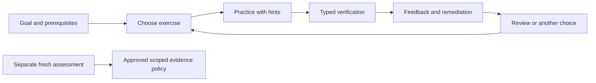

# Proposed CoreLab Exercise Bank

**Decision document, not an implemented feature.** Run `corelab-exercise-bank-20261031-01`; audit date 2026-10-31; source baseline `38b6a1d8f0baae9a753882185da7bd4430d14277`.

**Coordination complete:** Codex and Claude each published three completed rounds under this exact Run ID. Independent Round 1 preceded cross-reading; the final synthesis was created only after both matching Round 3 statuses were observed. The reviews remain append-only historical records, including their corrections.

CoreLab should add a small original exercise bank for deliberate practice, with several meaningful choices for each learning objective. Start with mathematical answers and explicitly scoped feedback; enable code verification only through a parent-owned, independently reviewed isolation profile. Completed exercises, watched solutions and correct practice answers must never silently become mastery PASS.

> Progress is measured by what you can independently explain, implement, and verify—not by how many tasks you click through.

## 1. Evidence and relationship to existing plans

The [Curriculum V2 proposal](../curriculum-review/proposed_curriculum_v2.md) and [Practical Learning System proposal](../corelab-labs-review/proposed_practical_learning_system.md) are design inputs, not deployed curriculum or labs. Keep all 169 existing topic IDs. Their seven proposed additions—M17, R16–R20 and E16—remain candidate references until approved. The practical report's L01–L22 labels are proposed lab contracts, not an inventory of working applications.

Inspected CoreLab already provides a prerequisite graph, diagnostic assessments, local progress storage, targeted weakness practice, review scheduling, and manual AI context handoff. The proposed bank should reuse those concepts without rewriting historical evidence.

| Actual baseline | Implication |
| --- | --- |
| 169 topics; 31 authored lessons/diagnostics | Breadth of the graph does not imply authored exercises for every topic. |
| 42 targeted questions in seven banks: 28 choice/number and 14 short | Short responses are not automatically verified. Keep existing IDs/answers/versions unchanged. |
| Eight independent practice activities, only M02 and PY01 with supported verifiers | A listed exercise or downloadable file does not imply verified execution. |
| Current question kinds are choice, number and short | Matrix/vector/code contracts and their storage are new work, not capabilities already present. |
| Targeted assessment attempts are excluded from mastery aggregation | Preserve that boundary. Fresh A0 targeted work can repair a specific weakness under existing rules without increasing topic mastery. |
| Trusted A0 lab evidence currently awards topic-wide I2 | Future narrow bank contracts must not be passed through this shortcut. A separately approved scoped policy is needed. |
| Current lab worker can print a forged success object and exit before tests | Do not reuse its success protocol for a new bank. The audit demonstrated this without signing or importing evidence. |

Evidence is split deliberately: **executed fixture/protocol checks**, **source inspection**, **proposed requirements**, and **unmeasured outcomes**. Neither reviewer ran learner trials, real robots or a deployed exercise bank. No production file was changed for this audit.

## 2. Source comparison and rights policy

Use external collections as optional references and sources of design patterns. Author the first release's prompts, hints, solutions and fixtures originally. A broad repository license is not blanket clearance for every embedded image, dataset, assignment or linked resource.

| Source | Useful contribution | Rights evidence and adoption decision |
| --- | --- | --- |
| Exercism problem specifications and Python track | Canonical examples, language-independent expected behavior, tests traceable to cases | Selected repositories/files verified MIT. Preserve notices for copied/adapted material; review each selected exercise. Optional later import, no dependency required. |
| PythonRobotics and Modern Robotics **code** | Algorithm reading and possible independent robotics oracles | Root licenses independently read as MIT. Select files/assets separately; book exercises are a different rights question. Link first. |
| Spinning Up and CS231n notes repository | RL conventions and ML explanations | Root licenses read as MIT; do not generalize to linked courses, assignments, models or datasets. Optional references. |
| nbgrader | Reinstating protected cells and handling timeouts | BSD-3-Clause source inspected. Its own FAQ does not present notebook execution as protection from unsafe code. Borrow patterns, not a sandbox claim. |
| PrairieLearn | Generation/parse/grade/test separation and external-grader resource controls | Mixed root terms include AGPL community code, separately licensed enterprise material and other notices. Do not describe the whole project as MIT. No wholesale adoption. |
| SymPy | Mathematical forms and exact arithmetic | Selected source BSD-3-Clause; `parse_expr` explicitly uses evaluation and warns about unsanitized inputs. No general expression parser in the MVP. |
| Hypothesis / pytest | Properties, edge-case generation and numerical comparisons | MPL-2.0 with exceptions / MIT respectively at inspected sources. Research references, not installed or executed upstream suites. Their defaults do not define CoreLab's error tolerances. |
| Bubblewrap | Linux namespace mechanisms | Inspected v0.6.1 COPYING is GNU Library GPL v2 text. An OS-provided research tool, not incorporated application code or a complete security policy. |
| MIT OCW / Project Euler | Foundation exercises and mathematical ideas | Published terms include CC BY-NC-SA 4.0 with scope/exceptions. Link-only for this MVP; never relabel adapted content as original CC BY 4.0. |
| Dive into Deep Learning | Explanations and progression | Root CC BY-SA 4.0 read. Link-only in this proposal; no assumption all code/assets share root prose terms. |
| OpenStax | Optional foundation reading | No selected book/edition/item's redistribution rights verified by this audit. Link-only pending direct verification. Avoid universal claims about all titles. |
| LeetCode, Codeforces, other contest/problem sites | Optional external fluency practice | No approved imports. Partial excerpts/secondary copies are insufficient redistribution evidence. No scraping or automatic evidence from external completions. |
| Modern Robotics book | Robotics theory and problem inspiration | No exercise redistribution permission established here. Link only; code's MIT license does not clear the book or instructor solutions. |

MIT/BSD/CC and other separately licensed materials can sometimes coexist in a repository when their obligations are met; that does not make them CoreLab-owned or relicense them under MIT/CC BY 4.0. Keep this first tranche original to avoid unnecessary complexity.

Every proposed item needs a rights record: author and originality attestation, exact source URL/commit/edition/page if adapted, license and exceptions, required notice, modifications, asset/data rights, reviewer and date. Mark `original`, `adapted-approved`, `link-only` or `blocked`. Concept-level inspiration is acknowledged without copying distinctive problem text, diagrams or tests. Original learning prose follows CoreLab's content policy; original software/tests follow its code policy. Third-party notices remain intact. No imported item in this document is cleared merely by being listed.

Pinned primary source files and observed license scopes are in [Codex Round 1 §14](codex_review.md#14-pinned-primary-source-index); additional reference links appear in §14 below.

## 3. Architecture: small, versioned and additive

Use static reviewed records under a proposed `content/exercises/` namespace, plus typed validators and a shared local practice service. Do not put evaluator code, shell commands, arbitrary import paths or plugin URLs in learner-controlled metadata. No cloud service, authentication, Docker requirement, CMS or psychometric model is needed for the numerical MVP.

| Record | Required information |
| --- | --- |
| Learning objective | Stable objective ID; existing topic and exact scope; C/M/I/T dimension practiced; prerequisites; applicability and lab preparation links. Candidate topics explicitly marked. |
| Exercise family/version | Prompt, scenario choices, representation, authored difficulty and rationale, optional specialization, estimate labelled unmeasured, permitted resources, hints, remediation and rights record. |
| Generated instance | Family/version, chosen scenario, seed plus generator/configuration version, immutable input bytes/hash, conventions and domain. Seed alone is not reproducibility. |
| Verification contract | Allowlisted answer type; independent oracle/constraints; units, tolerance and valid alternatives; invalid inputs; selected mutants; completion/resource/isolation requirements; verifier version/hash. |
| Practice event | Exercise/instance/version, submitted artifact hash, assistance and exposure history, outcome reason, fresh/repeat status, execution mode and timestamp. Store observed help separately from declared external help. |
| Assessment contract | Separate admission/coverage/freshness policy and eligible forms; reviewed dimension and mode scope; parent-produced evidence, if eligible. Never infer this from an exercise's difficulty or success count. |

`corelab-exercise/1` is a proposed **catalog schema**, not a new mastery evidence format. The prior practical report's result namespace remains an owner decision; reuse one approved versioned contract model rather than introducing competing `practical/1`, `lab/2` and bank evidence formats. The current types cannot safely accept these extra fields without an explicit migration.

Preserve old attempt IDs, purposes, assessment versions, lab signatures and restore behavior. New events can be stored in a separate validated collection or introduced through an additive typed migration; choose and test one before implementation. Existing v1 targeted items remain byte-identical. Never backfill exercise success into old mastery or reinterpret legacy signatures as new-scope evidence.

Suggested flow:

The numerical bank runs in the existing local-first application. Localhost restrictions remain. Downloading/running a coding submission is a different trust boundary; the web server must not execute learner code, import learner modules, or hold a grading worker's file access.

## 4. Learner choice, progression and adaptive practice

**Recommended** proposes a short adjustable session and states each reason. **Explore** filters by objective, application, difficulty, time estimate, lab and specialization, with prerequisite warnings. **More Practice** offers another task for one skill, showing when unseen alternatives are exhausted. These are proposed interfaces, not existing features. Start with a simple choice list; richer modes can wait until there is enough reviewed content.

Two choices should be different authored tasks targeting the same objective, not just new constants or two multiple-choice options. Require two reviewed routes for each MVP objective; the remaining pairs in the catalog are proposals, not an obligation to double the entire bank before release. A learner might choose projection of force along a rail or velocity along a corridor. They share projection scope; one may still be harder, and neither establishes all of M02. Derivation, implementation, test design and using a library are separate objective routes unless explicitly reviewed for equivalence.

Progression is structural: prerequisite recognition → single-method fluency → boundary cases → changed representation/composition → optional application. Author difficulty levels are provisional; they are not CoreLab L0–L4 or calibrated ability. Beginners need straightforward level-1 tasks; the peer's predominantly level-2/3 catalog alone is not a beginner course. Advanced extensions belong behind readiness warnings and suitable review.

For the initial packs, provide an explicit beginner on-ramp: identify the requested output and units, solve a small hand case with optional scaffolding, attempt one routine scenario, then choose a boundary or changed-representation task. For example, a supplied contingency table precedes constructing the Bayes table independently; a single frame mapping precedes composition. Guided substeps record their actual assistance and do not become independent assessment credit. Later Jacobian, A* or anti-windup tasks require their own prerequisite and contract review.

Optional tracks include manipulation, mobile robotics, perception, control/estimation, learning/RL, programming/testing and cognitive planning. Generic mathematics and language drills are welcome when a robot story would obscure the objective.

Use transparent rules: unresolved prerequisite weakness for the chosen goal, due review, ready unpracticed objective, one earlier mixed skill, optional specialization. Let the learner override, set a time budget and choose fewer items. An A0 correct first attempt may suggest the next structural step; repeated failures should offer a smaller worked example, a prerequisite and a different activity. A two-failure prompt is a pilot heuristic, not a lock or a diagnosis. Do not fit IRT/BKT, claim mastery probability, or use an LLM to select graded tasks without evidence and review.

| Assistance | Proposed behavior |
| --- | --- |
| A0 | No observed hints; outside help still declared by learner. No technical claim that independence can be detected. |
| A1 | Conceptual cue or Socratic question. |
| A2 | Specific next step, partial worked example or substantial scaffold. |
| A3 | Worked solution or equivalent direct assistance. |

Record the highest opened assistance level monotonically for that attempt. Help before a first attempt remains available. A worked solution is useful practice, but makes that form exposed. Show a fresh appropriately different task when the learner wants to demonstrate independence; do not relabel a repeat A0 merely because hints were closed. Feedback distinguishes a measured failure from an inferred misconception: “this Jacobian disagrees with the pose perturbation” is observed; “you used absolute angles” is a hypothesis unless directly established. Format/rounding errors must not be diagnosed as mathematical weakness.

Reuse the existing review scheduler where suitable and label scheduling choices as heuristics. Spacing/retrieval findings motivate revisiting concepts; they do not validate a particular interval sequence or prove transfer in robotics. A delayed known-form repeat is retention, not unfamiliar T. Manual ChatGPT context handoff can include the contract, attempt, observed errors and hint level; AI output remains assisted practice and is not signed evidence.

## 5. Core catalog: 20 audited families

These are authoring proposals. Each has two scenario routes, giving 40 route ideas—not 40 released exercises. Starred families have detailed contracts below. The executed audit covers the specific fixtures recorded in Appendix A of the independent review; it is not a completed grader for every row.

| ID / common objective | Choice A / Choice B | Curriculum and lab mapping | Verification and meaningful boundary |
| --- | --- | --- | --- |
| **X01*** Projection | Force along a rail / velocity component in a corridor, different frame/direction data | M02; L01/L06 | Exact rational projection + unit-vector alternative; zero direction, shape, orthogonal residual. Not a whole vectors PASS. |
| X02 Linear solve/identifiability | Two-sensor calibration / bounded force-allocation equations | M03/M04, M11; L06 | Independent 2×2 anchor and rank/inconsistency cases; accept a valid free-parameter solution when nonunique. Full numerical solver not implemented in audit. |
| X03 Chain rule | Nonlinear calibration curve / nested camera-response curve | M05/M06; L06/L16 | Explicit-domain derivative + finite differences, missing-inner-factor mutation. Not proof ability. |
| **X04*** Bayes | Rare fault alarm / defective-part screen | M08/M09; L09 | Exact contingency table/rational posterior; base rates, impossible observation and domain validity. No assumed independent alarms. |
| X05 Covariance | Aligned sensor residuals / correlated coordinate logs | M09; L09/L10 | Sample versus population denominator, PSD/singular anchor, n≤1 policy to author. Not correlation⇒independence. |
| X06 Numerical stepping | Decay-state Euler update / driven first-order response | M05/M07/M11; L04/L08 | Exact simple update/stability anchor; accuracy/refinement policy by variant. No physical-model truth claim. |
| X07 Python function contract | Sensor-batch mean / telemetry summary | PY01; numerical prerequisites | Empty/nonmutation/fractional result; loop and `fsum` formulations. Numeric domain/overflow policy must be specified. Legacy mean evidence remains mean only. |
| X08 Array axes/preprocessing | Feature columns / image-channel layout | PY04, V01, ML03; L16/L19 | Independent loop/shape anchors, constant-column policy, held-out training statistics. No leaked fit or square-only fixtures. |
| X09 Test design | Projection regression suite / kinematic function bug suite | PY07/T04; L05/L06 | Tests accept valid alternatives and kill selected genuine mutations; separate from program PASS. A single orthogonal case misses a zero stub. |
| **X10*** Frames | Camera-to-base marker / warehouse-frame waypoint | M12/R03; L01/L12 | Hand integer anchors, inverse/order, point/direction, reflection, shape; sequential and matrix formulations. SE(2) first, SE(3) separately. |
| **X11*** FK and optional J | 2R tabletop reach / 2R inspection link | R04/R06, M06; L02/L06 | Trig vs chain, explicit pose convention, nonzero unequal links; J checked by finite differences. FK/J are separate objectives. |
| X12 Odometry | Differential-drive cart / inspection rover | R02 and proposed R20; L03/L05 | Exact arc/straight/spin/nonzero-heading anchors; tiny motion and dimensioned tolerance. No localization/SLAM claim. |
| X13 Bounded feedback | Wheel-speed toy plant / thermal first-order toy | C01/C03, C09 subset; L04 | Audit tested a bounded P integrator only; PID/anti-windup/time-delay extensions still need their own model/review. No universal zero-error rule. |
| **X14*** Shortest path | Warehouse graph / route through a service network | PY02/E02, proposed R18 subset; L11 | Exhaustive small-graph oracle, any optimal simple path, ties/zero cycles/unreachable/invalid weights. Not geometric collision planning. |
| X15 Swept collision | Disc-robot inflated obstacle / tool-centre clearance segment | R03 and proposed R18; L11/capstone | Segment-circle closest distance, touching/degenerate/endpoint-only mutation; polygon/3D extension unvalidated. |
| X16 Camera geometry | Overhead marker / wrist-mounted point | V03/M12; L16/L17 | Pinhole projection/deprojection anchors, finite positive depth, dimensions/axes; calibrated intrinsics supplied. Not complete camera calibration. |
| **X17*** Shared gradient | Shared scalar computation graph / two uses across time | ML05/M06/PY06 optional; L19/L20 | Explicit loss, analytic/reverse accumulation + finite-difference check, lost-path mutations; no full BPTT claim. |
| X18 Value/terminal semantics | Finish/wait task / small continuing navigation MDP | RL01/RL02/RL03; L20 extension | Exact policy values/Bellman anchor; terminal versus administrative truncation under stated task. No lucky rollout as oracle. |
| X19 Episode leakage/QA | Teleop demonstrations / sensor-classification sessions | ML03/ML07 and proposed E16; L19 | Group split disjointness, train-only stats, time/corruption policy. Audit checked basic cases, not every dataset defect or generalization. |
| X20 Plan validity | Pickup/deliver facts / recharge/precondition scenario | E04/E05/E14 subset; L15/L22 | Independent state transition/goal and precondition checks; multiple valid plans. Not general cognition or optimality unless separately specified. |

The catalog maps **scopes**, not entire topic mastery. Example: X14 is graph search relevant to proposed R18, not collision-free robot motion; X12 is odometry relevant to proposed R20, not localization. Candidate M17's stable-solve work, R17's trajectory timing and R19's manipulation control need later dedicated exercises. Proposed R16 sensor-data and E16 episode-data scopes are only partially prepared. Approval of a candidate topic is not implied by this mapping.

### Additional choices contributed by the peer review

These extend the 20-family core after the initial packs. They are not extra completed implementation promises.

| Proposed option | Curriculum/labs | Required checks or limitation |
| --- | --- | --- |
| Integrate sampled velocity | M05, M11; L03/L07 | Displacement versus distance, nonuniform time, integration convention and refinement. Specification reviewed only. |
| Merge sensor dropout intervals | PY02, candidate E16; L05/L19 | Declared endpoint convention, touching/overlapping/nested/empty intervals, finite observation window. Specification only. |
| Write tests for angle wrapping | PY07/T04; L03/L05 | Accept both permitted ±π endpoints, diverse valid implementations, reject weak/self-referential suites; isolate submitted tests too. Peer harness independently rerun; finite domain still required. |
| C++ sensor ring buffer | CPP02/CPP03/CPP08; L05 option | Wraparound, FIFO overwrite, capacity zero, copy independence, empty/partial copies and memory safety. Peer ran sanitizer/mutation cases; Codex found the original partial-copy defect and reran the corrected reference. Expert review and full contract gates still required. |
| Sliding-window median | CPP05/CPP09; L09 | Even-size median, duplicate values, outgoing sample, warm-up and NaN policy. Specification only. |
| Encoder counter rollover | R02, candidate R16; L03 | Bit width, direction, ticks/revolution, gear ratio and sampling ambiguity beyond half the counter range. Specification only. |
| Pendulum integrator comparison | R07/M07; L08 | Energy definition, angle origin, damping, timestep and horizon. Numerical drift is not universally a failure. Specification only. |
| Scalar Kalman filter | C06/C07; L10 | Prior/process/measurement model, update timing, covariance validity and batch oracle of the same model. Specification only. |

For the buffer, a `std::deque` implementation can satisfy FIFO behavior while a raw-storage implementation additionally practices ownership; do not treat them as equivalent evidence for manual resource management. Correct behavior alone cannot establish a from-scratch method objective.

The peer also deepened X02 into identifiability, X13 into anti-windup PID, X14 into A*, X19 into episode-split evaluation and X18 into termination/truncation. Those extensions require their own well-posed contracts; a smaller fixture does not validate them.

### Lab preparation coverage

| Lab group from practical proposal | Preparation available in this design | Remaining boundary |
| --- | --- | --- |
| L01 frames; L02 FK; L06 J/IK | X01/X02/X03/X10/X11 | No full IK solver or physical calibration verified. |
| L03 odometry; L05 replay/software | X09/X12, integration, encoder, interval/test/buffer options | No ROS execution or timing guarantees. |
| L04 feedback; L07 trajectory; L08 dynamics | X06/X13, integration and pendulum options | PID, trajectory constraints and stable high-order simulation still need authoring. |
| L09 localization; L10 fusion | X04/X05, median and KF options | Statistics alone do not establish localization/estimation competence. |
| L11 search; L13 navigation | X14/X15; A* extension | No Nav2 integration, dynamic-obstacle or 3D planner claim. |
| L12 URDF/TF | X10 | Numeric frames do not prove URDF validity or live TF correctness. |
| L14 interfaces/MoveIt | Optional future frame/unit/interface compatibility task | **No integrated L14 exercise or robotics stack verification yet.** |
| L15 executive; L22 cognitive planning | X20 | Toy preconditions do not certify physical safety or general reasoning. |
| L16 camera; L17 servo | X03/X08/X16 | No completed calibration/closed-loop servo experiment. |
| L18 grasp | Optional future aperture/approach-clearance geometry | **No contact/grasp-success exercise yet.** |
| L19 data/BC; L20 RL | X08/X17/X18/X19 | No successful learned policy, full BPTT or held-out robot generalization claim. |
| L21 identification/sim-to-real | X02 identifiability extension | No physical-system parameter or sim-to-real validation. |

Every L01–L22 appears for traceability; a preparation link is not replacement of a lab's approved PASS contract. Do not advertise full lab exercise coverage from this matrix.

## 6. Six detailed technical examples

All six are original audit examples. Their small author-side reference tests were executed; production parsing, complete invalid-input checks, accessibility, task-choice equivalence and qualified review remain release work. Each accepts the specified mathematical alternatives, independently of how a learner expresses equivalent reasoning. Implementation-method claims need additional review.

### X01: Project a command onto an allowed direction

**Contract.** Equal-length bounded finite real vectors u,v; v nonzero. Return the vector `((u·v)/(v·v))v`. Distinguish the signed scalar component, which is a different output. Empty/shape/type/nonfinite/zero-direction failures produce contract feedback, not an invented numeric answer.

**Anchor.** u=(2,1,−1), v=(1,2,2): dot=2, norm²=9, projection=(2/9,4/9,4/9). Signed scalar component=2/3. Verify residual orthogonal to v; scaling v by any nonzero factor preserves the projected vector.

**Alternatives and bugs.** Direct rational formula and unit-direction formulation agree. Dividing by norm rather than norm² fails this anchor; a zero stub needs a nonorthogonal case to fail. Use declared dimensioned tolerances and bounded inputs rather than one magic epsilon over arbitrary magnitudes.

**Choices/hints.** Rail force or corridor velocity. A1 identify vector/scalar output → A2 compute v·v → A3 worked decomposition. A fresh vector is practice/retention; an unfamiliar modeling assumption may support separately reviewed transfer. Scope: M02 projection, preparation for L01/L06.

### X04: Interpret a rare fault alarm

**Contract.** p=P(F), s=P(+|F), q=P(+|not F), all in [0,1]; condition on a positive alarm only when `p*s+(1-p)*q > 0`. Reject impossible conditioning and invalid probabilities explicitly.

**Anchor.** p=1/50, s=9/10, q=1/20 gives 18/67≈0.2686567164. In 10,000 trials: 200 faulty produce 180 positives; 9,800 nonfaulty produce 490 positives. Table counting and conditional formula agree independently.

**Boundaries/alternatives.** Accept equivalent fractions/decimals with a stated tolerance. p=0 or s=0 can correctly yield zero when false positives remain possible; they are not automatically invalid. p=1 may yield one when conditioning is possible. Do not return sensitivity or ignore base rate. Two alarms require their joint/conditional dependence model.

**Choices/hints.** Fault alarm or defective-part screen. A1 pick the population being conditioned on → A2 count both sources of positives → A3 table and formula. Scope M08/M09, preparation L09. This posterior by itself is not a safety-stop rule.

### X10: Compose coordinate frames

**Contract.** SE(2), column homogeneous vectors, frame directions explicitly named. A maps B→A; B maps C→B. Distinguish points (homogeneous 1) from directions (0). Require valid proper rotations and finite matrices; shape/domain checks must be implemented before release.

**Anchor.** A rotates 90° and translates (1,2); B translates (3,−1). A·B rotates 90° and translates (2,5). C point (1,2) becomes A point (0,6). B direction (2,0) becomes A direction (0,2), without translation. A inverse maps A point (1,4) to B point (2,0).

**Alternatives and bugs.** Sequential transforms and matrix multiplication agree. Swapped multiplication and adding translation to a direction fail. Determinant −1 is reflection, not proper rotation. Round-trip consistency alone can miss two mutually consistent wrong functions.

**Choices/hints.** Camera marker or warehouse waypoint. A1 label source/target frames → A2 calculate one intermediate point → A3 full chain. Scope M12/R03, L01/L12. SE(3), quaternion conventions and live TF are separate extensions.

### X11: Forward kinematics, with a distinct Jacobian task

**Contract.** Planar 2R arm, positive link lengths, relative joint angles in radians, endpoint position and optionally orientation. FK and Jacobian are separate objectives.

**Anchor.** l1=2,l2=1, q1=π/2,q2=−π/2: endpoint (1,2), orientation 0. Position Jacobian is `[[-2,0],[1,1]]` metres/radian.

**Verification.** Direct trig and rotated local-link formulations agreed on 12 seeded poses. Analytic J and central differences with h=1e-5 agreed on the audited fixtures within 1e-8. A relative/absolute-angle mutant fails. These bounds are fixture-specific, not universal guarantees near arbitrary magnitudes. Before release add folded/straight/unequal links, tool offsets, type/domain checks and independent tolerance review.

**Choices/hints.** Tabletop reach or inspection arm. A1 draw relative angles → A2 reconstruct local endpoint → A3 derivation. At q2=0 the Jacobian loses an instantaneous direction; this is not impossibility of reaching another point along a finite path. Output checks do not prove analytic derivation. Scope R04/R06/M06, L02/L06.

### X14: Find any optimal route

**Contract.** For the first released variant: explicit directed graph with 1–20 nodes and integer costs 0–10,000 (booleans excluded); known endpoints. State the cost units. This bounds every simple-path total within exactly representable arithmetic. A future floating-weight variant needs separately reviewed precision/overflow behavior. Return an optimal simple path and cost, or `unreachable`. Validate the full graph, including negative edges in unreachable components. A finite graph and nonnegative costs make an optimal simple path available when reachable.

**Anchor.** S→A and S→B cost 1; A→G and B→G cost 1; A↔B cost 0. Optimal cost is 2 and several routes are valid. Do not require one serialization or tie-break order.

**Verification.** Dijkstra matched exhaustive simple-path enumeration on 10 seeded five-node graphs. Additional fixtures covered start=goal, unreachable targets, zero cycles, unknown endpoints and invalid/nonfinite/negative/bool weights. The final grader must independently validate submitted adjacency, endpoints, repeated-node policy and summed cost; the audit reference is not a full submitted-path validator.

**Self-audit correction during synthesis:** my original reference accepted arbitrarily large finite float weights. An actual probe S→A→G with both edges 1e308 returned `None` after the sum overflowed, although a path exists. This disproves the broader finite-float contract. Narrow the first variant to the bounded integers above; future numerical overflow must be a domain/representation error, never `unreachable`. Do not advertise the audit reference as a general finite-float solver. No production solver was changed.

**Choices/hints.** Warehouse graph or service-network route. A1 separate validity from cost → A2 frontier invariant → A3 small trace. A* requires declared heuristic/reopening rules; geometric obstacle avoidance is X15, not established here. Scope PY02/E02 and candidate R18 subset; L11.

### X17: Accumulate every gradient path

**Contract.** f=θx+θ², L=½(f−y)² over a bounded finite domain; compute dL/dθ. Both uses of θ share the same parameter.

**Anchor.** x=2,y=5,θ=3 gives f=15,L=50 and gradient 80. Reverse accumulation combines 20 from the direct θx path and 60 from θ².

**Verification.** Analytic expression `(f-y)*(x+2*theta)`, explicit reverse accumulation and central differences agree at the anchor and 10 further seeded bounded cases. Dropping either contribution fails. Symmetric difference is a corroboration with a selected step, not a symbolic proof.

**Choices/hints.** Shared scalar graph or separately authored two-use temporal graph. A1 mark every parameter use → A2 sum adjoints → A3 worked graph. A different graph must get its own fixtures; this does not establish full BPTT or network training. Scope ML05/M06, optional PY06; L19/L20.

### Peer examples and counter-review

Claude detailed Bayes, angle-test design, C++ ring buffer, 2R Jacobian, episode splitting and RL termination. Codex reran both published Python harness versions and reproduced their reported selected acceptance/mutation outcomes. The first synthetic frame/episode MAEs were 0.566/3.028; revised deterministic group ordering changed the second to 2.923. These describe one constructed dataset and split choices, not an expected learning gain or universal performance gap.

Additional Codex probes showed the initial Bayes alternative wrongly rejected valid zero-posterior cases, and the initial split reference could return empty train sets. Claude corrected both in Round 2; Codex reran the revised harness, including the boundary fixtures and a valid chronological group splitter. Require at least two groups, a fraction strictly between zero and one, a declared **group-count** allocation rule, and test-group count clamped to `[1,n-1]`. Valid group-disjoint split algorithms need not choose the same groups. A chronological split is not wrong if it actually preserves groups. Declare seed determinism and allowed ID types; index coverage alone does not prove leakage-free preprocessing or deployment generalization.

The displayed ring reference copied unused, uninitialized `double` slots when the source was empty or partially filled; ASan/UBSan passing on fully filled copies did not cover that defect. Value-initialize or copy only live elements, then test empty/partial/wrapped/self copies. Claude value-initialized storage and added empty/partial/wrapped copies in Round 2. Codex independently compiled and ran that corrected reference with the original plus added tests using g++ 11.4.0 and ASan/UBSan: compile/run exit 0, stdout `OK`, no diagnostics. Codex did not rerun the full mutant matrix or MemorySanitizer; those bounds remain explicit.

Additional Codex counterexamples made the peer Round 1 **and Round 2** Bayes and Jacobian comparators accept NaN at sampled points when their final fixed anchors/boundaries were correct. An `abs(error) > tolerance` rejection test is unsafe on nonfinite values. Claude corrected this in Round 3 using a positive finite/type-aware comparison. Codex independently reran that final harness and reproduced rejection of six NaN/Infinity/bool probes while the selected valid alternatives/mutations retained their outcomes. This repairs the demonstrated comparators, not a nonexistent deployed bank; full malformed-shape/error-path validation is still a release gate.

RL's illustrative MDP has finish reward 3 versus wait reward 1 forever. For `0≤γ<1`, V=max(3,1/(1−γ)); γ=2/3 is a tie. Bootstrap after an administrative time limit only for the declared continuing-task convention; a true finite-horizon task needs different state/value semantics. The revised peer harness added γ=0 and the tie and reproduced the expected values. Invalid-discount and convergence/residual contracts still need full release validation.

## 7. Reliable mathematical and coding verification

A released auto-checked exercise must pass these gates; no exercise in this proposal has completed every gate.

1. **Rights and specification:** provenance approved; self-contained prompt with output type, units, conventions, input domain, invalid-input behavior and permitted resources.
2. **Independent correctness:** hand anchor plus an independent solution/enumeration/model; avoid a reference and oracle sharing the same mistaken formula.
3. **Acceptance:** multiple valid approaches, equivalent forms, ties, nonunique solutions and representation choices accepted under the actual contract. A second technical reviewer must attempt false acceptance and false rejection; author-written mutants alone share the author's blind spots.
4. **Rejection:** named genuine mistakes, degenerate cases and invalid output rejected; mutations trace to an objective, not arbitrary style.
5. **Reproducibility:** immutable instance and submission bytes, generator/configuration and verifier versions, mode, measured outcomes and actual completion recorded.
6. **Safety:** executable submissions satisfy the platform's approved isolation and resource policy; malformed/incomplete/protocol-forged results fail closed.
7. **Teaching/accessibility:** hints correct and graded by assistance; feedback separates observation from diagnosis; readable notation/text alternatives, keyboard use and mobile presentation reviewed.
8. **Qualified review and pilot:** technical/pedagogical reviewer identified; beginner trials, time estimates, difficulty and choice comparability checked. Until then, difficulty/time remain authored estimates.

For answer entry, support bounded finite scalars and structured vectors/matrices. A small scalar grammar can accept signed integers, decimals and integer fractions, with bounded digits/exponents and nonzero denominator. No `eval`, arbitrary symbols, calls, attributes, pickle or unsanitized CAS parser. Exact rational forms should work for rational tasks; formatting errors receive formatting feedback. Validate shape/type before arithmetic, including bool-as-number, NaN and Infinity. Tolerances depend on units, magnitude, conditioning and algorithm—not a universal 1e-6.

Check mathematical solution sets rather than serialized references: a nullspace basis up to basis change, any optimal valid path, or a quaternion's sign-equivalent orientation where that representation is introduced. Numerical expression sampling alone does not prove symbolic equivalence; assumptions/domain distinguish x/x from 1. Defer general symbolic grading.

A residual is not always parameter accuracy in an ill-conditioned problem. Numerical integrators require a declared method, step/domain and error or stability criterion. Properties complement hand cases and independent oracles; they do not prove an arbitrary implementation correct. Test-writing tasks must accept legitimate implementations as well as kill selected mutations. For an initial test-design route, prefer learner-authored **declarative cases** (bounded inputs, expected values or allowlisted properties) that the parent runs against reviewed alternatives/mutants. This avoids giving a test suite the candidate implementation to inspect. If arbitrary test code is supported later, isolate it and the candidate separately behind a bounded value interface; running both in one process permits name/source inspection and does not prove test quality. Finite known mutants and inspectable local code still cannot prove authorship or comprehensive testing skill.

## 8. Parent-owned grading and the security boundary

**Threat model.** Protect the host's database, signing keys, credentials and workspace from submitted code. Protect result integrity against fake stdout, forged result objects/files, early exit, driver replacement, test mutation and incomplete runs. Trust the installed reviewed parent/oracle and the owner's deliberate software installation. The device owner can inspect or change a local application; this is a self-study evidence system, not tamper-proof remote examination.

Three execution tiers keep scope clear:

| Tier | What CoreLab does | Result |
| --- | --- | --- |
| Mathematical answer practice | Validates bounded typed answers without running submitted code | Practice feedback only. |
| Manual self-check kit | Offers reviewed test downloads/instructions; learner runs their own trusted code outside CoreLab; no verdict is returned, signed, imported or admitted as verified | Useful unverified self-check; does not depend on a sandbox broker. |
| Automatic code verification | Parent runs a reviewed contract with the required OS isolation and owns the comparisons | Practice feedback, or separately admitted scoped evidence; never automatic topic mastery. |

Manual kits have the same basic exposure as deliberately running one's own local program; official test artifacts still require source review. Do not run strangers' copied solutions under the assumption that a kit makes them safe. No Windows/macOS kit command was executed in this audit.

A parent-owned comparison is necessary for automatic verification but does not provide OS isolation. Conversely, a sandbox does not make a worker-generated `passed` object authoritative.

**Required sequence:**

1. Parent loads a reviewed allowlisted contract, validates the request, and snapshots/hashes the exact code and inputs it will run. Reject unsafe path traversal, symlink substitution, archives or client-chosen commands/mounts.
2. Parent keeps its expected results, assessment policy and signing key outside the worker's filesystem/process scope. It creates a fresh isolated job with minimal read-only runtime and input, private writable scratch, no host home/database/workspace and no network.
3. Worker returns only bounded typed result values on a separate channel. Treat the channel as learner-writable, even if the trusted driver was intended to own it. Request IDs correlate messages; they are not secret anti-forgery tokens.
4. Parent observes actual exit/signal, time/resource/output limits, expected message count/order, schema and all critical case comparisons. Reject duplicate/malformed/oversized/nonfinite/incomplete data. Diagnostic stdout/stderr never determines success. A correct value with fake success text remains correct because of the value, not the text.
5. Parent constructs its own outcome. Only a separately admitted assessment contract can produce scoped signed evidence, with instance/submission/verifier hashes, mode, observed results, assistance and policy version. Practice receives practice feedback, not mastery PASS.
6. Clean up every descendant and artifact on success, timeout, error or cancellation. Do not allow a passing case to mask failed critical cases or a process failure.

The installed Linux audit prototype used Bubblewrap 0.6.1 namespaces, a read-only job/runtime, a private result fd, CPU/address-space/file/fd limits, parent wall/output limits and parent-side comparisons. Fifteen controlled probes accepted three valid behaviors and rejected twelve invalid ones: forged stdout/early exit, wrong result, verdict object, bool, NaN, malformed/duplicate messages, nonzero exit, timeout, infinite CPU and output excess. Two benign checks could not see a unique host marker or reach a host-loopback listener.

**This is a proof of concept, not a certified sandbox or production runner.** Broad runtime mounts, capability/syscall policy, PID/cgroup/memory exhaustion, fork/descendant cleanup, escape resistance, compiler attacks, symlink races and all failure paths need security review and adversarial tests. The initial unsupported Bubblewrap option aborted; actual installed flags were corrected and the stated probes rerun. Pin and test supported configurations rather than assume commands are portable.

No Windows or macOS executable isolation profile was tested. AppContainer/Job/ACL, a supported helper or an explicitly isolated VM are options requiring separate engineering and verification; subprocess timeouts alone are insufficient. Native mathematical practice can work without an executable runner. If a required profile is unavailable, code verification remains unavailable or clearly trusted/manual practice, without a strong automatic claim. No silent host-execution fallback and no mandatory Docker requirement.

The current legacy stdout bypass must be fixed/versioned **before** enabling new signed code evidence. The audit did not exercise the signing/import path or access keys. Keep historical bytes and their original scope; disclose the legacy limitation and offer a fresh retest rather than retroactively fabricating stronger guarantees. A dedicated pipe alone would leave host-file access and verdict forgery unresolved.

## 9. Practice versus mastery PASS

| Activity/result | Honest claim | Cannot establish by itself |
| --- | --- | --- |
| Watch/read/worked solution | Exposure and supported learning | Verified independence or mastery. |
| Correct practice answer, including A0 | Correct on this specified instance | Full topic PASS, unfamiliar transfer or authorship. |
| Fresh targeted A0 correction admitted by current policy | Specific weakness independently corrected | Higher topic mastery level. |
| Code passes a hardened scoped contract | Implementation evidence for that objective/mode, if separately admitted | Whole-topic I2, derivation quality, hardware reliability or method originality. |
| Delayed fresh retrieval | Retention under the reviewed task scope | Unfamiliar transfer merely because time elapsed. |
| Unfamiliar application or open design | Reviewer-assessed transfer when admitted | Automatic L3/L4. |

Keep C/M/I/T and the Curriculum V2 applicability/coverage principle. M is not forced onto a pure tooling task; prose is not I. L3/L4 and open transfer need qualified review. Avoid difficulty-to-level conversions, points/streaks, repeated easy-choice accumulation and evidence backfill. Shared learning objectives do not make implementation, proof, testing and library-use routes interchangeable.

Practice-to-assessment admission requires a **separate** versioned form and coverage policy, reviewed exposure/freshness, critical criteria, observed assistance and resource mode. Public local generators are inspectable; seed changes cannot guarantee novelty or independent work. No blanket time lock repairs a leaked form. The present engine does not implement the proposed scoped aggregation rules, so numerical practice can precede that policy work, while new signed evidence must wait.

## 10. MVP and implementation roadmap

**Recommended first tranche:** four original packs—X01 projection, X04 Bayes, X10 frames and X11 FK—with two meaningful scenario choices each. This means eight practice choices to author and review, not eight already finished tasks. Publish numerical/vector/matrix answers first. Keep Jacobian separate from FK. Optionally commission angle-test design and one Python automatically verified implementation route after an execution profile clears its gates. Reviewed manual self-check kits can be offered earlier, without verification admission or a returned verdict.

Claude initially preferred Bayes, test design and Jacobian after a runner fix; in Round 2 he accepted the four-pack numerical MVP. Both reviewers accept manual trusted self-check kits before an automatic runner. The numerical-first recommendation minimizes the first release's automatic-execution security dependency; the owner still chooses the exact pack set. Do not require a speculative 30-item threshold before a simple recommendation list; expose honest limited choice and add richer selection only when useful.

| Phase | Deliverable | Exit condition |
| --- | --- | --- |
| 0: Decisions | Initial objectives, purpose, rights, reviewers, supported modes, budget and result namespace | Owner explicitly approves scope; no implementation approval inferred from this audit. |
| 1: Contracts/content | Four packs, two choices each, immutable versions, fixtures, valid alternatives, mutants, hints, rights | All mathematical/format/authoring gates pass; unresolved reviewer or license blocks remain visible. |
| 2: Numerical pilot | Typed entry, choice list, local practice events, feedback, known-form exposure and simple recommendations | Existing progress/evidence/backup restore unchanged; integration tests; accessibility/mobile and beginner trial. |
| 3: Optional code profile | Hardened parent broker and one supported interpreter/OS profile | Forgery/escape/resource/error cleanup tests and independent security review; unsupported platforms fail closed. |
| 4: Assessment pilot | Fresh eligible forms and approved scoped aggregation | No accidental topic-wide I2; old signatures restore; reviewer and admission policy validated. |
| 5: Goal-led growth | Remaining core families and selected peer options | Each passes the same gates; avoid claims of all-topic/all-lab coverage. |

Author planning estimates, not measured productivity: first content/manifests/review 30–60 hours; numerical choice/storage/feedback integration 24–56 hours; one hardened execution profile 40–100+ hours, plus other platforms and independent review. These ranges overlap and are uncertain; no sum is a delivery commitment. Claude estimates 3–8 hours per complete exercise and 20–50 for basic modes, also unmeasured. Qualified review, assessment calibration and learner trials add work. Do not assume the previous curriculum/lab budget covers this bank.

**Defer:** full symbolic algebra, arbitrary grader plugins, automated LLM-authored assessment banks, psychometric adaptation, cross-device sync, ROS/cloud infrastructure, broad automatic C++ execution and contact/physics/hardware claims. C++ ring buffer, RL terminal semantics and episode-data tasks are valuable next-wave candidates after their precise contract fixes.

## 11. Risks, limitations and owner decisions

| Risk | Required response |
| --- | --- |
| Incorrect or unfair oracle | Independent anchors, alternative solutions, boundary cases and review; defect found in a “passing” reference blocks release. |
| Forged success or host compromise | Parent-owned verdicts plus reviewed OS isolation; no worker-owned flags or fallback execution. |
| False mastery / historical corruption | Practice exclusion, separate assessment admission and additive migration; old bytes and signatures retained. |
| Unproven task equivalence or difficulty | Label authored estimates, scope routes honestly, pilot before calibration claims. |
| Repeats and hints mistaken for novelty | Exposure ledger, transparent exhaustion, structurally reviewed assessment forms and self-declared help limits. |
| Copyright ambiguity | Original-first, item-level rights record, link-only/blocked imports and preserved notices. |
| Simulated/numeric success advertised as real robotics | Explicit analytic/replay/simulation/hardware modes and limited contract claims. |
| Maintenance overload | Four packs first, static reviewed metadata, one optional code profile, named reviewers. |

Owner decisions before implementation:

- Approve initial four packs and learner goal; decide whether reviewed manual self-check kits belong in the first tranche.
- Confirm practice-only MVP; separately commission any new mastery contracts and scoped aggregation.
- Choose storage migration and one evidence namespace shared with the practical system.
- Appoint technical/pedagogical/security reviewers; decide how unsupported code platforms are presented.
- Approve original-content contribution/attribution requirements and whether any particular external import warrants rights review.
- Allocate content, security and pilot budgets; explicitly defer unstaffed platforms/labs.

Unresolved work is substantive: no production-grade execution profile, no verified Windows/macOS runner, no reviewed equivalence/difficulty calibration, no novice timing data, no full L14/L18 implementation, and no clearance to redistribute unselected external exercises. This is a technically grounded design ready for owner review, not a claim that a deployable bank is finished.

## 12. Reproducible validation and preserved work

| Check | Actual result and boundary |
| --- | --- |
| Codex original content script | Twenty groups of author-side fixtures/spot checks; code/output in [Round 1 Appendix A](codex_review.md#appendix-a--original-content-audit-script). The output reports 154 named assertions, including several arithmetic facts that exercise no implementation. **This is not 154 implementation tests**, broad coverage or complete graders. No replacement “effective test count” was invented. |
| Codex parent/worker proof of concept | 15 controlled probes: three valid accepted, twelve invalid rejected; benign marker/network checks blocked. Script/output in [Appendix B](codex_review.md#appendix-b--controlled-linux-parentworker-prototype). Linux only, not security certification. |
| Peer Python harness rerun by Codex | Rounds 1/2/3 selected outcomes reproduced; Bayes/split counterexamples in [Round 2](codex_review.md#round-2--critical-cross-review-of-claude-round-1), revised reruns and nonfinite-output counterexamples in [Round 3](codex_review.md#round-3--final-rebuttal-and-synthesis-position). Final peer harness rejects all six published NaN/Infinity/bool probes. |
| Codex reference self-audit | A two-edge 1e308 path falsely appeared unreachable through float overflow. The synthesis narrows the initial X14 cost domain and records the defect; the original research script remains preserved. |
| Peer C++ checks | Claude reported the mutant matrix. Codex found the original partial-copy defect and independently compiled/ran the corrected reference with original plus empty/partial/wrapped-copy tests using g++ 11.4.0, ASan/UBSan: exit 0, `OK`, no diagnostics. No independent full-mutant-matrix or MemorySanitizer run. |
| Existing app tests | `npm test`: 119 passed across eight files; Linux, Node 26.8.1 (repository requires Node 24+). These validate current app invariants, not the proposed bank. |
| Existing content validation | `npm run validate:content`: 169 topics, 31 lessons/diagnostics, 42 targeted questions in seven banks, 28 video resources. |
| Not performed | New UI/build/browser/Windows/macOS/robot/simulator/learner study testing. No such success is claimed for this documentation-only task. |

Preservation check at synthesis creation: SHA-256 comparison found **all 182 baseline files unchanged**, including application source and both prior review directories. The pre-existing `next-env.d.ts` working-tree change was preserved. New output is confined to `exercise-bank-review/`; temporary authoring/reproduction files live outside the project under `/tmp`. No production implementation, evidence signing/import, curriculum migration, commit, push or repository-visibility change occurred.

Finalization checked topic IDs against the 169-node source plus the seven explicitly proposed candidates, all 22 lab references, the 20 core catalog rows, local document links, completed-round status and preservation hashes. This does not replace future implementation/integration/browser tests.

## 13. Review disposition

| Round | Actual exchange and outcome |
| --- | --- |
| 1: Independent research | Both published their own source comparison, 20-item catalogs and six detailed examples before cross-reading. Codex included durable fixtures and a controlled parent/worker prototype; Claude included Python/C++ alternatives and mutants. |
| 2: Critical cross-review | Codex reproduced peer Python outcomes and identified Bayes boundaries, empty splits and a partial-copy C++ defect. Claude corrected those, reproduced Codex scripts and challenged tautological assertion counts, unnamed modes and mapping gaps. |
| 3: Final rebuttal | Both accepted the three execution tiers, declarative automatic test design, finite-only comparisons, separate assessment admission, original-first rights and a numerical four-pack MVP. Claude fixed the demonstrated nonfinite-output acceptance; Codex independently reproduced the final six rejection probes. Codex removed the assertion count as an implementation-quality headline. |

The final **design** is converged; exact catalog prioritization remains a proposal choice. Claude's final 20 favors C++ buffer, trajectory timing, interface checks and grasp-clearance geometry, placing covariance, stepping, pendulum and KF among later work. This synthesis retains the twenty independent core families plus explicitly optional peer routes, keeping the cognitive planning scope and all lab preparation gaps visible. The latest user request is “at least 15–20”; it does not impose a hard upper cap. Neither catalog commits the owner to ship all items. Both recommend four numerical packs first and no automatic code verification before its gates.

During synthesis, Codex additionally found float overflow in its own Dijkstra research reference and narrowed the initial integer-cost contract (§6). This is a transparent self-audit correction after the three debate rounds, **not** a claim Claude reviewed that new finding or a fourth debate round. A finite input alone does not guarantee finite intermediate arithmetic.

No release-approved reviewers, learner trials, full hostile-output validator, production sandbox or cross-platform runner have been supplied. Selected counterexamples are repaired in research artifacts; that is not a blanket approval of the future implementation. Owner decisions in §11 remain explicit.

Completed-review SHA-256 fingerprints (the synthesis itself is excluded to avoid circular hashing):

| Artifact | SHA-256 |
| --- | --- |
| `codex_review.md` | `e5d1dfb133769ce36a4fd01557802201869f7cac986626f5f0a82732fbc56ffe` |
| `codex_status.json` | `2d8a2d59086e5a5ff7546e6010c2b590cfbb2aa66da7badf42b9ce30eee882b5` |
| `claude_review.md` | `0879333383911ad02d2e0915ca4053248c0d14cb3f3d00bc39ab9c9694e9329e` |
| `claude_status.json` | `889f02a49b97b1c7e52226f8c6d688fc700a005011c7a44e5ab89571385b1700` |

## 14. Primary references and audit trail

The [Codex review](codex_review.md) includes original scripts, outputs and pinned commit/file sources. The [Claude review](claude_review.md) preserves its independent catalog, harness and rebuttals. Their JSON status files record completed rounds for this exact run. Prior reports remain separate and unchanged.

Additional rights references read during cross-review: [PythonRobotics LICENSE](https://github.com/AtsushiSakai/PythonRobotics/blob/master/LICENSE), [Modern Robotics code LICENSE](https://github.com/NxRLab/ModernRobotics/blob/master/LICENSE), [Spinning Up LICENSE](https://github.com/openai/spinningup/blob/master/LICENSE), [CS231n notes LICENSE](https://github.com/cs231n/cs231n.github.io/blob/master/LICENSE), [D2L LICENSE](https://github.com/d2l-ai/d2l-en/blob/master/LICENSE). These moving-branch links describe point-in-time root-license reads on 2026-10-31; any future import must pin the selected file/commit and inspect exceptions.

Other direct primary references: [MIT OCW terms](https://ocw.mit.edu/pages/privacy-and-terms-of-use/), [Project Euler copyright](https://projecteuler.net/copyright), [SymPy parsing warning](https://docs.sympy.org/latest/modules/parsing.html), and [Clang MemorySanitizer](https://clang.llvm.org/docs/MemorySanitizer.html). OpenStax book/item terms remain unverified for redistribution; search excerpts are not a substitute for that check.
