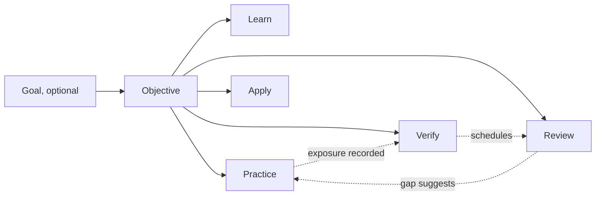
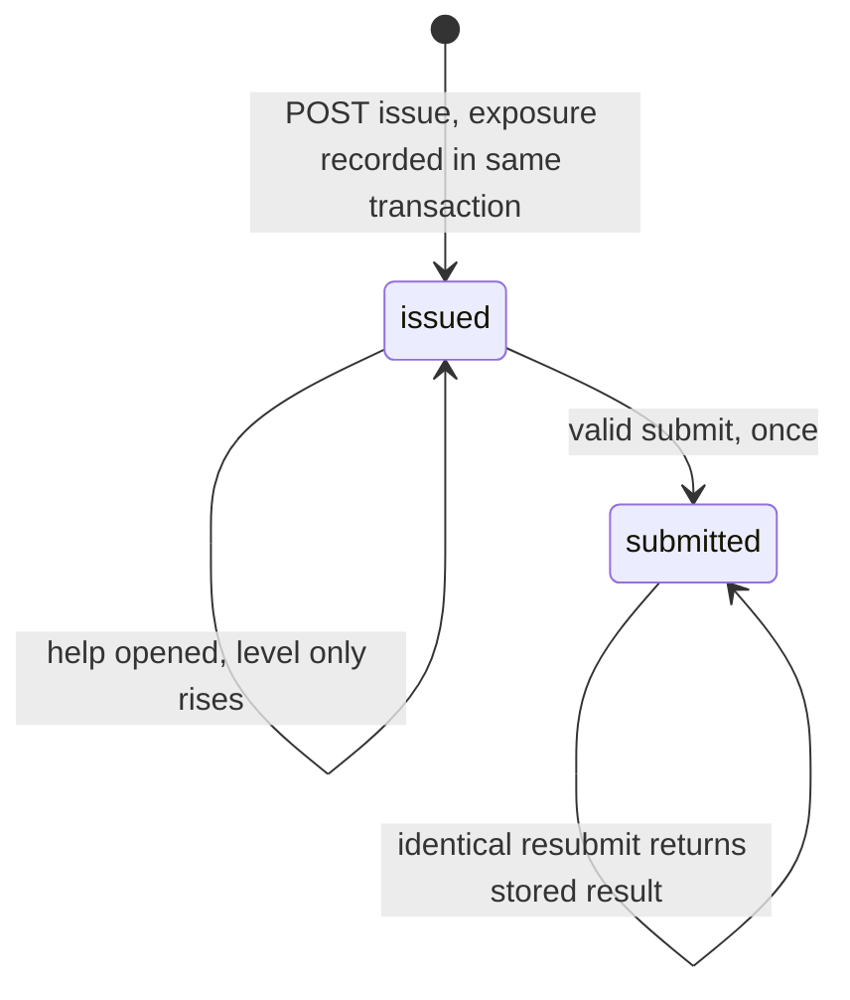

# CoreLab V2 Unified Specification

**Status: final design specification, ready for Implementation Master Planning. Nothing here is implemented.** No production code, curriculum, assessment, progress or evidence was changed, and nothing was committed. Implementation requires owner approval (section 19).

**Baseline:** repository `38b6a1d8f0baae9a753882185da7bd4430d14277`. **Inputs:** [Curriculum V2](../curriculum-review/proposed_curriculum_v2.md), [Practical Learning System](../corelab-labs-review/proposed_practical_learning_system.md), [Exercise Bank](../exercise-bank-review/proposed_exercise_bank.md), [Claude unified draft](claude_unified_design.md), and [independent integration audit](codex_integration_audit.md), whose dispositions this specification adopts. Codex completed the interrupted finalization on 2026-10-31, preserving the completed design and appendices. No further debate round was held.

**How to read claims.**

| Label | Meaning |
| --- | --- |
| **[Proposed]** | A requirement or feature to be built. **Not implemented and not tested** |
| **[Executed]** | Actually run; details in section 3 |
| **[Repo]** | Read in the current source |
| **[Report]** | Taken from a finalized proposal |
| **[E]** | An estimate, unmeasured |

Everything in sections 4–16 is **[Proposed]** unless marked otherwise. Acceptance criteria are tests to pass later, not results.

## 1. Decisions in brief

1. **Learn, Practice, Apply, Verify and Review are open activities, not gates.** Readiness changes recommendations and warnings only.
2. **The learning objective is the integrating object.** Lessons, exercises, labs, forms and reviews reference versioned objective IDs. Topics, the v1 graph and topic levels stay as they are.
3. **Verified I is unavailable until an independently reviewed isolation profile exists.** The earlier `local-trusted` proposal is **withdrawn**. Manual self-check is practice only. The pilot ships with I shown as unavailable.
4. **The server owns attempts.** Issue, exposure, hint use, freeze and submit are durable before any answer exists. Client-supplied grades, freshness or **observed/effective** assistance are never authoritative; declared external help remains an explicit self-attestation.
5. **All V2 data lives in a versioned sidecar** in the same SQLite file. `state`, `masteryFor`, v1 content and legacy signatures are untouched, and `user_version` stays 2.
6. **Practice and evidence are separated** by tables, endpoints, purpose checks and a database trigger.
7. **Full backup and atomic restore ship with the first durable V2 data,** not later.
8. **Signature validity, issuer trust, contract recognition and objective admissibility are four separate checks.** Backups restore records as provenance-labelled history, re-derived where possible.
9. **The pilot is Frames and planar FK on the numerical pathway,** with static reviewed instance pools and existing lessons unchanged.
10. **Capacity is the biggest open risk.** The pilot alone is estimated at 95–180 h [E], and does not fit the 12-hour FK slot in the Curriculum V2 plan.

## 2. Finding-by-finding resolution

Every BLOCKER and MAJOR is resolved by a specification decision. **"Resolved" means designed and given acceptance criteria. It does not mean implemented.**

| ID | Severity | Finding | Decision | Section | Acceptance |
| --- | --- | --- | --- | --- | --- |
| B-01 | BLOCKER | Same-user CLI cannot protect key or database, or guarantee parent-owned evidence | `local-trusted` withdrawn. Self-check kits are practice only. Verified I stays `unavailable` until the G-I gate passes. No fallback. Any weaker product claim needs a separate name, threat model and owner decision, and is not offered here | 6 | AC-I1 to AC-I4 |
| B-02 | BLOCKER | No durable attempt or exposure contract | Server-owned attempt lifecycle, content fingerprint, append-only exposures, monotonic assistance, close-once submit | 7 | VS-04, AC-A1 to AC-A10 |
| M-01 | MAJOR | `user_version=2` is not a migration protocol | Independent sidecar version, ordered transactional migrations, supported range, fail-closed guard, pre-migration copy, legacy-view mode, mixed-history checkpoint | 9 | VS-13, AC-M1 to AC-M6 |
| M-02 | MAJOR | Backup comes after first durable data | `corelab-backup/3` ships in stage S1. Consistent export, validate-all-first, full snapshot, atomic replace | 10 | VS-13, AC-B1 to AC-B5, AC-B9, AC-B10 |
| M-03 | MAJOR | Valid signature is not issuer approval | Four-check model. Restored records carry provenance. C/M recomputed from retained data. Private keys never exported. Legacy path left as is and documented | 8.5, 10.4 | VS-14, AC-E5, AC-E6 |
| M-04 | MAJOR | Backups can exceed restore limit | Dedicated restore route, one UTF-8 byte limit for export and import, measured bytes without relying on Content-Length, refusal before offering a backup that can't be restored | 10.3 | VS-14, AC-B6 to AC-B8 |
| M-05 | MAJOR | Nonexistent visualization, undefined readiness bridge | Typed references. FK uses visualization `forward-kinematics`; `frames` is an illustration. New `M01.radians-trig` objective and small bridge pack, because M01 doesn't teach it | 5.2, 14.3 | VS-01, VS-02 |
| M-06 | MAJOR | Report, replay and retention contracts incomplete | Discriminated I artifact contract, reserved behind G-I. Inert importer. Idempotency rules. Retention through a review-purpose attempt with a delay basis. Typed `last_ref` | 8.3, 8.4, 8.6 | VS-11, VS-12, AC-E3, AC-I4 |
| M-07 | MAJOR | Fixtures accept 4×4 output and NaN orientation | Shape and all-field validation before any comparison, on every case. Both false accepts now rejected in the corrected script [Executed, author-side] | 14.5, Appendix A | VS-07, VS-09, VS-10 |
| M-08 | MAJOR | No API or bounded-history contract | Small local API, strict schemas, redaction, frozen instance data, pagination, indexes, deterministic selector, performance budget | 11, 12 | VS-05, AC-P1 to AC-P3 |
| N-01 | MINOR | Unperformed tests described as done; flag vague | Section 3 separates executed from proposed. `CORELAB_V2=1` defined exactly | 3, 9.5 | AC-F1 to AC-F3 |
| N-02 | MINOR | Slice larger than needed | Generators, `set-of-valid`, model cards and robot adapters deferred. Vocabulary reserved only | 13, 14.1 | Scope table 14.1 |

Codex's observations that needed no change: the objective layer, legacy read model, optional activities and numerical-first slice are retained. Keeping the old graph is a scope choice, and Codex's correction that a navigation edge change wouldn't itself broaden an old signature is accepted.

## 3. Executed tests versus proposed features

### 3.1 Actually executed

| What | By | Result | Limit |
| --- | --- | --- | --- |
| Corrected Frames/FK fixture script, Appendix A | Claude, this round | L01-SE2: 2 of 2 valid accepted, 14 of 14 injected bugs rejected. L02-planar: 2 of 2 valid, 11 of 11 rejected. Includes both Codex false accepts | Author-side fixtures on a fixed set. **Not a grader, not adversarially reviewed** |
| Sidecar probe, Appendix B, real baseline `Store` on a temporary database | Claude, this round | Additive tables ignored by baseline. V1 → sidecar → V1 edit → V1 restore keeps sidecar rows. `user_version` stays 2. `user_version=3` rejected by baseline. `VACUUM INTO` copy made. One transaction rolled back across `state` and sidecar | Simulated with raw SQL. **No V2 code exists.** The probe also showed a hash-only checkpoint misses edit-then-restore, which changed the design (9.4) |
| Appendix A and B rerun from their published code | Codex, finalization, 2026-10-31 | Reproduced the displayed fixture and sidecar outputs on temporary databases; Python 3.14.7, Node 26.8.1, Linux | Research reruns only; no application feature was added |
| Migration copy mechanism | Codex, finalization | Separate read-only `VACUUM INTO` succeeded while another connection held `BEGIN IMMEDIATE` on a temporary WAL database; copied committed row count was 1 | One Linux mechanism probe, not AC-M completion |
| Published sidecar SQL/evidence guard | Codex, finalization | Executed the SQL blocks in SQLite 3.53.4 in memory: 23 cases, 6 accepted and 17 rejected as specified | Guard coverage only; no full admission/exposure/restore service exists |
| `npm test`, `npm run validate:content` | Codex (audit) | 119 tests in 8 files; 169 topics, 31 lessons | Current app only |
| Graph parsers | Codex | Curriculum 176 nodes, 319 edges; lab projection 25 and 39; acyclic | Structure, not sequencing quality |
| Legacy forged stdout | Claude and Codex, separately | `lab-tests.py` accepts crafted JSON then exit 0 | Signing CLI not run |
| Same-user child reading a file outside its cwd | Codex | Read a benign marker despite empty env, temp cwd, `-I` | Demonstrates the boundary; no runner exists |
| Portable backup with throwaway key | Codex | `validateBackup` accepted; `trusted:false` became true; legacy I=2 | Current documented restore policy |
| 8.14 MB valid `/2` backup against 8,000,000 limit | Codex | Document validates; handler limit is lower | Compared by inspection, not HTTP |
| Linux bubblewrap parent/worker probes | Codex, rerun by Claude | 15 probes, 3 accepted, 12 rejected | **Not a certified sandbox.** Linux only |
| Exercise fixtures D1–D6, X-series | Claude and Codex, earlier | See Exercise Bank §12 | Author-side |
| MUR5e, TurtleBot3, OMX-F, MuJoCo model runs | Claude, earlier | See Practical report; mostly single runs | Not support claims; some logs were lost |

### 3.2 Not executed at all

All V2 software: sidecar migrations in real code, attempts, API, UI, selector, backup `/3`, restore route. Any isolation profile for release. Any Windows or macOS route. Any new runner. Any learner use. Any performance measurement of V2. **No learning benefit, difficulty calibration or time saving has been measured.**

## 4. The learning system



| Activity | Purpose | Honest claim | Creates evidence? |
| --- | --- | --- | --- |
| **Learn** | Understand | "Read or watched" | Never. Existing lessons, videos and visuals |
| **Practice** | Build skill with help available | "Correct on this instance" | **Never** |
| **Apply** | Use it in a task | "Self-check run by you, not verified" | **Never in the pilot.** Protected contracts later, through Verify |
| **Verify** | Show it independently | Scoped objective result, C and M only in the pilot | **Yes, scoped** |
| **Review** | Keep it | "Retained on a fresh item after a delay" | Retention only, when eligible. Never transfer |

**Learner freedom rules.**

- Any activity can come first, including going straight to Verify.
- Prerequisites warn and offer a bridge, and never block ordinary study.
- Goals, routes and specializations are optional. The selector can always be overridden.
- Several exercise routes exist per objective, with differences stated.
- No points, streaks or forced sequences.
- The single hard stop: real hardware activity after a safety-critical failure. Outside the pilot.

**Existing behaviour stays.** Dashboard recommendations, v1 diagnostics, weak-skill practice and topic reviews keep working as they do. New suggestions are labelled as objective suggestions, with their own reason text.

## 5. Objectives and content

### 5.1 Registries

| Object | Example | Location | Rule |
| --- | --- | --- | --- |
| Topic | `R04` | Existing graph | Unchanged |
| Objective | `R04.planar-fk@1` | `content/v2/objectives.v1.json` | Scope change means a new version |
| Exercise family | `X11@1`, routes `tabletop`, `inspection` | `content/exercises/` (`corelab-exercise/1`) | Immutable per version |
| Instance pool | `X11@1/tabletop` | Inside the family file | **Static, committed, reviewed** |
| Assessment form | `F-R04@1` | `content/verify/` | **Not `content/assessments/`**, which `getAssessmentCatalog` scans [Repo] |
| Review pool | `RV-R04@1` | `content/verify/` | Fingerprint-disjoint from forms and practice |
| Self-check kit | `L02.planar@1` | `content/labs/` | Unverified practice |
| Goal path | `manipulation@1` | `content/v2/paths.v1.json` | Advisory |

**Static pools, no generator in the pilot.** Instances may be produced by an authoring script, but are committed and reviewed as data. This removes a runtime generator, its seed semantics and most reproducibility risk [Decision, per N-02]. The vocabulary for generators stays reserved. Old versions are never deleted, so restore can recompute results. `content/v2/manifest.v1.json` records a SHA-256 per file, checked in CI and stored on each attempt.

**Identifiers in learner UI.** `L01` looks like level L1, and `T01` like dimension T. The UI says "Frames lab" and "Difficulty 2 of 5". Files keep report IDs.

### 5.2 Typed references

```json
{
  "id": "R04.planar-fk",
  "version": 1,
  "topicId": "R04",
  "statement": "Compute endpoint position and orientation of a planar 2R arm with relative joint angles and unequal links, in SI units and radians.",
  "excludes": ["spatial chains", "Jacobian", "inverse kinematics", "physical accuracy"],
  "dimensions": { "C": "form", "M": "form", "I": "unavailable", "T": "reviewed-only" },
  "readiness": [
    { "type": "objective", "ref": "M01.radians-trig@1", "strength": "recommended" },
    { "type": "objective", "ref": "R03.compose-invert-se2@1", "strength": "for-route", "route": "inspection" }
  ],
  "learn": [
    { "type": "lesson", "topic": "R04", "anchor": "theory-and-derivation" },
    { "type": "visualization", "id": "forward-kinematics", "note": "Default links 2 and 1.5; label them. Intuition only, not an oracle" },
    { "type": "illustration", "id": "frames", "lesson": "R04" }
  ],
  "practice": [{ "family": "X11", "version": 1 }],
  "apply": [{ "kit": "L02.planar", "version": 1, "pathway": "numerical", "mode": "self-check" }],
  "verify": { "C": { "form": "F-R04", "version": 1 }, "M": { "form": "F-R04", "version": 1 } },
  "review": { "pool": "RV-R04", "version": 1 },
  "proposedTopicRefs": []
}
```

**Validator rules, extending `validate:content` behind the flag.** Every typed reference resolves in its own registry. Media IDs come from `lib/media.ts`, and `frames` only resolves as an illustration [Repo]. Lesson anchors exist. Readiness has no cycles or duplicates, checked independently of the topic graph. `topicId` is one of the 169; the seven candidates may appear only in `proposedTopicRefs`. No instance fingerprint appears in both a form and any other pool. Every objective states `excludes`. Frozen form variants, item IDs/inputs, coverage and permitted option ordering must match the committed source; source identity alone cannot bless an arbitrary replacement instance.

**Mapping to the other proposals.** The Practical matrix and Bank catalog stay the planning source for other topics. **A mapped item that isn't authored is not shown as available.**

## 6. Trust model and code execution (B-01)

**What is protected.** Host keys, database and files against submitted code. Result integrity against forged output, early exit, verdict-shaped values and incomplete runs.

**What is not.** Authorship, and tampering by the device owner. This remains a self-study system, not a proctored exam. **A trusted owner and each submitted process are separate trust decisions**, which is why the earlier reasoning was wrong and is withdrawn.

| Tier | Who runs what | CoreLab receives | Evidence |
| --- | --- | --- | --- |
| **Answer practice and forms** | No code runs | Typed answers | Practice, or C/M through Verify |
| **Manual self-check kit** | Learner runs their own code with reviewed tests, by hand, outside CoreLab | At most a self-report "I ran it", stored as practice | **None, ever.** No verdict, signature, or import |
| **Protected verification** | Parent broker runs a reviewed contract in an isolation profile | Parent-constructed result | Scoped I, only after gate G-I |

**State in the pilot:** I shows **"Not available yet: needs a reviewed isolated runner"** on every objective. This is a valid, honest deliverable.

**Gate G-I (all required before any I admission).**

1. An isolation profile keeps keys, database, parent policy, oracle answers and verdict construction beyond the worker's reach.
2. An **independent** security review signs off, against a written threat model, covering escape, resources, process cleanup, and error paths.
3. Parent owns completion and comparison. Worker returns bounded typed values only. Worker `passed`, score, objective or signature fields are ignored.
4. Supported OS list is explicit. Unsupported platforms **fail closed** with "unavailable". **No silent unisolated fallback.**
5. Adversarial tests of forged output, early exit and hostile values pass.
6. Fix/version the legacy stdout bypass before enabling any new signed code evidence, as required by the Exercise Bank. Historical reports keep their exact bytes and legacy scope; neither a new broker nor a format rename silently upgrades them.

Budget [Report]: 40–100+ h plus independent review for an initial isolation profile; other OS profiles need separate estimates and reviews. The Linux prototype is research only.

**Other rules.** The web server never executes, imports or compiles submissions. Legacy `verify-lab` remains for existing M02 and PY01 behaviour, with its limitation documented and an optional fresh retest later. Kits warn: run only code you trust, because a kit doesn't make other people's code safe.

## 7. Attempts and exposure (B-02)

### 7.1 Tables

```sql
CREATE TABLE v2_attempts (
  id TEXT PRIMARY KEY,
  purpose TEXT NOT NULL CHECK (purpose IN ('practice','placement','verify','review','transfer')),
  objective_refs TEXT NOT NULL,      -- JSON [{id,version,dimension?}], server-derived
  source_kind TEXT NOT NULL CHECK (source_kind IN ('family','form','review_pool','kit','transfer_prompt')),
  source_id TEXT NOT NULL, source_version INTEGER NOT NULL, source_hash TEXT NOT NULL,
  route TEXT,
  policy_version INTEGER NOT NULL,
  instance_json TEXT NOT NULL,       -- immutable, bounded copy of what was issued, oracle fields kept server-side
  fingerprints TEXT NOT NULL,        -- JSON array, one per item
  status TEXT NOT NULL CHECK (status IN ('issued','submitted')),
  issued_at TEXT NOT NULL, submitted_at TEXT,
  issued_seq INTEGER NOT NULL UNIQUE, closed_seq INTEGER UNIQUE,
  observed_level INTEGER NOT NULL DEFAULT 0 CHECK (observed_level BETWEEN 0 AND 3),
  declared_level INTEGER,            -- A0..A3 from learner at submit
  submission_json TEXT, submission_hash TEXT,
  grade_json TEXT,                   -- server-computed
  history_epoch INTEGER NOT NULL
);
CREATE INDEX v2_attempts_source ON v2_attempts(source_id, source_version, issued_at);
CREATE INDEX v2_attempts_status ON v2_attempts(status, purpose, issued_at);

CREATE TABLE v2_exposures (          -- append-only
  id TEXT PRIMARY KEY, at TEXT NOT NULL, event_seq INTEGER NOT NULL UNIQUE,
  fingerprint TEXT NOT NULL, attempt_id TEXT NOT NULL REFERENCES v2_attempts(id),
  kind TEXT NOT NULL CHECK (kind IN ('issued','hint1','hint2','solution','feedback','kit_download'))
);
CREATE INDEX v2_exposures_fp ON v2_exposures(fingerprint, kind);
```

### 7.2 Lifecycle



**Purpose/source mapping.** Practice/placement use reviewed family data (or a kit for practice), never verification forms. Placement gives advisory readiness feedback, no evidence. Verify uses a form; due review uses a review pool. `transfer` is reserved/unavailable. Client source overrides cannot change this mapping. A kit manifest lists the sample fingerprints and any authored solution-exposure relations revealed by download. Ordinary formula study does not automatically expose every future procedure check; the reviewed resource/exposure policy is explicit.

**Rules.**

1. **Issue before showing.** Attempt row and `issued` exposures commit before the response returns.
2. **Frozen.** Source, version, hash, policy and instance are fixed at issue. Later content changes never alter an open attempt.
3. **Help is monotonic.** `POST assist` writes an exposure and raises `observed_level` to the maximum, in one transaction. Reload, abandon or re-issue never clears it.
4. **Abandoning leaves the record.** An abandoned attempt stays `issued`, its exposures remain, and it can be resumed. There's no abandon state to game.
5. **Close once.** Submit validates format first. A **format error returns field errors and doesn't close the attempt.** Identical `submission_hash` after close returns the stored result. A different submission after close returns `409 attempt_closed`, and the learner can request a new attempt.
6. **Server derives everything.** Effective assistance is `max(observed, declared)`. Freshness, grade and admission are computed server-side. Requests carrying `grade`, `fresh`, `observed`, `passed` or `coverage` fail schema validation.
7. **Feedback is exposure.** Revealing an expected answer or solution writes `feedback` or `solution` in the same transaction that makes it available. The server maps each authored hint to its level; the client cannot request A1 and receive A3 content.
8. **Cross-tab help counts.** Eligibility is provisionally checked at issue, then rechecked against the committed ledger inside the close transaction. Ignore only this attempt's own ordinary `issued` records. An identical fingerprint exposed in another attempt, or solution-level exposure through an authored relation, before close makes this check inadmissible. Matching help opened in another tab cannot be hidden by the `exposuresBeforeIssue` snapshot. Serialize help/close writes with `BEGIN IMMEDIATE`; help committed after close cannot rewrite an already closed result, but affects later attempts.
9. **Idempotency includes the declaration.** `submission_hash` covers canonical answers **and** declared assistance. An otherwise identical resubmit with a different declaration is a different submission and gets `409`; no stored assistance can be lowered.
10. **Historical boundaries are durable.** A server-owned safe-integer event sequence orders issue, exposure and close independently of timestamp ties. Allocate `issued_seq` before its issue exposures; allocate `closed_seq` before any close feedback. Exposure rows each have `event_seq`. Prior-at-issue means `< issued_seq`; prior-at-close means `< closed_seq`, excluding only its own ordinary issue exposures. Commit sequence allocation and records together; no duplicate sequence across these event fields. Restore preserves this order and initializes the next local sequence above the retained maximum. Later feedback/help cannot retroactively make a historical pass inadmissible.
11. **Closed attempts stay closed.** Assist on a submitted attempt returns `409 attempt_closed`; offer a new practice attempt for further help. Close feedback is recorded after the close boundary, without raising that closed attempt's observed level. Replaying its stored result records no duplicate exposure.

### 7.3 Semantic fingerprint

Each item fingerprints its canonical `{structure, inputs}` using the domain-separated SHA-256 definition in §7.5.

- `structure` is an authored ID such as `se2.compose@1`, shared by every route and form using the same task.
- `inputs` are the canonicalized mathematical inputs, with numbers as exact decimal strings.
- **Excluded on purpose:** purpose, route wrapper text, scenario names, form ID.

So identical content under another route, purpose or form has the same fingerprint, and renaming it can't make it fresh.

**Reviewed relations.** `content/v2/exposure-relations.v1.json` lists structure pairs that should count as mutually exposed even with different numbers, such as an authored transfer variant after its solution was read. Relations are authored and reviewed, never inferred.

**Eligibility at issue and close.** For `verify`, select a form with no previously exposed identical fingerprints and no solution-level exposure covered by the reviewed structure relations. Ordinary practice on different numbers does not expose every later procedure check. Recheck these same rules at close, excluding only the current attempt's own ordinary issue exposure. For `review`, use the same exposure rule plus §8.6's due/delay policy. If no eligible item remains, return `no_unexposed_form` or `no_unexposed_review`, preserve the due obligation, and offer explicitly repeated practice. **New numbers in a known structure support M procedure evidence, never unfamiliar transfer.**

**Honest limit.** Content is local and inspectable, and external AI help is self-declared. This makes CoreLab honour its own observed-help and history claims. It does not prove independence.

### 7.4 Help during Verify

A learner may open help during a verify attempt. **The UI warns first.** The attempt continues as assisted, and cannot be admitted. Nothing is hidden from them. The same rule applies to matched help recorded elsewhere while the attempt is open; reloading or using another tab does not restore A0 eligibility.

### 7.5 Canonical bytes and bounded values

For new data, `canonical_json` means [RFC 8785 JCS](https://www.rfc-editor.org/info/rfc8785/) encoded as UTF-8: reject duplicate object keys, nonfinite numbers, invalid Unicode and unsupported values. Timestamps are validated UTC ISO 8601 values assigned by the server, with issue not after submit and no future-dated admission. At close, require `submitted_at >= issued_at` and a nonnegative basis delay. A clock regression cannot manufacture an elapsed review delay; invalid time histories remain inert pending correction. Device-owner clock tampering remains outside the threat model. Protocol counters/versions are safe integers; authored mathematical inputs use normalized exact decimal **strings** (zero has one spelling; strip redundant signs/trailing zeros). Structure IDs fix the requested quantity, convention and units. This is a bounded representation rule, not general symbolic-equivalence grading. Reviewed exposure relations cover meaningful equivalences beyond it.

`fingerprint = SHA256(UTF8("corelab-fingerprint/1\n") || JCS({structure,inputs}))`. Manifest/source hashes cover exact retained file bytes. Submission hashes cover validated, normalized answer values and declared assistance; numeric answers have a reduced rational representation with integer-string numerator/denominator, so formatting differences do not change the value. Open text is bounded text and is never evaluated. New canonicalization must pass reference vectors before use; legacy report serialization remains untouched. [Proposed]

## 8. Evidence admission

### 8.1 Table

```sql
CREATE TABLE v2_evidence (           -- append-only
  id TEXT PRIMARY KEY, at TEXT NOT NULL,
  objective_id TEXT NOT NULL, objective_version INTEGER NOT NULL,
  dimension TEXT NOT NULL CHECK (dimension IN ('C','M','I','retention','transfer_reviewed')),
  attempt_id TEXT REFERENCES v2_attempts(id),
  source_kind TEXT NOT NULL CHECK (source_kind IN ('form','review_pool','contract','reviewer')),
  source_id TEXT NOT NULL, source_version INTEGER NOT NULL, source_hash TEXT NOT NULL,
  pathway TEXT NOT NULL, mode TEXT NOT NULL,
  effective_assistance INTEGER NOT NULL CHECK (effective_assistance BETWEEN 0 AND 3),
  outcome TEXT NOT NULL CHECK (outcome IN ('admitted','not_admitted','unreviewed','unverifiable')),
  reason_code TEXT NOT NULL,
  recorded_json TEXT NOT NULL,       -- bounded immutable original claim; original report if any
  validation_json TEXT NOT NULL,     -- derived admission/provenance checks, rebuildable at restore
  policy_version INTEGER NOT NULL,
  provenance TEXT NOT NULL CHECK (provenance IN ('local','restored_same_workspace','restored_foreign')),
  UNIQUE (attempt_id, objective_id, objective_version, dimension)
);
CREATE INDEX v2_evidence_obj ON v2_evidence(objective_id, objective_version, dimension, at);

-- Migration 1 is the pilot: I and reviewed transfer cannot be admitted.
CREATE TRIGGER v2_evidence_admission_guard BEFORE INSERT ON v2_evidence
WHEN
  (NEW.attempt_id IS NOT NULL AND NOT EXISTS (
    SELECT 1 FROM v2_attempts a WHERE a.id=NEW.attempt_id
      AND a.status='submitted' AND a.purpose IN ('verify','review')
  )) OR
  (NEW.outcome='admitted' AND (
    NEW.dimension IN ('I','transfer_reviewed') OR
    NEW.attempt_id IS NULL OR
    NEW.effective_assistance<>0 OR
    NOT EXISTS (
      SELECT 1 FROM v2_attempts a WHERE a.id=NEW.attempt_id
        AND a.status='submitted' AND a.observed_level=0 AND a.declared_level=0
        AND NEW.source_id=a.source_id AND NEW.source_version=a.source_version
        AND NEW.source_hash=a.source_hash
        AND ((NEW.dimension IN ('C','M') AND a.purpose='verify'
              AND NEW.source_kind='form')
          OR (NEW.dimension='retention' AND a.purpose='review'
              AND NEW.source_kind='review_pool'))
    )
  ))
BEGIN SELECT RAISE(ABORT, 'inadmissible evidence purpose or pilot dimension'); END;
```

### 8.2 Admission policy v1, a pure function

`admit(attempt, sourceManifest, exposureLedgerAtClose, policy) -> records[]` (ledger sliced at the durable `closed_seq`, not at restore time), one per covered objective and dimension, in the close transaction. The server first closes a valid attempt as `submitted`, then derives records/reviews; all writes commit together or all roll back. The database guard is defense in depth, not a substitute for coverage, freshness and source validation.

A C or M record is `admitted` only if all hold:

1. Purpose is `verify`, and the source is a recognized immutable form whose hash matches.
2. Exposure passes §7.3 both at issue and at close; the current attempt's own issue event is not disqualifying, but matching hints, solutions or other attempts' exposure are.
3. Effective assistance is A0: nothing observed, and declared A0.
4. The form's coverage includes this objective version and dimension.
5. All critical items designated for that objective-dimension are correct.
6. Its **own** item subset meets the objective-dimension threshold in §14.4. A global form score cannot admit a failed scope or veto an unrelated passing scope.

**Partial results.** Otherwise a `not_admitted` record states the reason. `recorded_json` preserves the bounded original claim and any inert signed report; it excludes its own wrapper fields to avoid recursive serialization. `outcome`, `reason_code`, `validation_json` and restore provenance are the current validated projection. Normal operation appends immutable events; restore may rebuild that projection while preserving the original claim/report bytes. No client-supplied recorded outcome is authoritative. Other objective-dimensions on the form are judged separately. A failure doesn't remove an earlier admission: **history is attainment, and a present gap is a recommendation signal.** Format and infrastructure errors never reach grading.

**Coverage and thresholds are starting pilot values, not validated standards.** Listed in 14.4.

### 8.3 Reserved I artifact contract, inactive until G-I

Namespace `corelab-practical/1` (decision D4). While G-I is unmet, `POST /api/v2/reports/import` returns `unavailable`, and no code path creates **admitted** I. Restore may retain a bounded inert historical I claim as `unverifiable`, never as eligible I. Enabling protected I requires a separately approved schema/policy migration, not a runtime toggle that bypasses the pilot guard.

```json
{
  "schema": "corelab-practical/1",
  "contract": { "id": "L02.planar", "version": 1, "hash": "<sha256>" },
  "objectives": [{ "id": "R04.planar-fk", "version": 1 }],
  "profile": { "id": "<reviewed isolation profile>", "version": 1 },
  "pathway": "numerical", "mode": "analytic",
  "runner": { "id": "<broker>", "version": "<v>", "oracleHash": "<sha256>" },
  "hashes": { "submission": "<sha256>", "inputs": "<sha256>", "config": "<sha256>" },
  "completion": { "exit": "clean", "limitsHit": [], "casesRun": 42, "casesExpected": 42 },
  "checks": [{ "id": "pose-all-fields", "objective": "R04.planar-fk", "critical": true, "passed": true }],
  "assistance": { "declared": "A0", "attemptRef": "<id or null>" },
  "at": "<ISO 8601>",
  "issuer": { "keyId": "<sha256 of SPKI DER public key bytes>", "publicKey": "<PEM>" },
  "signature": "<base64 Ed25519 over RFC 8785 canonical bytes of all other fields>"
}
```

**Rules.**

- Parent derives coverage and verdict; policy, not a stored `passed`, decides.
- Only objectives whose required checks completed are covered, not every topic linked to a lab.
- A hash mismatch, or an unknown contract, profile or mode, is `not_admitted`. Renaming fields grants nothing.
- The importer is inert. It never executes data, and never follows report paths or URLs.
- `corelab-lab/1` stays separate, with its serialization unchanged.

### 8.4 Replay and idempotency

| Event | Behaviour |
| --- | --- |
| Same report imported twice | Recognized report digest/signature and objective-version identify one result. Return the stored result; no second pass or review advance. G-I must add a durable unique import key before activation |
| Same closed attempt submitted again | Stored result if identical; otherwise `409` |
| Concurrent submits | `BEGIN IMMEDIATE` plus the unique index allow one winner; the other receives the stored result or `409` |
| Same content re-issued after exposure | Issued as practice, never eligible |

### 8.5 Four separate checks

| Check | Question | C/M from forms | I report | Legacy lab |
| --- | --- | --- | --- | --- |
| **Signature validity** | Does the signature verify? | N/A | Required | Existing behaviour |
| **Issuer** | Is this key enrolled here? | N/A | Must be in `v2_issuers` | Unchanged |
| **Recognized source** | Is the form or contract known at this hash? | Required | Required | N/A |
| **Admissibility** | Does policy admit it for this objective? | Required | Required | **Never**; stays on the legacy track |

**Legacy behaviour is unchanged and documented.** `validateBackup` accepts embedded-key reports and sets `trusted=true`, and live import requires the local key [Repo]. This is known, tested behaviour under the local-owner model. It is left alone so historical records keep their meaning, and legacy reports never produce V2 evidence. Tightening it is decision D9.

### 8.6 Reviews and retention

```sql
CREATE TABLE v2_objective_reviews (
  objective_id TEXT NOT NULL, objective_version INTEGER NOT NULL, dimension TEXT NOT NULL,
  stage INTEGER NOT NULL CHECK (stage BETWEEN 0 AND 3), due TEXT NOT NULL,
  basis_evidence_id TEXT NOT NULL REFERENCES v2_evidence(id),
  last_ref_kind TEXT NOT NULL CHECK (last_ref_kind IN ('evidence','attempt')),
  last_ref_id TEXT NOT NULL,
  state TEXT NOT NULL CHECK (state IN ('active','suspended')),
  PRIMARY KEY (objective_id, objective_version, dimension)
);
```

- **Starts** when C or M is first admitted for that objective version. Stage 0 is due after 1 day; each correct due A0 review advances to stage 1/2/3 and schedules 3/7/21 days **from that review**, capped at stage 3. This matches the relative-interval heuristic. A later C/M pass does not postpone an existing earlier due obligation.
- **Review issue binding.** Freeze `{basisEvidenceId, dimension, stage, due, lastRef, reviewRowToken}` in `instance_json`. At close, recheck the active basis and the token under the write transaction. If another check already changed that obligation, preserve the attempt result as `not_admitted/stale_review`, with no second stage advance. Restore replays these transitions in event order rather than trusting a supplied stage/due cache.
- **Retention record** requires a due `review` attempt from a known pool, current-close exposure validation, effective A0, every mandatory part of its selected item correct, and **at least 7 days since the admitted C/M basis**. The basis must match objective version and dimension, remain effectively admitted, and precede the attempt. Its time/delay is derived, not client-provided.
- **Early "Review now"** is issued as practice. It's useful, gives no retention credit and doesn't advance the stage.
- **Reviews before 7 days,** when due, use review purpose and advance the stage, without creating a retention record.

| Review outcome | Stage and due | Evidence |
| --- | --- | --- |
| Correct, A0, due | Next stage | Retention if at least 7 days |
| Correct, assisted | Unchanged, due in 1 day | None |
| Wrong | Stage 0, due in 1 day | `not_admitted`; earlier records stay |
| Partial | Per objective-dimension, independently. One gap doesn't postpone another | Per row |

Select one reviewed retrieval item per due objective-dimension, not the whole pool. The four-item pilot pool supports at most four fresh checks before explicit exhaustion; do not advance stage or due date merely because no fresh item remains. An assisted correction uses new practice; it never silently converts to retention. `last_ref_kind/id` must resolve to a matching closed attempt/evidence in the same objective-version/dimension. Restored reviews whose basis is no longer admitted are retained as suspended history and excluded from active scheduling until a valid new basis exists.

Legacy `reviews` are untouched. The UI merges both lists with labels.

**Transfer.** This vocabulary is reserved, not enabled in the pilot. A future approved transfer attempt can be closed as `submitted` while its UI assessment status is `unreviewed`; these are different states. It creates no reviewed evidence until a qualified-review workflow and migration exist. Retained historical transfer claims remain inert/unverifiable. **Without that workflow/reviewer, no transfer evidence and no L3/L4.**

### 8.7 Levels

`masteryFor` doesn't read V2 tables. Objective results are shown as "C ✓, M –, I not available", never as L-numbers. Topic levels and C/M/I/T, L0–L4 and A0–A3 keep their meanings. Whether objective evidence ever changes topic levels is decision D3, under a separately versioned policy.

## 9. Sidecar storage and migrations (M-01)

### 9.1 Why this shape

`state` is one strict JSON row [Repo]. Codex's strict-progress probe rejected a new top-level field. Baseline rejects `user_version > 2`, and sets 2 on open [Repo]; the sidecar probe confirmed baseline ignores additive tables, and that bumping to 3 would lock out baseline [Executed]. So: **same file, `user_version` stays 2, separate version for the sidecar.**

### 9.2 Migration protocol

`lib/v2/migrations.ts` holds ordered `{ version, up, checksum }` entries. `CREATE TABLE IF NOT EXISTS` is not a column upgrade strategy. Pilot values are **migration input 0; supported read/write version 1**. Version 0 means no sidecar tables exist. Partial tables without valid metadata, missing/mismatched migration checksums, noninteger versions, or unsupported older/newer versions disable V2 without modifying them; the compatible legacy view remains available. A newer **legacy** `user_version` still follows the baseline rejection rule.

1. Before the first V2 access, inspect `sqlite_schema` and metadata safely; do not query an absent `v2_meta` table as though it existed.
2. Reserve the writer connection with `BEGIN IMMEDIATE` and recheck the starting version. With writes reserved, a separate read-only connection creates a consistent pre-migration `VACUUM INTO` copy, using a bound path. VACUUM must not run inside a transaction on its own connection. If backup, validation or disk checks fail, release the reservation and perform no migration. See [SQLite documentation](https://www.sqlite.org/lang_vacuum.html).
3. Close and reopen/validate the copy before applying DDL. Use private directories and filesystem-safe UTC names (`YYYYMMDDTHHMMSSfffZ` plus UUID), beside the configured database's backup directory. Never overwrite a copy or interpolate a client path into SQL.
4. Under the reserved write transaction, apply one known step, record its checksum and version, then commit. Failure rolls back that step; the verified pre-copy remains. Future multi-step migrations resume only from the last fully committed supported version.
5. Recheck sidecar version/checksum under **each V2 write transaction**; a startup cache alone is insufficient. A mid-run mismatch disables V2 writes and the checkpoint hook. No stale process upgrades/downgrades a database implicitly.

The separate-connection copy mechanism was reproduced once during finalization on a temporary WAL database; it is not a complete migration or cross-platform test. Interrupted-copy cleanup, disk-full/lock failure and supported OS behavior remain AC-M acceptance work.

### 9.3 Tables, all in migration 1

`v2_meta`, `v2_migrations`, `v2_attempts`, `v2_exposures`, `v2_evidence`, `v2_objective_reviews`, `v2_prefs`, `v2_issuers` (empty until G-I), `v2_history_epochs`, `v2_restore_snapshots`.

`v2_meta` keys: `sidecar_schema_version`, `workspace_id` (installation UUID), `legacy_state_hash`, `legacy_snapshot_count`, `legacy_checkpoint_at`, `current_history_epoch`, `data_revision` (monotonic local counter), `next_event_seq` (next unused learning-event sequence). Versions/revisions/counts are bounded safe integers, never inferred from client fields.

Additional migration-1 contracts:

| Table | Minimum columns and invariant |
| --- | --- |
| `v2_meta` | `key` primary key; validated `value`; known keys only for writes |
| `v2_migrations` | `version` primary key, `checksum`, `applied_at`; ordered known migrations, no backup-supplied SQL |
| `v2_prefs` | `key` primary key, bounded `value_json`; only allowlisted learning preferences |
| `v2_issuers` | `key_id` primary key, public key, local enrollment status/time; empty and inactive in pilot, **not imported from learning backups** |
| `v2_history_epochs` | integer `id` primary key, `origin_workspace_id`, `at`, reason, checkpoint hash/count; every attempt's epoch resolves |
| `v2_restore_snapshots` | UUID `id`, `at`, sidecar version, snapshot hash and bounded snapshot JSON; **never contains this snapshot table recursively** |

SQL foreign keys are enabled. Static objective/source references and JSON shapes are checked by strict application schemas; cross-record IDs, versions and matching objective/dimension are validated before commit. Every learning mutation increments `data_revision` in the same transaction. Event sequence fields are positive safe integers, globally unique across issue/close/exposure events; `closed_seq` is null only while issued and exceeds `issued_seq` when submitted. These cross-table/status constraints are checked by the service and restore validator, not implied by the illustrative SQL alone. Snapshot recovery retains local installation identity/trust configuration separately from imported learning history.

### 9.4 Legacy-view mode and mixed history

**Rollback isn't a full V2 rollback.** It is a supported legacy-view mode: an older app, or flag off, can read and edit `state`, while V2 rows stay untouched.

**Checkpoint.** The hash of `state` **and** the count of `restore_snapshots`. The probe showed a hash alone misses edit-then-restore, since restoring gives the old hash back [Executed].

While V2 is enabled **and a supported sidecar is initialized**, a small **pre-commit** hook in `Store.update` refreshes the hash/count and increments `data_revision` after the legacy state update but before `COMMIT`, in that same transaction. It is not a post-commit hook. With the flag off, no sidecar, or unsupported sidecar, it does nothing to V2 and legacy behavior remains available.

**On V2 start or re-entry,** compare the live legacy hash/count with the checkpoint. A mismatch means only "Your topic history changed or was restored outside V2"; hashes cannot prove that attempts are a superset, so do not infer that distinction. Retain both histories, start an epoch and require acknowledgement before resuming ordinary V2 learning writes. The acknowledgement endpoint is the narrowly allowed checkpoint/epoch mutation during this gate; export and safe restore preview remain available. V2 evidence depends on its own retained sources, not a legacy topic level. The selector reads the current legacy state with its label.

The hash/count checkpoint detects ordinary baseline edits and restore operations, including edit-then-restore; it is **not** an adversarial audit log. `history_epoch` records context and never backfills or merges evidence. A no-op hash/count match is not proof that the owner did not edit the database.

### 9.5 Feature flag (N-01)

| Condition | Behaviour |
| --- | --- |
| `CORELAB_V2` is not exactly `1` (default) | V2 routes return 404. No V2 content loaded. No migrations, no V2 tables created, no V2 writes. UI shows nothing new. `/3` restore is refused with a message. Legacy limits unchanged |
| `CORELAB_V2=1` | Read once on the server at start. Migrations run on first V2 route access, never in the `Store` constructor |
| Was on, now off | Legacy-view mode. Tables ignored. Checkpoint logic runs when V2 returns |

Client never decides: all enforcement is on the server. "Off means identical" needs integration checks (AC-F1), not just the existing test suite.

## 10. Backup and restore (M-02, M-03, M-04)

### 10.1 Formats

| Schema | Export | Import |
| --- | --- | --- |
| `corelab-backup/1`, `/2` | `/2` is offered as **"legacy only, excludes objective history"** | Still accepted. Restores `state` only. Preview says V2 history stays, and what that implies. Starts a new epoch |
| `corelab-backup/3` (new) | **Default once V2 data exists** | Replaces exported learning state atomically; keeps installation identity/trust |

```json
{
  "schema": "corelab-backup/3",
  "exportedAt": "<ISO>",
  "workspaceId": "<uuid>",
  "sidecarSchemaVersion": 1,
  "contentManifestHash": "<sha256>",
  "legacy": { "schema": "corelab-backup/2", "curriculumVersion": "1.0", "exportedAt": "<ISO>", "progress": {} },
  "v2": { "attempts": [], "exposures": [], "evidence": [], "objectiveReviews": [], "prefs": [], "historyEpochs": [] },
  "counts": { "attempts": 0, "exposures": 0, "evidence": 0 },
  "contentHash": "<sha256 of JCS of every envelope field except contentHash>"
}
```

**`contentHash` detects corruption, not forgery.** §7.5 defines canonical bytes. The displayed envelope is structural: each row array has the strict migration-1 schema above; `legacy.progress` is the existing validated Progress shape, not literally empty `{}`. Counts are derived and include every exported row collection. `contentManifestHash` identifies the author's known source manifest; missing versions may be archived, never silently substituted.

**Learning backups never include:** private keys, issuer enrollments, installation-security metadata, restore snapshots or external `.local` artifacts. `workspaceId` is an **origin label**, not proof of issuer trust. Legacy report strings, recorded evidence claims and signatures remain exact. Local `workspace_id`, issuer pins and migration registry are not replaced by a foreign backup. Imported epochs preserve their origin; a new local restore epoch is added without rewriting historical attempts.

### 10.2 Export

One read transaction across `state` and the exported learning tables produces a consistent, deterministic row order and canonical UTF-8 envelope. Count and validate the complete output, including a conservative reserved allowance for restore-derived provenance/validation and a local epoch, before returning headers or offering a file; a bounded private spool may be used, then streamed. It must not expose a partial download before discovering an over-limit export. Installation-security tables and local snapshots are excluded as above.

### 10.3 Limits (M-04)

| Limit | Value [E], confirm by measurement | Enforced |
| --- | --- | --- |
| Full backup | 128 MiB (134,217,728) UTF-8 bytes | Export and restore route |
| `instance_json` | 16 KiB per attempt | Issue |
| `submission_json` | 16 KiB per attempt | Submit |
| Attempts | 100,000 | Issue refuses with a message and a suggestion to archive, near the limit |
| Generic `/api/action` | Unchanged at 8,000,000 | Existing |

- Dedicated preview/restore routes count actual streamed UTF-8 bytes **before JSON parsing**, regardless of Content-Length, cancel on overflow and reject duplicate JSON keys. The raw body is the backup document; bounded confirmation/revision headers carry control metadata, avoiding a wrapper that makes an otherwise valid 128 MiB document exceed its own limit.
- At 80% of the supported logical-backup budget, warn. New persistent V2 writes must be checked against a conservative byte budget before commit, and must not make a supported profile unexportable. Use exact encoded row sizes plus envelope overhead or a conservative upper bound, not character counts; reaching a cap refuses the new write without deleting existing history. Apply the active-profile capacity check in the enabled legacy pre-commit hook as well; flag-off legacy behavior remains unchanged.
- If activation, a legacy-view edit or an incoming profile is already over the supported cap, V2 enters read-only/maintenance mode. Never delete history automatically. Offer a **current** consistent SQLite recovery copy, with a tested stop/reopen recovery procedure; a stale pre-migration copy is not a current backup. The measured budget must include derived restore overhead, not just incoming bytes; a supported offered export must pass the same post-restore projection at the boundary (AC-B6/B10). Increase the supported limit only after memory/disk/OS acceptance tests, or archive by an explicitly approved workflow. Generic unbounded upload/export is not a fallback. Recovery copies use an owner-operated local maintenance procedure and an application-chosen private destination, never a web parameter for an arbitrary file path or an unrestricted raw-database download.
- Any copy is checked after completion; interrupted files are discarded. JSON exports over the cap refuse before offering a file. Snapshot disk headroom is checked before restore; an incomplete copy or insufficient space never triggers live replacement.
- With V2 on, `/1` and `/2` restores also use these routes. **Important:** current `checkLocalRequest` rejects declared bodies over 8,000,000 bytes. The planned minimal helper change accepts a route-specific `maxBytes` option, defaulting to the unchanged 8,000,000 for every legacy caller. V2 backup routes pass their 128 MiB cap and also enforce actual streamed bytes; other V2 JSON writes use 16 KiB, or 64 KiB for a future I artifact. Host/origin checks are never bypassed. **With V2 off, the legacy mismatch remains documented.**

### 10.4 Restore

**Two steps: preview then explicit confirm.** Preview parses/validates a bounded document and shows counts, origin label, partial/full scope, unknown sources, recomputed admission changes and which local history is replaced. It returns the canonical backup digest plus a target token containing the current `data_revision` and legacy hash/count. Confirmation resends the same raw document with bounded `X-CoreLab-Confirm`, `X-CoreLab-BackupHash` and `X-CoreLab-ExpectedRevision` headers. Recompute the digest and compare the target token under `BEGIN IMMEDIATE`; any intervening local change returns `409 restore_preview_stale`, with no replacement. These tokens prevent accidental stale confirmation, not owner tampering. Checkpoint acknowledgement, restore, and every helper that writes learning data use the same guarded transaction coordinator; reads never mutate history implicitly.

**Validate before live writes.** Read-only work or a temporary staging database is allowed; validation may not change the active database. Pilot `/3` accepts sidecar schema 1 only. `/1` and `/2` use the existing legacy validator. Future supported older-sidecar adapters must validate the old envelope and migrate in a temporary known schema; do not execute SQL or migration instructions from a backup.

| Case | Behavior |
| --- | --- |
| Unsupported sidecar/envelope version | Reject whole backup; no invented compatibility |
| Duplicate IDs, malformed shapes/types, contradictory source envelopes, dangling record references, counts/hash mismatch | Reject whole backup |
| Unknown **content** objective/form/policy version | Retain original bounded history; effective outcome `unverifiable`; exclude from active mastery, readiness and review scheduling |
| Known C/M source | First validate the frozen variant/items against the known immutable source, then recompute grade **and all admission predicates** from retained instance, purpose, coverage, assistance and exposure **at its retained issue/close boundaries**; compare hashes/versions. Replay reviews from admitted bases in event order, including the frozen obligation token. Never keep admission solely because the numeric grade matches |
| Invalid chronology, reused event sequence, conflicting review transition or impossible basis | Reject malformed/contradictory history; time/policy that cannot be established stays inert, never admitted |
| Recomputed grade differs | Preserve the recorded claim/answers, set effective outcome `not_admitted`, reason `recompute_mismatch` and retain the computed validation result |
| I or reviewed-transfer claim during pilot | Retain original artifact/claim as inert `unverifiable` history; no admission. Its live `attempt_id` may be null, with the original reference preserved in `recorded_json` |
| Later protected I restore | Verify signature, contract/profile and **locally enrolled** issuer under the approved later policy. A self-contained public key or matching workspace label never enrolls a key |
| Reviews whose basis loses admission | Retain as `state='suspended'`; no stage advance or active due obligation derived from it until a valid basis exists |

Original `recorded_json`, submitted answers, source identity and signed report bytes are retained. Canonicalizing the backup envelope never reparses/reserializes an embedded signed-report string. Source hashes resolve against retained immutable application content; the learning backup does not invent missing source files. A frozen instance alone cannot authorize unknown content. `outcome`, provenance and `validation_json` are a rebuilt **effective projection**, not a rewrite of the original claim. Incoming `grade_json`, `outcome`, `trusted`, `passed` or validation caches never authorize anything alone. Preserve unknown content as history, not as an enabled objective. Raw record references must still resolve inside the retained backup; unknown content and missing history rows are different cases.

**Trust and origin.** Backups are not authenticated; a hand-edited self-consistent backup remains within the local-owner limit. Label foreign origin explicitly. A fresh install keeps its newly generated local workspace ID; full learning restore never imports issuer enrollment, private keys or installation authority. C/M may be re-admitted only through the complete deterministic policy above, with restored provenance. Legacy reports remain legacy and produce no V2 evidence.

**Atomic apply.** After the digest, target revision, validation and disk checks, one `BEGIN IMMEDIATE` transaction for `/3`: capture the complete pre-restore learning state and local configuration in a **nonrecursive** local snapshot; replace legacy `state` and the exported learning rows in dependency order; keep local installation identity/issuer pins/migration registry; add a local epoch; refresh checkpoint/revision; commit. For `/1` or `/2`, take the same full local pre-restore snapshot but replace only legacy `state`, retaining sidecar learning rows and starting the labelled epoch. Prevent two previewed restores from interleaving. No callbacks may commit independently. Any failure rolls back the replacement and snapshot changes together.

Snapshots include retained source claims and required local recovery metadata but never other snapshots or private key files. Retain at most five snapshots and 512 MiB total [E], with headroom validated before the operation. Stage any pruning in the same successful transaction; rollback preserves the previous snapshot set. Recovery restores the chosen snapshot's learning/configuration state atomically under the same validation rules, after a fresh preview; it does not transplant another install's trust. Missing external datasets stay missing references, never a reason to follow an arbitrary path or URL.

Round-trip means preserved original learning records/source bytes plus equivalent effective results under the same recognized policy. Export timestamps, the new restore epoch/revision and restored provenance legitimately differ; it does **not** promise byte-identical entire backup envelopes. Legacy validation still uses unchanged `validateBackup`.

## 11. Local API (M-08)

All routes enforce `checkLocalRequest` with the route-specific byte budget from §10.3, and return 404 when the flag is off. JSON request schemas are strict, unknown fields/duplicate keys rejected, and actual bytes are bounded before parsing. Downloads need not be JSON. No route executes submissions. Binding remains 127.0.0.1; no public or LAN listener is introduced.

| Route | Purpose | Key response rule |
| --- | --- | --- |
| `GET /api/v2/objectives?topic=` | Summaries with per-activity status | Includes I as `unavailable` |
| `GET /api/v2/objectives/:id` | Detail, typed references, readiness warnings | Only authored items |
| `POST /api/v2/attempts` | `{ purpose, objectiveId, source?, route?, resumeAttemptId? }`; server selects enabled sources and eligible pools; explicit resume ID never reassigns a frozen attempt | Redacted instance, formats, units, precision, tolerance text. Never answers |
| `GET /api/v2/attempts/:id` | Resume | Same redaction |
| `POST /api/v2/attempts/:id/assist` | `{ level }` | Server maps to authored hint; records exposure before returning content and raises observed level |
| `POST /api/v2/attempts/:id/submit` | `{ answers, declaredAssistance }` | Result, feedback, or field errors. Reveals answers per policy |
| `POST /api/v2/kits/:id/download` | Records `kit_download` exposure | Kit file |
| `POST /api/v2/kits/:id/self-report` | Optional "I ran it" | Stored as practice only |
| `GET /api/v2/select?mode=&objective=&limit=` | Selector | Max 10 items, with reasons |
| `GET /api/v2/history?objective=&cursor=&limit=` | History | Keyset pagination; max 50 |
| `GET /api/v2/backup/export`, `POST /api/v2/backup/preview`, `POST /api/v2/backup/restore` | §10; raw backup JSON, confirmation headers on restore | Same UTF-8 backup cap; stale preview rejected |
| `POST /api/v2/history/acknowledge` | Acknowledge the displayed mixed-history checkpoint token | Under the write lock, recheck hash/count, create one epoch, refresh checkpoint/revision; stale token returns 409 |
| `PATCH /api/v2/preferences` | Allowlisted learning preferences only | Bounded values, revision/capacity checks; no trust or grade fields |
| `GET /api/v2/backup/snapshots`; `POST /api/v2/backup/snapshots/:id/preview`; `POST /api/v2/backup/snapshots/:id/restore` | List summaries, preview and confirm a local snapshot by opaque ID | Same digest/target-token, validation and atomic recovery rules; no supplied filesystem path |
| `POST /api/v2/reports/import` | Reserved | `unavailable` until G-I |

**Answer formats.**

| Type | Pilot rule |
| --- | --- |
| `number` | Regex-validated decimal `^[+-]?\d{1,12}(\.\d{1,12})?$`, or fraction `^[+-]?\d{1,9}/[1-9]\d{0,8}$`. No exponents, names, or `eval` |
| `vector`, `matrix` | Fixed shape from the item; one validated number per cell |
| `choice` | Stable option IDs, shuffled per attempt with the order frozen. Avoids the fixed index-0 defect [Repo] |
| `open` | Stored, never auto-graded; not an auto-admitted C/M criterion in the pilot |

Decimal commas produce a format hint and no attempt closure. Each item shows its tolerance, such as "within ±0.001", and required units. **Accept path only:** finite, right type, close.

**Record sizes.** Grade/validation JSON is capped at 16 KiB each; immutable recorded claims at 64 KiB, with any later I artifact bounded by its approved profile. Preference, epoch and snapshot schemas have explicit field/collection bounds. History returns summaries, not entire recorded artifacts; attempt detail returns one bounded attempt. Display restored content as escaped data, never executable HTML, commands or active embedded content.

**Performance.** Static catalogs cached after validation. Selector reads bounded queries through the indexes. Budget [E], confirm by measurement: `/select` under 200 ms and under 64 KiB at 50,000 attempts on a named machine.

## 12. Selection and UI

### 12.1 Three modes

| Mode | Behaviour |
| --- | --- |
| **Recommended** | 3–5 items, adjustable, with reasons. May be short while the catalog is small, and says so |
| **Explore** | Filter by domain, application, difficulty, objective, lab, specialization. Warnings only. Optional external links marked "outside CoreLab, no evidence" |
| **More Practice** | One objective: unseen instance on this route, other route, then labelled repeats, then an honest end |

**Selector (pure, deterministic).** Priority order, first matching rule per slot:

1. Unresolved V2 failure on a goal's readiness objective.
2. Due objective review.
3. Legacy weakness mapped by a **reviewed** relation to the objective, read-only.
4. Next ready objective for the goal.
5. One earlier mixed item.
6. One optional application item.

**Tie-break:** earliest due, then fewest attempts, then objective ID ascending. Same inputs give the same list.

**Repeated credible failures** offer a smaller example, a prerequisite, or another activity, never a block. Two failures is a pilot heuristic. Format errors don't count. **V2 practice never marks a legacy weakness corrected.**

No IRT, BKT, or LLM selection. Routes for the same objective are alternatives; dimensions and seeds aren't presented as equivalent tasks.

### 12.2 Screens

**Topic page, panel behind the flag.**

```text
R04 Forward Kinematics                   Topic level (v1): L1 · Retention (v1): yes
-------------------------------------------------------------------------------
Objective: Planar 2R forward kinematics         Not covered: spatial chains, IK, hardware
 Ready?    Radians and sine/cosine bridge recommended        [Open bridge] [Skip]
 Learn     Lesson · Arm visual (links 2, 1.5) · Frames figure [Open]
 Practice  Tabletop reach | Inspection link · 3 tried         [Choose]
 Apply     Self-check kit · not verified                      [Open kit]
 Verify    C ✓  M –  I not available yet  Transfer: needs reviewer [Fresh check]
 Review    Due in 3 days                                      [Review]
```

Other changes, all behind the flag:

| Place | Change |
| --- | --- |
| `/practice` | Tabs Recommended, Explore, More Practice, beside My Weaknesses |
| `/objectives/:id` | Added to `valid` slugs in `app/[[...slug]]/page.tsx` |
| Dashboard | Separate "Objective practice" card. Existing recommendation unchanged. **Labels explain the difference between v1 prerequisite suggestions and objective suggestions** |
| Settings | Backup: default full, legacy-only option, restore preview, mixed-history acknowledgement |

**Flows.**

| Learner | Path | Rule |
| --- | --- | --- |
| New | Open objective, optional placement, choose activity | No R01, M04, ROS or Jacobian detour for this objective |
| Confident | Fresh check straight away | Warning if readiness is unmet, never a block |
| Stuck | Offered smaller example or bridge | Learner chooses |
| Returning with v1 history | "Your topic level stands. Objective checks are narrower and newer." Optional placement | Nothing backfilled |

**Accessibility.** Keyboard-complete matrix entry. Screen-readable coordinate tables as an alternative to every visual. No colour-only status. Usable at phone width. Video optional.

**AI tutor.** The manual handoff can include the objective, attempt and permitted hints, with no oracle answers. Returned AI assistance must be declared A1–A3; it does not create evidence. In-app help is recorded by the assistance policy; external copying/help remains self-declared and cannot be automatically detected. No AI output importer, API key or AI grading is added.

## 13. Pathways, diversity and later stages

| Pathway | Modes | Status | Rule |
| --- | --- | --- | --- |
| **Numerical** | `analytic`, `self-check` | Pilot | No Docker, ROS, GPU, or robot |
| **MuJoCo** | `physics` | Later, optional. Requires a model card when selected | "In simulation, on this model" |
| **ROS 2** | `replay`, `mock`, `physics` | Later, optional. Earlier single runs were in Docker, some with modified launches. Not a support claim | Linux first; others unknown |
| **Hardware** | `hardware` | Optional, unverified. Device safety plan and supervision | "This device, this protocol" |

**Rules.** Pathway and mode describe what was checked, and don't rank mastery. No numerical, simulated or ROS result authorizes hardware. **CoreLab never connects to a simulator or robot.** Any later I produced by executing submitted code still needs G-I, plus a reviewed pathway-specific contract; a replay/device contract does not waive isolation. Integrated capstone stays behind the bounded backend spike [Report]; no backend is chosen here.

**Exercise diversity is preserved, not built yet.** The Bank's 20 families, its extensions, and all 22 labs stay in the catalog and may be added by goal under the same gates: each new item uses the same schema, gates and modes. Optional specializations stay as tags. Robotics context isn't forced where a plain maths or code task is clearer.

**Deferred (N-02).** Generators, `set-of-valid` grading, expression parsing, model-card tooling, simulator or robot adapters, reviewer workflow, 176-node graph migration, capability engine, assessment v2 routing beyond D7.

**Licensing.** Original content first: original code/tests follow MIT; original educational prose follows CC BY 4.0 where rights are clear, as in the repository licensing policy. Each item records author/originality, precise source/version if adapted, license/exceptions, notices/modifications, asset/data rights, reviewer and date; status is `original`, `adapted-approved`, `link-only` or `blocked`. Missing clearance blocks distribution. Third-party works keep their own terms and attribution; a root license never clears linked books, videos or datasets. The pilot imports no third-party prompt, model, or dataset.

## 14. Frames/FK pilot specification

### 14.1 Scope

| In | Out |
| --- | --- |
| 6 objectives (14.2) | SE(3), quaternions, spatial chains, Jacobian, IK |
| Bridge pack; X10/X11 with two routes each | Bayes X04, other families. X01 is optional |
| Static pools; number, vector, matrix, choice, open | Generators, `set-of-valid` |
| Attempts, exposure, full backup, restore, migrations | Automatic code verification of any kind |
| C/M forms, objective reviews | Any I admission |
| Self-check kits L01-SE2, L02-planar | MuJoCo, ROS, hardware |
| Recommended, Explore, More Practice | Topic-level changes; graph changes |

**Existing lessons M12, R03 and R04 are used unchanged.** Note R04's prerequisites in the v1 graph remain {R03, M04} [Repo]; this objective's readiness is advisory and separate.

### 14.2 Objectives

| Objective | Topic | Dimensions | Readiness | Learn [Repo] |
| --- | --- | --- | --- | --- |
| `M01.radians-trig@1` | M01 | C, M, practice only in pilot | None | **New bridge text; M01 lesson doesn't teach this** |
| `M12.frame-labels@1` | M12 | C | None | M12 theory; `frames` illustration; video `mr-transform` |
| `M12.point-vs-direction@1` | M12 | C, M | radians-trig | M12 theory |
| `R03.compose-invert-se2@1` | R03 | C, M | frame-labels, point-vs-direction | R03 theory, `frames` illustration, videos `mr-rotation`, `mr-transform` |
| `R03.rotation-validity@1` | R03 | C, M | compose-invert-se2 | R03 theory |
| `R04.planar-fk@1` | R04 | C, M | radians-trig; for chain route, compose-invert-se2 | R04 theory, `forward-kinematics` visualization, `frames` illustration, video `mr-fk` |

**I is `unavailable` for all. T is reviewed-only for all.** M12 and R03 lessons have no interactive visualization today [Repo]; numeric tables serve as the alternative rather than a new engine.

### 14.3 Readiness bridge

Short original text in `content/v2/bridges/radians-trig.v1.md`, plus family `XB1@1`, about 15 minutes [E].

- Degrees to radians, and radians to degrees.
- sin and cos at 0, π/6, π/4, π/2, π; sign by quadrant.
- Coordinates from angle and length: (l cos θ, l sin θ).
- Stating units for a length and an angle.

Fully optional. Skipping is allowed, and is noted only as "recommended, not completed".

### 14.4 Exercises and forms

**Conventions, stated in every prompt.** Column vectors. `T_AB` maps B coordinates to A coordinates. Homogeneous 3×3 with bottom row (0, 0, 1). Metres and radians. Counter-clockwise positive. Joint angles relative.

| Family | Route | Scenario | Core task | Pool [E] |
| --- | --- | --- | --- | --- |
| `XB1@1` | single | Plain | 14.3 | 12 |
| `X10@1` | `camera-marker` | Marker seen by a camera on a mobile base | Compose, invert, map point and direction | 8 |
| `X10@1` | `warehouse-waypoint` | Waypoint in shelf, then warehouse frame | Same structures, different data | 8 |
| `X11@1` | `tabletop` | Tabletop arm reaches an item | Position and orientation, trig | 8 |
| `X11@1` | `inspection` | Inspection link with unequal lengths; chain form suggested | Same output | 8 |
| `X01@1` | deferred optional support | Projection on a rail or corridor | Not enabled until its own objective/manifest/review is approved; the existing M02 lesson remains available | Not in S1 count |

**Progression in each family (authored difficulty, 1 of 5 and up).** Identify output and units; one hand case with optional scaffolding; routine; boundary or changed representation. Guided substeps record their assistance.

**Hints, per item.** A1 concept question; A2 specific next step; A3 worked solution. Example for compose: A1 "Which frame do the inner labels cancel?"; A2 "Write `T_AC = T_AB T_BC`, then compute the rotated offset"; A3 full working.

**Remediation.** Separates observation from diagnosis. "Your translation is (4,1), expected (2,5). A common cause is swapped order." Then a minimal counterexample, a lesson anchor and a fresh item.

| Misconception | Probed by | Minimal counterexample |
| --- | --- | --- |
| Composition order | Noncommuting pair | Same point, both orders |
| Translating a direction | Point and direction pair | Direction (2,0) under translation |
| Inverse without rotating the offset | Nonzero rotation and translation | Round trip fails |
| Reflection as rotation | det −1 matrix | Mirror image |
| Shear as rotation | det +1, not orthogonal | Lengths change |
| Absolute angles | Nonzero q1 and q2 | Hand 2R case |
| Position right, orientation forgotten | Pose answer | Same tip, different tool direction |
| Degrees for radians | Prompted unit | π/2 entered as 90 |

**Assessment forms [starting pilot values, not validated].** Each immutable bundle (`F-FRAMES@1`, `F-R04@1`) contains static parallel variants `A` and `B`, with disjoint fingerprints. `instance_json.formVariant` and the complete selected item IDs are frozen at issue; changing a variant requires a new bundle version. Do not put different content under one unversioned form identity. Options are shuffled to stable IDs, with their displayed order retained.

| Form | Objective-dimension | Items | Designated critical |
| --- | --- | --- | --- |
| `F-FRAMES@1` | frame-labels C | 2 | 1 |
| | point-vs-direction C, M | 2, 2 | 1, 1 |
| | compose-invert-se2 C, M | 2, 2 | 1, 1 |
| | rotation-validity C, M | 2, 2 | 1, 1 |
| | **Totals** | **8 C, 6 M** | |
| `F-R04@1` | planar-fk C, M | 5, 5 | 2, 2 |

**Admission thresholds are scoped.** Each objective-dimension must pass **its own** item subset at ≥80% and all of its critical items. Thus the two-item Frames subsets require **2/2**, and the five-item FK subsets require **4/5 plus both critical items**. A 1/2 objective is not admitted because unrelated objectives raised a global score. Other passing subsets remain independently eligible. The optional form-summary labels (Frames ≥7/8 C, ≥5/6 M; FK ≥4/5 each) are informational only and grant no broader claim.

**Each critical objective is probed in two distinct ways.** These small subsets can cause false failures and do not establish reliable mastery measurement; review thresholds/coverage during the pilot and version any change. M evidence here is a bounded independent numerical procedure, not proof that a written derivation was correct.

**Review pools.** `RV-FRAMES@1` covers the seven Frames objective-dimensions; `RV-R04@1` covers FK C and M. Four reviewed retrieval items per objective-dimension [E], disjoint from forms/practice. Select one item (with all its mandatory parts) per due check. After four fresh checks, state exhaustion and preserve the due obligation. New reviewed items require a new pool version; repeats are practice, never relabeled fresh.

### 14.5 Contracts

These apply to kits now, and to a protected contract if G-I is ever met. **Validation order on every case: structure and shape; types; finiteness; then numerical comparison. Every output field, every case.**

**L01-SE2 interface (self-check kit, Python standard library).**

| Function | Input | Output | Invalid input |
| --- | --- | --- | --- |
| `make_transform(theta, x, y)` | Finite real, not bool | Exactly 3×3 nested list | `ValueError` |
| `compose(T_ab, T_bc)` | Valid transforms | 3×3; **inputs not mutated** | `ValueError` |
| `invert(T)` | Valid transform | 3×3 | `ValueError` |
| `apply_point(T, p)` | Valid; length-2 | Length 2 | `ValueError` |
| `apply_direction(T, v)` | Valid; length-2 | Length 2, no translation | `ValueError` |
| `is_rotation(R, tol=1e-9)` | Exactly 2×2 finite | Exactly `True` or `False`; orthogonality **and** det +1 | `ValueError` on shape |

Valid transform: bottom row (0,0,1) within 1e-9; upper-left block passes `is_rotation`. No silent repair. Authored make/input fixtures use |θ| ≤ 2π and |x|, |y| ≤ 100 m. Compose outputs may exceed an input translation bound; do not reject a mathematically valid output for that reason. Graded/kit adapters must reject out-of-contract primitive inputs explicitly and validate computed finiteness; they never claim arbitrary-scale support. Tolerance: 1e-9 on the declared bounded fixtures, not universal. The Appendix is a partial research check; complete bound/overflow/tolerance-edge tests remain proposed acceptance work.

**Anchors.** A = rotate +π/2, translate (1,2). B = translate (3,−1).

| Check | Expected |
| --- | --- |
| A·B | Rotation +π/2, translation (2,5), i.e. [[0,−1,2],[1,0,5],[0,0,1]] |
| A·B applied to point (1,2) | (0,6) |
| A applied to direction (2,0) | (0,2) |
| A⁻¹ applied to point (1,4) | (2,0) |

Reversed composition and translated direction must fail.

**L02-planar interface.** `planar_2r(q1, q2, l1, l2)` returns exactly `(x, y, theta)`, or a length-3 list, of finite real non-bool values. `l1, l2 > 0`. Nonfinite or bool input, or nonpositive length, raises `ValueError`. Declared fixture-input domain: |q| ≤ 2π, lengths ≤ 10 m; adapters reject out-of-contract inputs explicitly. The Appendix does not establish full domain-bound conformance. **Orientation compares modulo 2π:** `|atan2(sin(a−b), cos(a−b))|`. Tolerance 1e-6 m and 1e-6 rad.

| Case (q1, q2, l1, l2) | Expected (x, y, θ mod 2π) |
| --- | --- |
| (π/2, −π/2, 2, 1) | (1, 2, 0) |
| (0, 0, 2, 1), stretched | (3, 0, 0) |
| (0, π, 2, 1), folded | (1, 0, π) |
| (π, π, 2, 1), wrap | (−1, 0, 0) |
| Nonzero unequal cases | Independent trig expansion |

**Typed-answer tolerance.** Stated per item, usually ±0.001 for decimals. Exact fractions accepted. The learner sees required precision before answering.

**Required rejection suite (Appendix A).** Swapped order; inverse errors; translated direction; reflection and shear accepted; identity stub; NaN; **4×4 with correct prefix**; bad bottom row; bool entries; input mutation; invalid inputs accepted; absolute angles; swapped links; degrees; orientation wrong; equal links; hardcoded anchor; **NaN orientation at edge poses**; zero link accepted; extra output field; bool orientation.

**FK visualization.** The existing `forward` model uses default links 2 and 1.5, returning elbow and tip only [Repo]. It's labelled, and never used as an oracle. Task data differing from the viewer is pointed out.

### 14.6 Implementation map

**New files.**

```text
lib/v2/flag.ts           migrations.ts     db.ts
lib/v2/content.ts        schemas.ts        answers.ts
lib/v2/fingerprint.ts    attempts.ts       admission.ts
lib/v2/reviews.ts        select.ts         backup.ts
lib/v2/checkpoint.ts
app/api/v2/...           (routes in section 11)
components/v2/...        (objective panel, attempt, matrix input, modes, backup)
content/v2/              objectives, paths, relations, manifest, bridges
content/exercises/       content/verify/      content/labs/
scripts/validate-v2.ts
tests/v2/...
```

**Small edits to existing files, gated by the flag.**

| File | Edit |
| --- | --- |
| `lib/storage.ts` | Pre-commit checkpoint/revision/capacity hook inside `update` transaction, gated by initialized supported V2 |
| `app/[[...slug]]/page.tsx` | Add `objectives` slug |
| `components/topic.tsx`, `dashboard.tsx`, `weakness-practice.tsx`, settings UI | Panels and tabs |
| `scripts/validate-content.ts` | Call V2 validator when flagged |
| `lib/http.ts` | Optional route-specific byte cap; default and locality/origin behavior unchanged for legacy callers |

**Not edited.** `lib/engine.ts`, `lib/labs.ts`, `lib/assessment.ts`, `content/assessments/`, `content/practice/`, `corelab/curriculum_graph_v1.json`, `scripts/verify-lab.mjs`, `scripts/lab-tests.py`.

### 14.7 Learner trial (S3)

3–8 volunteers [E], over at least 21 days, on the OSes chosen in D6. Stated in advance: active time, assistance, false failures, confusion between the two records, accessibility issues, and delayed performance at 7 and 21 days. The day-7/day-21 trial tasks are separately predeclared observations; they do not override the relative 1/3/7/21 scheduler or automatically create retention evidence. If no eligible due item exists, trial observations stay outside admission. **A small trial gives case evidence, not an effect size.** Continuing, changing or stopping are all acceptable outcomes.

## 15. Acceptance criteria

**All are [Proposed] tests. None has been run against V2.**

### 15.1 Vertical slice (from the audit)

| ID | Stage | Condition |
| --- | --- | --- |
| VS-01 | S1 | Every enabled objective, readiness, route, lab, source version, anchor and media reference resolves in its typed registry. Duplicate, cyclic or dangling readiness fails. `frames` only as illustration; FK uses `forward-kinematics` |
| VS-02 | S1 | New and returning learners open any activity directly. Unmet readiness gives a specific warning and optional bridge. Dashboard distinguishes legacy from objective suggestions. No compulsory R01, ROS, or Jacobian detour |
| VS-03 | S1 | X10 and X11 each offer two authored routes with stated differences. Instance binds to route and survives reload. Repeats and exhaustion labelled |
| VS-04 | S1 | Issue, open hint or solution, abandon, reload, resubmit can't lower observed assistance or erase exposure. External help stays self-declared. Changing purpose, route or source ID doesn't make identical exposed content fresh |
| VS-05 | S1 | Practice, kits, reading, visuals and AI feedback create no evidence. Legacy mastery is unchanged. Client-supplied grade, freshness, coverage or observed/effective assistance is rejected; declared help remains self-attested |
| VS-06 | S1 | SE(2) anchors in 14.5 pass; reversed order and translated direction fail |
| VS-07 | S1 | Exact shape and bottom row; finite non-bool; orthogonality and det +1. Reflection, shear, nonfinite, malformed and 4×4 prefix fail. Nonmutation and invalid-input behaviour tested |
| VS-08 | S1 | FK anchor passes. Nonzero unequal cases reject absolute angles, swapped links and degrees |
| VS-09 | S1 | Stretched, folded and near-boundary fixtures validate x, y and orientation. NaN orientation rejected. Angle-equivalent output accepted |
| VS-10 | S1 | Domains, formats and precision stated. Equivalent fractions accepted. Bool, NaN, Infinity, wrong shape rejected. Format and infrastructure errors create no weakness. Independent valid solutions and named mutants behave as intended |
| VS-11 | S2 | Admission needs a known immutable form, version, policy and coverage, an eligible server-owned attempt and all critical criteria. Partial results per policy. **No I admission while profile unavailable** |
| VS-12 | S2 | Delay basis, assistance, new instance and source validated. Early review gives no retention. Partial or failed review doesn't postpone other objectives. Transfer stays unreviewed without a judgement |
| VS-13 | S1 | `/3` round-trips with attempts, exposure and signatures. Invalid or interrupted restore changes nothing. Full snapshot recoverable. Legacy partial restore explicit. Newer sidecar rejected. V1 → V2 → V1 edit and restore → V2 passes |
| VS-14 | S1 | Every supported export imports through the advertised flow at its limit. Unknown issuer, profile, contract and replay follow policy. Serialized `passed`, `trusted` never trusted alone. No private key in backups |
| VS-15 | S1 | Numerical path usable with external network blocked. Video optional. Keyboard and screen-readable matrix alternative. Phone-width completion. No route executes a submission. Locality checks on all new endpoints |
| VS-16 | S1 | 119 existing tests and content validation stay green. Signed legacy fixtures round-trip. Fixture legacy history scores identically. Flag on and off tested. Permitted-volume history on named hardware. Unsupported OS limits published |

### 15.2 Additional

| ID | Stage | Condition |
| --- | --- | --- |
| AC-I1 | S1 | No API, restore path or direct pilot SQL insert can create **admitted I** while G-I is unmet. Inert historical I may be retained as unverifiable only. Test effective eligibility, not just grep for a dimension string |
| AC-I2 | S1 | Self-report creates a practice record only |
| AC-I3 | S1 | `reports/import` returns `unavailable`, reads nothing from report-supplied paths |
| AC-I4 | G-I | Forged stdout, early exit, verdict object, NaN, bool, oversized, timeout, and worker attempts to read marker key and database all fail, per independent review |
| AC-A1 | S1 | Issue writes attempt and exposure atomically before the response |
| AC-A2 | S1 | Observed level never decreases across any request sequence (property test) |
| AC-A3 | S1 | Format error leaves attempt open and uncounted |
| AC-A4 | S1 | Identical resubmit returns stored result; different resubmit gets `409`; concurrent submit yields one result |
| AC-A5 | S1 | Same fingerprint across routes, purposes and forms treated as exposed |
| AC-A6 | S1 | Open attempts are unaffected by later content versions |
| AC-A7 | S2 | Help during Verify warns first, then makes the attempt inadmissible |
| AC-A8 | S2 | Issue Verify, reveal matching/related solution in a second tab, then submit: close-time revalidation refuses admission. Test both transaction orders and reloads |
| AC-A9 | S1 | Purpose/source combinations, form-variant identity, canonical input/submission bytes and changed assistance on retry follow §§7/11; placement/kit cannot masquerade as Verify |
| AC-A10 | S1/S2 | Tied timestamps, close feedback, later help and full restore preserve historical exposure cuts. Closed assist returns 409; concurrent due-review closes advance once; corrupted sequence/review bindings reject or remain inert as specified |
| AC-E1 | S2 | Trigger aborts evidence insert for a practice attempt, even by direct SQL |
| AC-E2 | S2 | For a seeded history, `masteryFor` output is identical before and after any V2 activity |
| AC-E3 | S2 | Double submit or import never creates a second pass or review advance |
| AC-E4 | S2 | Later failure doesn't delete an admitted record, and raises a recommendation |
| AC-E5 | S1 | Restored records have correct provenance; recompute mismatch and unknown version retained with status |
| AC-E6 | S1 | Fresh-install and foreign restore labelled; local workspace identity and issuer pins retained; no serialized enrollment or trust value grants authority |
| AC-E7 | S2 | A two-item objective at 1/2 is not admitted despite a passing global form score. Other eligible objective-dimensions still admit. Null, practice, unclosed, assisted and source-mismatched admissions fail guard/service checks |
| AC-E8 | S1 | Restore recomputes full policy, preserves recorded claims, suspends reviews with ineligible bases, and retains inactive I/transfer claims without admitting them |
| AC-M1 | S1 | Migrations apply in order, each atomic; simulated failure leaves prior version intact |
| AC-M2 | S1 | Newer sidecar disables V2, legacy view works, no V2 write occurs |
| AC-M3 | S1 | Baseline build opens a V2-used database with progress intact |
| AC-M4 | S1 | Edit-then-restore outside V2 is detected through hash plus snapshot count |
| AC-M5 | S1 | Pre-migration copy created/openable with WAL and writer reservation; interrupted or incomplete copy never triggers migration |
| AC-M6 | S1 | Absent/partial metadata, unsupported old version, checksum mismatch, concurrent version change and failed pre-commit hook have explicit safe outcomes. No writes through a stale sidecar version |
| AC-B1 | S1 | Export sees one consistent snapshot under concurrent writes |
| AC-B2 | S1 | All validation, including projected post-restore capacity and reserved overhead, occurs before any write; injected failure at each step leaves all stores unchanged |
| AC-B3 | S1 | Full snapshot restores the pre-restore state |
| AC-B4 | S1 | Duplicates, dangling references and hash mismatches reject the whole backup |
| AC-B5 | S1 | `/1` and `/2` preview states that V2 history is retained, and restore starts an epoch |
| AC-B6 | S1 | Near and over limit, non-ASCII data and absent Content-Length handled by byte count |
| AC-B7 | S1 | Over-limit export refuses before headers/file offer; projected-capacity failure (including an enabled legacy update) rolls back atomically and preserves old data, and owner-operated maintenance creates a current recovery snapshot |
| AC-B8 | S1 | Valid document above 8 MB reaches the dedicated route despite Content-Length, while legacy/default routes keep their 8,000,000-byte limit. Count non-ASCII actual bytes; test streamed cancellation |
| AC-B9 | S1 | Local change after preview makes confirmation stale (409); no partial replacement. Keep local identity/trust and exclude snapshots recursively; pruning rollback retains prior snapshots |
| AC-B10 | S1 | Canonical hashes, row order, counts and snapshot recovery round-trip original source bytes. Derived provenance/epoch changes are not incorrectly asserted byte-identical |
| AC-P1 | S1 | Selector is deterministic, with fixture ordering and exhaustion tests |
| AC-P2 | S1 | History paginated; responses bounded; no full history on dashboard refresh |
| AC-P3 | S2 | Measured latency and payload at permitted volume on named hardware. Budget adjusted from measurement |
| AC-F1 | S1 | Flag off: no V2 tables created, no V2 content read, V2 routes 404, behaviour matches baseline in an integration test |
| AC-F2 | S1 | Only exactly `1` enables. Enforcement is server-side |
| AC-F3 | S1 | On → off → on keeps V2 data and runs checkpoint logic |
| AC-C1 | S1 | Each auto-checked item passes Bank gates 1–7, **including a second person's false-accept and false-reject attempts** |
| AC-C2 | S1/S2 | Form variants, readiness route names, pool exhaustion, representation limits and every domain/shape/finite policy are validated; research fixture counts do not stand in for release conformance |

## 16. Stages and effort

| Stage | Delivers | Exit | Effort [E], low confidence |
| --- | --- | --- | --- |
| **S0 Decisions** | Approve pilot scope, capacity and D11 limits; plan reviewers/OS checks. Later decisions may keep their explicit safe defaults | Owner approves implementation scope; release approvals remain stage-specific | — |
| **S1 Practice** | Sidecar, migrations, attempts, exposure, answers, full backup and restore, modes, bridge, X10, X11, kits, objective UI | All S1 criteria. **Useful on its own** | Content 20–40 h; software 45–85 h |
| **S2 Verify C/M** | Forms, admission, evidence display, reviews, retention | All S2 criteria. **Useful on its own** | Content 15–25 h; software 15–30 h |
| **S3 Trial** | Volunteers, 21+ days | Report | People's time; not estimated |
| **Pilot total** | | | **95–180 h, before reviewer time** |
| **G-I** (separate) | Isolation profile, independent review, one OS, approved migration/admission contract | AC-I4 and the separately approved G-I acceptance plan | 40–100+ h [Report], plus review. **Not in the pilot** |

**Supersedes** the draft's 75–150 h, which priced a weaker P3 and put backup later. **Compare:** Curriculum V2's FK slot is about 12 h of its 100-hour plan. **Sequencing dependency:** S1 before S2, because forms rely on attempts and exposure. Nothing depends on G-I.

## 17. Cross-proposal decisions carried forward

| Topic | Decision |
| --- | --- |
| Execution security conflict, Labs vs Bank | **Bank's stricter position wins for verified I.** Labs §16's parent-only harness is not sufficient for evidence |
| Namespaces | `corelab-exercise/1` for catalog; `corelab-backup/3` for backup; `corelab-practical/1` recommended for I reports, D4 |
| First tranche | Frames/FK pilot. Bayes is the next slice. M02 and PY01 contracts wait for G-I; their existing behaviour stays |
| Prerequisites | v1 graph unchanged, and advisory objective readiness alongside. **The two aren't mixed into a "canonical" path.** R04 ancestry differs: current {M01, M02, M03, M04, M12, R01, R02, R03}, V2 proposal {M01, M02, M03, M12, R03} [Report, parsed by Codex] |
| Lab sequence | L01 before L02, in that artifact order only. IDs don't make all 22 compulsory |
| IDs | X-numbers for exercises, L-numbers in files, plain names in UI |
| Modes | Pathway plus mode, 13 |
| T dimension | v1 T stays and is labelled as retention. New evidence separates `retention` and `transfer_reviewed` |
| C/M form shape | Coverage per objective; 5+5 is a starting point |
| Weakness | Selector reads both, V2 never mutates legacy |
| Bank's 20-item count | Catalog retained; the pilot doesn't depend on the cap |
| Assessment v2 routing | `Store.attempt` and its UI route default to v1, though versioned files can load [Repo]. New forms use the separate path. M08 fix is D7 |

## 18. Risks

| Risk | Severity | Mitigation | Residual |
| --- | --- | --- | --- |
| Capacity exceeds plan | **High** | Stages ship alone; D1 | Owner trade-off |
| No reviewer | **High** | AC-C1 blocks release; D5 | Could stop release entirely |
| Two records confuse learners | High | Labels, trial observation | May force D3 |
| Dashboard and objective suggestions disagree | Medium | Separate labels and reasons | Real during pilot |
| I unavailable disappoints learners | Medium | Clear status; self-check kits still teach | Accepted |
| Unfair item or wrong key | High | Gates, versioned fixes that never rewrite history, a reporting path | Some will ship |
| Migration or restore bug harms data | High | Sidecar isolation, pre-migration copy, atomic restore, failure injection | Low if tests pass |
| Mixed-history confusion | Medium | Epochs, acknowledgement | Rare |
| Static pools run out | Low | Honest exhaustion; add content | Accepted |
| Inspectable content | Low | Stated self-study scope | Accepted |
| Single maintainer | High | No services, static content, small modules | Real |
| Forms too short to be reliable | Medium | Labelled starting values; trial data | Accepted |
| Backups can be hand-edited | Low | Local-owner scope, labels | Accepted |

## 19. Remaining owner decisions

| # | Decision | Recommendation | If undecided |
| --- | --- | --- | --- |
| D1 | Capacity: what does this displace in the Curriculum V2 plan? | S1 and S2 replace its FK slot and pilot-preparation hours; keep the first 8 h defect specification | Plans overrun silently |
| D2 | Fund G-I, and for which OS? | Not now. Decide after S3, Linux first if so | I stays unavailable, which is safe |
| D3 | Can objective evidence ever change topic levels? | Not in the pilot; decide from trial results | Two records coexist |
| D4 | I report namespace | `corelab-practical/1` | Only blocks G-I |
| D5 | Named technical, adversarial and pedagogical reviewers | **Needed before S1 release** | Blocks release of auto-checked items |
| D6 | Supported OSes for the pilot | Linux, plus any the owner can test. CoreLab itself targets all three, but V2 is untested | Published limits |
| D7 | Fix M08 false failure through assessment version routing? | Yes, as a small separate change. Requires `Store.attempt` and UI routing. Old attempts stay | Known unfairness stays |
| D8 | Adopt V2 prerequisite edges in production? | Not during the pilot | v1 graph stays |
| D9 | Tighten legacy portable-restore trust? | Not now; preserve history meaning | Documented limitation stays |
| D10 | Approve any later weaker "trusted local self-check" claim? | **No.** If ever wanted, it needs its own name and threat model, and is never verified I | Not offered |
| D11 | Approve initial backup/snapshot/capacity limits and recovery policy? | 128 MiB logical backup, five/512 MiB nonrecursive local snapshots; validate memory/disk budget and preserve a current recovery path | Do not activate writes without an approved, testable capacity policy |

**Approval boundaries.** Implementation Master Planning may proceed with the safe pilot defaults; it is not production authorization. D1/D11 scope, capacity and recovery policy require owner approval before S1 writes are enabled. D5 reviewer appointments and D6 tested support claims block the relevant release. D2/D4 concern only a later G-I project; D3/D8/D9/D10 keep the frozen/no-weaker-trust defaults unless separately approved. D7 is a tracked separate defect, not silently fixed by this pilot.

## 20. Limits of this specification

- It's a design. Compatibility claims rest on reading code and small author-side probes until S1 criteria run.
- Thresholds, pool sizes, limits and budgets are starting values.
- Authored item counts assume someone writes and reviews them; effort could be well off.
- No full objective map exists beyond this pilot.
- Windows, macOS, mobile, accessibility, simulators and hardware are untested for V2.
- It can't establish that the pilot improves learning. S3 gives case evidence only.

## 21. Finalization and planning handoff

**Verdict: ready for Implementation Master Planning, subject to the owner decisions in §19.** Both BLOCKER and all eight MAJOR audit findings have a normative disposition in §2 and testable release gates in §15. This closes the architectural audit at the design level; it does not certify production security, migrations, learning outcomes or OS support.

**Finalized input revisions (SHA-256, 2026-10-31).**

| Input | SHA-256 |
| --- | --- |
| Curriculum V2 | `31a45e6d3e34b5e09e4c613474d1eefc494d603a7391e835630699777cfd6dc7` |
| Practical Learning System | `8d32d26c2f85db214572ad55e7a1770155f711affa1acf8d7da68dc0e4de012e` |
| Exercise Bank | `f60a523b73185cdc92457246dfd19decdd919ac307e19a9f8252cd3c290c5d76` |
| Claude unified draft | `6ab8b7897f5d20d54be12758ffc4e18f7883e33cef5acf17e15fe06c5537ddee` |
| Codex integration audit | `ed60f2ace88700fe7dcfb357dcd51ffc68a92dd8bfafd165f5be12d80a065acc` |

**Consistency and document checks.** Reconciled the identity DAG versus navigation projection, retained all original topic identities, kept proposed topic additions out of the live graph, and mapped the pilot to Bank X10/X11 and Labs L01/L02. Readiness is an independent advisory DAG. Bridge/route, media type, form variant and review-pool references are explicit. Section/acceptance IDs, relative document links, balanced code fences and the published SQL were checked. The completed Appendix A/B code remains unchanged.

**Finalization probes.** Appendix A reproduced 14/14 SE(2) and 11/11 planar injected-bug rejections with both valid alternatives. Appendix B reproduced legacy reopen, mixed-history, rollback and version-rejection behavior using the baseline `Store` and throwaway SQLite files. A separate WAL-copy probe reproduced §9.2's two-connection mechanism. The published SQL guard accepted closed A0 C/M, review-purpose retention, and three inert historical cases; it rejected practice/placement/unclosed/null admissions, I/transfer admission, assisted/missing-declaration cases, unknown attempts, mismatched source ID/version/hash/kind, and wrong purpose/dimension combinations: **23/23 expected decisions**. These are limited research checks; the service-level criteria remain proposed. Existing app tests/content validation in §3 belong to the prior audit, not a new V2 implementation test run. No build/lint/browser or Windows/macOS verification is claimed for this documentation-only finalization.

**Master Plan must carry forward:** D1/D11 approval before enabling persistent writes; S1 backup/migration/capacity and flag-off gates before any durable pilot release; D5 independent item reviewers and D6 tested OS claims; S2 attempt/exposure cuts, scoped C/M and review replay; separately versioned handling of D7. Keep automatic I and reviewed transfer unavailable. G-I is a separate approved project with a schema/policy migration and security review, never a fallback inside S1/S2. Preserve the legacy verifier/portable-backup limitations in user-facing documentation until a separately approved fix exists.

## Appendix A: corrected Frames/FK check [Executed]

Author-side fixtures on a fixed set. Python 3.11.9, standard library. **Not a release grader.**

```text
L01-SE2 valid: {'matrix': True, 'angle-offset': True}
L01-SE2 mutants rejected: 14 of 14 []
L02-planar valid: {'trig': True, 'transform-chain': True}
L02-planar mutants rejected: 11 of 11 []
```

```python
# CoreLab V2 spec: Frames/FK contract check. Standard library only. Author-side fixtures, not a release grader.
import math
def num(x):return type(x) in (int,float) and math.isfinite(x)      # bool excluded by exact type
def close(x,y,tol):return num(x) and abs(x-y)<=tol
def is_mat3(M):return isinstance(M,(list,tuple)) and len(M)==3 and all(isinstance(r,(list,tuple)) and len(r)==3 and all(num(v) for v in r) for r in M)
def is_vec2(v):return isinstance(v,(list,tuple)) and len(v)==2 and all(num(x) for x in v)
def eqm(A,B,tol=1e-9):return is_mat3(A) and all(close(A[i][j],B[i][j],tol) for i in range(3) for j in range(3))
def eqv(a,b,tol=1e-9):return is_vec2(a) and all(close(x,y,tol) for x,y in zip(a,b))
def rejects(f,*a):
    try:f(*a)
    except ValueError:return True
    except Exception:return False
    return False
def mm(A,B):return [[sum(A[i][k]*B[k][j] for k in range(3)) for j in range(3)] for i in range(3)]
def mv(A,v):return [sum(A[i][k]*v[k] for k in range(3)) for i in range(3)]
def T(t,x,y):c,s=math.cos(t),math.sin(t);return [[c,-s,x],[s,c,y],[0.,0.,1.]]
def chk(M):
    if not is_mat3(M) or not all(close(a,b,1e-9) for a,b in zip(M[2],(0,0,1))):raise ValueError
    if not Ref.is_rotation([M[0][:2],M[1][:2]]):raise ValueError
class Ref:
    @staticmethod
    def make(t,x,y):
        if not all(num(v) for v in (t,x,y)):raise ValueError
        return T(t,x,y)
    @staticmethod
    def compose(A,B):chk(A);chk(B);return mm(A,B)
    @staticmethod
    def invert(M):
        chk(M);a,b,c,d,x,y=M[0][0],M[0][1],M[1][0],M[1][1],M[0][2],M[1][2]
        return [[a,c,-(a*x+c*y)],[b,d,-(b*x+d*y)],[0.,0.,1.]]
    @staticmethod
    def point(M,p):
        chk(M)
        if not is_vec2(p):raise ValueError
        return mv(M,[p[0],p[1],1])[:2]
    @staticmethod
    def direction(M,v):
        chk(M)
        if not is_vec2(v):raise ValueError
        return mv(M,[v[0],v[1],0])[:2]
    @staticmethod
    def is_rotation(R,tol=1e-9):
        if not(isinstance(R,(list,tuple)) and len(R)==2 and all(isinstance(r,(list,tuple)) and len(r)==2 and all(num(v) for v in r) for r in R)):raise ValueError
        a,b,c,d=R[0][0],R[0][1],R[1][0],R[1][1];return abs(a*a+c*c-1)<tol and abs(b*b+d*d-1)<tol and abs(a*b+c*d)<tol and abs(a*d-b*c-1)<tol
class Alt(Ref):
    @staticmethod
    def compose(A,B):
        chk(A);chk(B);t=math.atan2(A[1][0],A[0][0])+math.atan2(B[1][0],B[0][0]);p=Ref.point(A,[B[0][2],B[1][2]]);return T(t,p[0],p[1])
    @staticmethod
    def invert(M):
        chk(M);t=-math.atan2(M[1][0],M[0][0]);c,s=math.cos(t),math.sin(t);x,y=M[0][2],M[1][2];return T(t,-(c*x-s*y),-(s*x+c*y))
def mut(**k):return type('M',(Ref,),{n:staticmethod(f) for n,f in k.items()})
def mutating_compose(A,B):
    r=mm(A,B);A[0][2]+=1;return r
ML01={'swapped order':mut(compose=lambda A,B:mm(B,A)),'inverse without R^T on p':mut(invert=lambda M:[[M[0][0],M[1][0],-M[0][2]],[M[0][1],M[1][1],-M[1][2]],[0.,0.,1.]]),
'transpose only':mut(invert=lambda M:[[M[0][0],M[1][0],M[0][2]],[M[0][1],M[1][1],M[1][2]],[0.,0.,1.]]),'direction translated':mut(direction=lambda M,v:Ref.point(M,v)),
'reflection accepted':mut(is_rotation=lambda R,tol=1e-9:abs(R[0][0]**2+R[1][0]**2-1)<tol and abs(R[0][1]**2+R[1][1]**2-1)<tol),'det only (shear accepted)':mut(is_rotation=lambda R,tol=1e-9:abs(R[0][0]*R[1][1]-R[0][1]*R[1][0]-1)<tol),
'always identity':mut(compose=lambda A,B:T(0,0,0)),'nan point':mut(point=lambda M,p:[float('nan')]*2),
'4x4 with correct prefix (Codex)':mut(compose=lambda A,B:[r+[123.] for r in mm(A,B)]+[[123.]*4]),'bad bottom row':mut(compose=lambda A,B:mm(A,B)[:2]+[[0.,0.,2.]]),
'bool entries':mut(compose=lambda A,B:[[True if abs(v-1)<1e-12 else v for v in r] for r in mm(A,B)]),'mutates input':mut(compose=mutating_compose),
'accepts invalid matrix':mut(invert=lambda M:Ref.invert(M) if abs(M[2][2]-1)<1e-9 and abs(M[0][0]**2+M[1][0]**2-1)<1e-9 else [[1.,0.,0.],[0.,1.,0.],[0.,0.,1.]]),'accepts nonfinite theta':mut(make=lambda t,x,y:T(t,x,y) if math.isfinite(t) else T(0,x,y))}
def l01(S):
    A=T(math.pi/2,1,2);B=T(0,3,-1);H=[[0,-1,2],[1,0,5],[0,0,1]]
    try:
        if not eqm(S.make(math.pi/2,1,2),A):return False
        a=[r[:] for r in A];b=[r[:] for r in B];R=S.compose(a,b)
        if not eqm(R,H) or a!=A or b!=B:return False
        if not eqv(S.point(H,[1,2]),[0,6]) or not eqv(S.direction(A,[2,0]),[0,2]):return False
        if not eqv(S.point(S.invert(A),[1,4]),[2,0]):return False
        C,D=T(.7,-2,.5),T(-1.1,4,3)
        if not eqm(S.compose(S.invert(C),C),T(0,0,0)) or not eqm(S.compose(C,D),mm(C,D)):return False
        if S.is_rotation([[0.,-1.],[1.,0.]]) is not True:return False
        for bad in ([[1.,0.],[0.,-1.]],[[2.,0.],[0.,.5]],[[1.,1.],[0.,1.]]):
            if S.is_rotation(bad) is not False:return False
        for f,*args in ((S.invert,[[1.,0.,0.],[0.,1.,0.],[0.,0.,2.]]),(S.invert,[[2.,0.,0.],[0.,.5,0.],[0.,0.,1.]]),(S.is_rotation,[[1.,0.,0.]]),(S.make,float('nan'),0.,0.),(S.point,A,[1.]),(S.direction,A,[float('inf'),0.])):
            if not rejects(f,*args):return False
    except Exception:return False
    return True
def fk(q1,q2,l1,l2):
    if not all(num(v) for v in (q1,q2,l1,l2)) or l1<=0 or l2<=0:raise ValueError
    return (l1*math.cos(q1)+l2*math.cos(q1+q2),l1*math.sin(q1)+l2*math.sin(q1+q2),q1+q2)
def fk_chain(q1,q2,l1,l2):
    if not all(num(v) for v in (q1,q2,l1,l2)) or l1<=0 or l2<=0:raise ValueError
    M=mm(mm(T(q1,0,0),T(0,l1,0)),mm(T(q2,0,0),T(0,l2,0)));return (M[0][2],M[1][2],math.atan2(M[1][0],M[0][0]))
def nanedge(a,b,c,d):
    x,y,t=fk(a,b,c,d);return (x,y,float('nan')) if a==0. and b in (0.,math.pi) else (x,y,t)
ML02={'absolute angles':lambda a,b,c,d:(c*math.cos(a)+d*math.cos(b),c*math.sin(a)+d*math.sin(b),b),'swapped links':lambda a,b,c,d:fk(a,b,d,c),'degrees':lambda a,b,c,d:fk(math.radians(a),math.radians(b),c,d),
'position right, orientation wrong':lambda a,b,c,d:(*fk(a,b,c,d)[:2],a),'equal links assumed':lambda a,b,c,d:fk(a,b,c,c),'hardcoded anchor':lambda a,b,c,d:(1.,2.,0.),'nan everywhere':lambda a,b,c,d:(float('nan'),)*3,
'NaN orientation at edge poses (Codex)':nanedge,'accepts zero link':lambda a,b,c,d:(c*math.cos(a)+d*math.cos(a+b),c*math.sin(a)+d*math.sin(a+b),a+b),'extra output field':lambda a,b,c,d:(*fk(a,b,c,d),0.),'bool orientation':lambda a,b,c,d:(*fk(a,b,c,d)[:2],True)}
def rot_err(a,b):return abs(math.atan2(math.sin(a-b),math.cos(a-b)))
def pose(r,X,Y,Th,tol):return isinstance(r,(list,tuple)) and len(r)==3 and all(num(v) for v in r) and close(r[0],X,tol) and close(r[1],Y,tol) and rot_err(r[2],Th)<=tol
def l02(f):
    try:
        fixtures=[(math.pi/2,-math.pi/2,2,1,1,2,0),(0.,0.,2,1,3,0,0),(0.,math.pi,2,1,1,0,math.pi),(math.pi,math.pi,2,1,-1,0,0),(.3,.4,2,1,None,None,None),(-1.2,2.2,.7,1.3,None,None,None),(2.5,-.9,1.1,.2,None,None,None),(-3,3,.5,.5,None,None,None),(1e-3,1e-3,1,2,None,None,None),(3.1,3.1,1,2,None,None,None)]
        for q1,q2,l1,l2,X,Y,Th in fixtures:
            if X is None:
                X=l2*(math.cos(q1)*math.cos(q2)-math.sin(q1)*math.sin(q2))+l1*math.cos(q1);Y=l2*(math.sin(q1)*math.cos(q2)+math.cos(q1)*math.sin(q2))+l1*math.sin(q1);Th=q1+q2
            if not pose(f(q1,q2,l1,l2),X,Y,Th,1e-6):return False
        for a in ((0.,0.,0.,1.),(0.,0.,-1.,1.),(float('nan'),0.,1.,1.),(0.,float('inf'),1.,1.),(True,0.,1.,1.)):
            if not rejects(f,*a):return False
    except Exception:return False
    return True
print('L01-SE2 valid:',{'matrix':l01(Ref),'angle-offset':l01(Alt)})
r={k:not l01(v) for k,v in ML01.items()};print('L01-SE2 mutants rejected: %d of %d'%(sum(r.values()),len(r)),[k for k,v in r.items() if not v])
print('L02-planar valid:',{'trig':l02(fk),'transform-chain':l02(fk_chain)})
r={k:not l02(v) for k,v in ML02.items()};print('L02-planar mutants rejected: %d of %d'%(sum(r.values()),len(r)),[k for k,v in r.items() if not v])
```

## Appendix B: sidecar probe [Executed]

Real baseline `Store` from commit `38b6a1d` on a temporary database outside the repository, Node 26.8.1 through `tsx`. V2 is simulated with raw SQL. **No V2 code exists.** One line of output changed the design: after edit-then-restore, the hash again matches the checkpoint, so a hash alone cannot detect that history was replaced (section 9.4).

```text
after V2: user_version 2 pre-migration copy has sidecar: 0
V1 reopen sessions: 1
after V1 edit: sidecar rows 1 user_version 2 mixed history detected: true
after V1 restore of older /2: sessions 1 sidecar rows 1 still differs from checkpoint: false equals original hash: true
rollback left both stores unchanged: true
V1 reopen after probe: 1
user_version=3 rejected: Database was created by a newer CoreLab. Upgrade the app before opening it.
```

```ts
// Feasibility probe only. Uses the real baseline Store against a temporary database outside the repository.
import { DatabaseSync } from "node:sqlite";
import { createHash, randomUUID } from "node:crypto";
import { Store } from "/home/tronghia/corelab/lib/storage";
const file = process.argv[2], copy = file + ".pre";
const h = (s: string) => createHash("sha256").update(s).digest("hex");
const stateHash = (d: DatabaseSync) => h((d.prepare("SELECT json FROM state WHERE id=1").get() as { json: string }).json);
const uv = (d: DatabaseSync) => (d.prepare("PRAGMA user_version").get() as { user_version: number }).user_version;
const note = (id: string) => ({ id, topicId: "R04", at: new Date().toISOString(), kind: "note", text: id, minutes: 1 });
// 1. V1 creates a history
let s = new Store(file);
s.update((p) => { p.sessions.push(note("v1-a") as never); });
const backup2 = JSON.parse(JSON.stringify(s.export()));
s.close();
// 2. V2 migration: pre-migration copy, then one transaction adds sidecar tables, meta and checkpoint
let d = new DatabaseSync(file);
d.exec(`VACUUM INTO '${copy}'`);
d.exec("BEGIN IMMEDIATE");
d.exec("CREATE TABLE v2_meta (key TEXT PRIMARY KEY, value TEXT NOT NULL); CREATE TABLE v2_attempts (id TEXT PRIMARY KEY, payload TEXT NOT NULL);");
d.prepare("INSERT INTO v2_meta VALUES ('sidecar_schema_version','1'),('legacy_state_hash',?)").run(stateHash(d));
d.prepare("INSERT INTO v2_attempts VALUES (?,?)").run(randomUUID(), "{}");
d.exec("COMMIT");
console.log("after V2: user_version", uv(d), "pre-migration copy has sidecar:", (() => { const c = new DatabaseSync(copy); const n = c.prepare("SELECT count(*) n FROM sqlite_master WHERE name='v2_meta'").get() as { n: number }; c.close(); return n.n; })());
d.close();
// 3. V1 again: opens, edits, then restores an older /2 backup
s = new Store(file);
console.log("V1 reopen sessions:", s.read().sessions.length);
s.update((p) => { p.sessions.push(note("v1-b") as never); });
d = new DatabaseSync(file);
const count = () => (d.prepare("SELECT count(*) n FROM v2_attempts").get() as { n: number }).n;
const check = () => (d.prepare("SELECT value FROM v2_meta WHERE key='legacy_state_hash'").get() as { value: string }).value;
console.log("after V1 edit: sidecar rows", count(), "user_version", uv(d), "mixed history detected:", stateHash(d) !== check());
s.restore(backup2, true);
console.log("after V1 restore of older /2: sessions", s.read().sessions.length, "sidecar rows", count(), "still differs from checkpoint:", stateHash(d) !== check(), "equals original hash:", stateHash(d) === check());
s.close();
// 4. All-store atomicity: state and sidecar replaced in one transaction; a failure leaves both unchanged
const before = [stateHash(d), count()];
d.exec("BEGIN IMMEDIATE");
try {
  d.prepare("UPDATE state SET json=? WHERE id=1").run("{}");
  d.exec("DELETE FROM v2_attempts");
  throw new Error("simulated validation failure");
} catch { d.exec("ROLLBACK"); }
console.log("rollback left both stores unchanged:", stateHash(d) === before[0] && count() === before[1]);
// 5. Baseline schema limit on a sidecar-bearing database
d.close();
s = new Store(file); console.log("V1 reopen after probe:", s.read().sessions.length); s.close();
d = new DatabaseSync(file); d.exec("PRAGMA user_version=3"); d.close();
try { new Store(file); console.log("user_version=3 opened"); } catch (e) { console.log("user_version=3 rejected:", (e as Error).message); }
```
