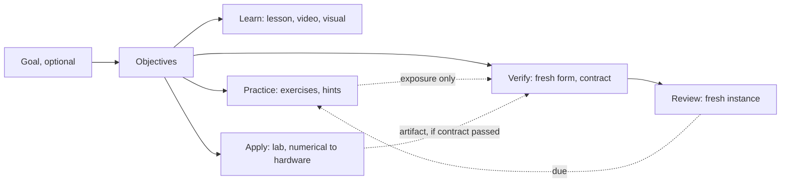
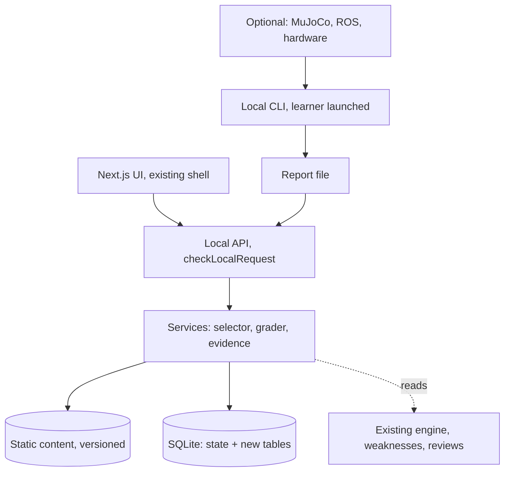

# CoreLab V2 — unified design (draft for Codex audit)

**Status:** design only. No production code, curriculum, assessment, progress or evidence was changed. Baseline `38b6a1d`. Everything described as new is **proposed**, and is marked as such where it could be mistaken for an existing feature.

**Inputs:** `curriculum-review/proposed_curriculum_v2.md`, `corelab-labs-review/proposed_practical_learning_system.md`, `exercise-bank-review/proposed_exercise_bank.md`, and the repository code.

Labels: **[Repo]** read in current code. **[Report]** from a finalized proposal. **[T]** I ran it for this design. **[E]** my estimate, unmeasured. **[Decision]** choice made here, open to audit.

## 1. Summary of decisions

1. **Five activities, not five gates.** Learn, Practice, Apply, Verify and Review are open at any time. Nothing locks except hardware activity after a safety failure.
2. **One object links everything: the learning objective.** Lessons, exercises, labs, assessment forms and reviews all reference objective IDs. Topics stay as the map. Existing topic levels stay as they are.
3. **New data goes in new tables.** The existing `state` JSON, its `Progress` shape, backups, signatures and `masteryFor` are not touched by the pilot.
4. **Two records, side by side, on purpose.** "Topic level (v1)" comes from today's engine. "Verified objectives" comes from the new evidence table. **New evidence does not change topic levels** until the owner approves a separate policy.
5. **Practice and evidence are physically separate:** different tables, endpoints and forms. No code path writes a practice event into evidence.
6. **Code execution has three trust profiles, stated plainly** (section 7.3). This resolves a direct conflict between the Labs and Exercise Bank reports.
7. **The pilot is one vertical slice:** Frames and planar FK, on the numerical pathway, using existing lessons. It deliberately excludes Bayes, Jacobian, SE(3) and any simulator.
8. **Capacity is the main unresolved risk.** The three reports' first tranches do not fit in one 100-hour plan. Section 13 asks the owner to choose.

## 2. Constraints found in the repository [Repo]

These shape the design more than the reports do.

| Fact | Location | Consequence |
| --- | --- | --- |
| All progress is one JSON row, `state` | `lib/storage.ts:179` | Adding fields means touching strict schemas. New tables avoid it |
| Constructor throws if `user_version > 2`, and runs `PRAGMA user_version=2` | `lib/storage.ts:172,179` | Keep it at 2 for additive tables, so the old app still opens the database. Bumping would block rollback |
| `Store.attempt` calls `getAssessment(topic)`, whose default version is 1 | `lib/storage.ts`, `lib/content.ts:51` | **A v2 diagnostic cannot be served today.** "Fix M08 by versioning" from Curriculum V2 needs code work, which the report doesn't state |
| `getAssessmentCatalog` scans `content/assessments/` by filename | `lib/content.ts:87` | Don't put new forms there. Use a new directory |
| Backup schema is strict, `curriculumVersion` is literal `"1.0"` | `lib/storage.ts:95-101` | Old importers reject additions. Needs a new backup schema, with old ones still accepted |
| `restore` replaces `state` only, snapshotting it first | `lib/storage.ts:229` | New tables need a defined restore behaviour |
| `recommend` only offers topics whose prerequisites all have L1 | `lib/engine.ts:137` | With the v1 graph, R04 needs R03, M04, and through R03, R02 and R01. **V2's shortened edges (R03←M12, R04←R03) do not exist in production** |
| Non-targeted attempts count toward mastery; `targeted` ones don't | `lib/engine.ts:70` | Don't reuse attempts for anything new |
| Any trusted A0 lab sets `dims.I = 2` for the topic | `lib/engine.ts:79-82` | New evidence must not enter `p.labs` |
| Report validator accepts only M02 and PY01 | `lib/labs.ts:9` | New reports need a separate validator |
| `dims.T = 1` after two A0 passes at least 7 days apart | `lib/engine.ts:88-93` | Existing T1 means retention. Keep the value; label it honestly |
| Topic route allows only `lessons` and `assessments` sub-pages | `app/[[...slug]]/page.tsx` | New UI fits as tabs in existing pages, or needs route edits |
| Practice bank R04 exists; M12 and R03 banks do not | `content/practice/` | Pilot practice is new content for M12 and R03 |
| `frames` visualization id exists | `lib/media.ts:22` | Reuse; no new engine |
| Lessons M12, R03, R04 share stable headings | `content/lessons/` | Objective map can use anchors without editing lessons |
| All API routes use `checkLocalRequest` | `lib/http.ts` | New routes must too |

## 3. Inconsistencies across the reports, resolved

| # | Inconsistency | Resolution | Why |
| --- | --- | --- | --- |
| 1 | **Execution security.** Labs §16: a parent harness is enough, as this is "intentionally launched local trusted study code", and "stronger isolation would be a separate justified project". Exercise Bank §8: automatic code verification requires reviewed OS isolation, and evidence must protect keys | **[Decision]** Three profiles in 7.3. The CLI that a learner launches on their own code uses `local-trusted`, with parent-owned verdict and **no sandbox claim**. OS isolation is required only if CoreLab ever launches code itself, or runs code not written by the learner | A sandbox protects the host, not evidence integrity: the owner can edit the app and key anyway. Requiring one would make I evidence Linux-only for 40–100+ h [Report], with no integrity gain against the actual threat model. **Codex: please attack this one** |
| 2 | **Namespaces.** `corelab-lab/2`, `corelab-practical/1`, `corelab-exercise/1` | `corelab-exercise/1` is catalog only. `corelab-practical/1` is the result report, as a recommendation; owner confirms | Avoids implying an upgrade of the strict `/1`. Practice events use no report format at all |
| 3 | **First tranche.** Curriculum: M02, PY01, M08 defects first, FK at hours 78–90. Labs: L01, L02. Bank: projection, Bayes, frames, FK | Pilot is Frames and FK with projection as optional support. Bayes becomes the second slice. M02 and PY01 v2 contracts wait for the runner | Requirement 9 asks for Frames/FK. Bayes doesn't support it. **Cost: M08's false failure stays longer** unless the owner funds a small fix (section 13) |
| 4 | **Budget.** 12 h FK slot vs 30–80 h for two labs vs 54–116 h for the bank | Stated openly in section 12. Not additive, but cannot all fit | Owner decision |
| 5 | **Prerequisites.** V2's edges differ from production's | Do not change the graph. Add advisory `readiness` to objectives, used by the new selector only. `recommend()` is untouched, so the dashboard still follows the v1 graph | Graph changes affect historical interpretation, and need their own approval |
| 6 | **ID collisions.** `L01` (lab) vs `L1` (level); `T01` (topic) vs `T` (dimension) vs my earlier T0–T3 (tiers); "level 2" difficulty vs L2 | Learner UI never shows `L01`: "Lab: Frames". Difficulty is "Difficulty 2 of 5". Pathways have names, not T-numbers. Files keep `L01`, matching the reports | Confusing a lab with a mastery level would misstate evidence |
| 7 | **Exercise IDs.** Final Bank uses X01–X20, and my review used EX-* | X-numbers only | Final report wins |
| 8 | **Mode vocabulary.** Labs: analytic, mock, replay, physics, hardware. Request: numerical, MuJoCo, ROS 2, hardware | Two fields. `pathway` = where it runs. `mode` = what kind of evidence | 10.1 |
| 9 | **T dimension.** V1 T1 is repetition; reports require reviewed transfer | Keep `dims.T` unchanged. New evidence has separate kinds `retention` and `transfer-reviewed`. UI labels v1 T as "Retention" | No history changes; no false transfer claim |
| 10 | **C/M form.** Curriculum: 5 C + 5 M pilot, at least 4 of 5 each; Labs: reviewed coverage, not one shape; Bank: separate admission | Scoped forms per objective, with coverage declared per objective. The 5+5 applies only where both dimensions apply and is a starting point | Frames and FK can use it; other contracts may not |
| 11 | **Review.** Reports reuse 1/3/7/21; `reviews` requires an attempt ID and backup validates that | New `objective_reviews` with the same intervals, referencing new events. Topic reviews unchanged. UI merges two lists | Cannot point legacy reviews at new events without breaking restore validation |
| 12 | **Weakness.** Reports reuse `deriveWeaknesses`, which only reads attempts | New practice failures live in their own derivation; the selector reads both. Legacy statuses aren't changed by new events | A correct new exercise must not mark a legacy weakness "independently corrected": that rule covers authored equivalents only |
| 13 | **Hints.** v1 assistance is self-declared. Bank: observed and declared are separate | New events store both, and the effective level is the higher. v1 attempts unchanged | |
| 14 | **20 exercises.** Bank has 20 plus extras | Inherited as a catalog. The pilot uses 3 families | The pilot doesn't depend on this question |
| 15 | **R10, candidates M17, R16–R20, E16** | Candidate IDs only in `proposedTopicRefs`, never `topicId` | Prevents dangling references |

**Limits of this table.** Item 1 is a judgement call. Items 3–5 trade something away. None of these is a new capability.

## 4. The learning system



| Step | Purpose | What it can claim | Evidence? | Status |
| --- | --- | --- | --- | --- |
| **Learn** | Understand | "Read or watched" | Never | Exists: lessons, videos, visuals, sessions |
| **Practice** | Build skill, with help allowed | "Correct on this instance" | **Never** | Partly exists as weak-skill practice; bank is new |
| **Apply** | Use it in a system | "Self-check ran" (kit), or feeds Verify if contract run | Only through Verify | Mostly new |
| **Verify** | Show it independently | Scoped objective PASS, or a failure | **Yes, scoped** | New path; v1 diagnostics remain |
| **Review** | Keep it | "Retained on a fresh instance" | Retention only, not transfer | Topic reviews exist; objective reviews new |

**Learner freedom rules.** Any step can be first: a confident learner goes straight to Verify. Steps can be skipped without penalty. Prerequisites warn, never block. Goals and specializations are optional. Several exercise routes exist per objective. Recommended is overridable. **There is no required path, no points and no streaks.** Verify still can't be passed by doing the other four.

## 5. Objective map

### 5.1 Objects

| Object | Identity | Location | Mutable? |
| --- | --- | --- | --- |
| Topic | `R04` | Existing graph | Not changed |
| **Objective** | `R04.planar-fk` | `content/v2/objectives.v1.json` | New version when scope changes |
| Exercise family | `X11@1` | `content/exercises/` (`corelab-exercise/1`) | Versioned |
| Lab contract | `L02.planar@1` | `content/labs/` | Versioned |
| Assessment form | `R04.planar-fk.form@1` | `content/verify/` **not** `content/assessments/` | Versioned, immutable once used |
| Goal path | `manipulation@1` | `content/v2/paths.v1.json` | Versioned; advisory |

### 5.2 Example record

```json
{
  "id": "R04.planar-fk",
  "version": 1,
  "topicId": "R04",
  "statement": "Compute endpoint position and orientation of a planar 2R arm with relative joint angles and unequal links.",
  "excludes": ["spatial chains", "Jacobian", "inverse kinematics", "physical accuracy"],
  "dimensions": { "C": true, "M": true, "I": true, "T": "reviewed-only" },
  "readiness": ["M12.frame-labels", "M01.radians"],
  "learn": [
    { "lesson": "R04", "anchor": "theory-and-derivation" },
    { "visual": "frames" }
  ],
  "practice": ["X11@1"],
  "apply": [{ "lab": "L02.planar@1", "pathway": "numerical" }],
  "verify": {
    "C": "R04.planar-fk.form@1",
    "M": "R04.planar-fk.form@1",
    "I": "L02.planar@1"
  },
  "review": { "intervalsDays": [1, 3, 7, 21], "instanceFrom": "X11@1" },
  "proposedTopicRefs": []
}
```

**Validator rules (extends `validate:content`).** All references resolve. `topicId` is in the 169. `proposedTopicRefs` only holds the seven candidates. A form can't share instances with its practice family. Every objective has a stated `excludes`. Forms carry a separate exposure domain.

### 5.3 Pilot mapping

| Objective | Topic | Learn (exists) | Practice (new) | Apply (new) | Verify (new) |
| --- | --- | --- | --- | --- | --- |
| `M12.frame-labels` | M12 | M12 lesson; `frames` visual | X10 first step | L01 kit | C form |
| `M12.point-vs-direction` | M12 | M12 lesson | X10 | L01 kit | C, M form; I via L01 |
| `R03.compose-invert-se2` | R03 | R03 lesson | X10 routes A, B | L01 kit | C, M form; I via L01 |
| `R03.rotation-validity` | R03 | R03 lesson | X10 | L01 kit | C form; I via L01 |
| `R04.planar-fk` | R04 | R04 lesson | X11 routes A, B | L02 kit | C, M form; I via L02 |
| `M02.projection-compute` (optional) | M02 | M02 lesson | X01 | — | Not in pilot |

The whole-system map for other topics inherits the Practical report's section 9 matrix and Bank's section 5 catalog. **A mapping is a plan, not an available item.** UI only shows authored items.

## 6. Data model and compatibility

### 6.1 New tables, same SQLite file [Decision]

```sql
CREATE TABLE IF NOT EXISTS v2_meta (key TEXT PRIMARY KEY, value TEXT NOT NULL);

CREATE TABLE IF NOT EXISTS practice_events (      -- append-only
  id TEXT PRIMARY KEY, at TEXT NOT NULL,
  family TEXT NOT NULL, family_version INTEGER NOT NULL, route TEXT,
  instance_hash TEXT NOT NULL, objective_ids TEXT NOT NULL,
  answers_json TEXT NOT NULL, outcome TEXT NOT NULL, reason_code TEXT,
  observed_assistance TEXT NOT NULL, declared_assistance TEXT NOT NULL,
  fresh INTEGER NOT NULL
);

CREATE TABLE IF NOT EXISTS evidence_records (     -- append-only
  id TEXT PRIMARY KEY, at TEXT NOT NULL,
  objective_id TEXT NOT NULL, objective_version INTEGER NOT NULL,
  dimension TEXT NOT NULL,   -- C M I retention transfer-reviewed
  source_kind TEXT NOT NULL, -- form | contract | review
  source_id TEXT NOT NULL, source_version INTEGER NOT NULL,
  pathway TEXT NOT NULL, mode TEXT NOT NULL,
  assistance TEXT NOT NULL, exposure_json TEXT NOT NULL,
  result TEXT NOT NULL,      -- passed | failed | unreviewed
  payload_json TEXT NOT NULL, policy_version INTEGER NOT NULL
);

CREATE TABLE IF NOT EXISTS objective_reviews (
  objective_id TEXT PRIMARY KEY, stage INTEGER NOT NULL,
  due TEXT NOT NULL, last_ref TEXT NOT NULL
);

CREATE TABLE IF NOT EXISTS v2_prefs (key TEXT PRIMARY KEY, value TEXT NOT NULL);
```

**Why the same file with `user_version` still 2.** One file for the learner to manage. The current constructor both rejects versions above 2 and sets 2 on open, so additive tables keep old binaries working. **Rollback means reinstalling the older app, whose code ignores these tables.** New-table schema versions live in `v2_meta`. Must be proven by test (AC-3).

**Why no change to `state`.** `Progress`, `attempts`, `labs` and `reviews` keep their exact meaning. Old evidence is never rewritten, aliased or backfilled.

### 6.2 Backups

| Schema | Export | Import |
| --- | --- | --- |
| `corelab-backup/1`, `/2` | `/2` still available, legacy data only | **Still accepted.** Restores `state`, and leaves new tables alone, with a clear notice |
| `corelab-backup/3` (new) | `{ legacy: <exact /2 document>, v2: { events, evidence, reviews, prefs } }` | Validates both. Snapshot taken first. Legacy part goes through existing `validateBackup` |

A `/3` restored onto an older app is rejected by its strict schema, which is honest. The `/2` export remains available for that case.

### 6.3 What is never done

Rewriting attempts, signatures, hashes or levels. Mapping a v1 report to a new objective. Inferring new evidence from old PASSes. Changing `recommend`, `masteryFor`, `validateLab`, `reportSchema`, v1 content files, or topic prerequisites during the pilot.

**Old evidence display.** v1 topic levels remain visible and unchanged. Objectives show "No objective evidence yet" even when a v1 topic is L1. **This will look odd to learners with history.** Wording: "Your topic level stands. Objective checks are narrower and newer." Placement can be offered; nothing is backfilled.

## 7. Architecture

### 7.1 Layers



| Module (new) | Does | Does not |
| --- | --- | --- |
| `lib/v2/content.ts` | Load and validate objectives, families, forms, labs | Execute anything from content |
| `lib/v2/answers.ts` | Bounded numeric grammar, vector and matrix entry; finite-only comparison | `eval`, CAS, expressions |
| `lib/v2/instances.ts` | Pure, seeded instance generator from allowlisted family parameters | Run authored code from JSON |
| `lib/v2/practice.ts` | Grade practice, append event, derive failures | Touch evidence |
| `lib/v2/verify.ts` | Issue form, grade, apply policy, append evidence | Change topic levels |
| `lib/v2/select.ts` | Three modes, pure function of inputs, returns reason strings | IRT, LLM, or writes |
| `lib/v2/practical-report.ts` | Validate `corelab-practical/1` | Accept `corelab-lab/1` |
| `scripts/verify-practical.mjs` | Parent runner, CLI only | Be importable from a route |

**Feature gate.** `CORELAB_V2=1` hides all of it until pilot acceptance. Off means behaviour identical to today. Tested.

**Grading happens on the server, as today.** Public payloads redact expected values, keys and tolerances, matching current redaction.

### 7.2 Dependencies

| Component | Required? | Note |
| --- | --- | --- |
| Node 24+, SQLite, Next.js | Yes | Existing. No new runtime dependency for answer practice |
| Python 3 | Only for code routes | Existing optional |
| NumPy | Only if a kit says so | Pilot kits use the standard library by default [T: my fixture script does] |
| MuJoCo | Optional, later | Not installed by CoreLab |
| Docker, ROS 2 | Optional, later | Never needed for CoreLab itself |
| Hardware | Optional | Separately reviewed |

No queue, no plugin system, no service, no cloud account, no sync.

### 7.3 Code execution profiles

| Profile | Who launches | What is run | Isolation | Parent owns verdict? | Can create evidence? |
| --- | --- | --- | --- | --- | --- |
| **`self-check`** | Learner, by hand | Their code with a reviewed kit | None. Same as running their program | No verdict returned | **No.** Nothing is imported |
| **`local-trusted`** [Decision] | Learner, via `verify-practical` | **Their own** code | Separate process, scrubbed env, temp cwd, timeout, output limit. **No filesystem or network protection** | **Yes.** Worker returns values only; parent compares | **Yes, scoped, labelled "self-attested, not isolated"** |
| **`isolated`** (later) | CoreLab, or for third-party code | Any | Reviewed OS sandbox, per Bank §8 | Yes | Yes |

**Rules.** The web server never runs code. Any code from a stranger is out of scope for `local-trusted`, and the CLI says so. The current stdout defect is closed in the new runner by having no worker verdict at all, which Codex's Appendix B protocol demonstrates [Report]. Legacy `verify-lab` stays for existing behaviour, and its limitation is documented.

**The honest weakness.** Under `local-trusted`, worker code runs as the same user and can read the signing key and the database. A learner pasting hostile code could lose local data, as with any program they run. This is not an integrity loss beyond the existing model, where the owner can already forge. Mitigation: the signing key isn't passed to or stored inside the worker's directory, and the warning is shown. **Whether this is acceptable is decision D2.**

### 7.4 Answer grading

Types: `number`, `vector`, `matrix`, `choice`, `set-of-valid` (for example any optimal path). Rules from Bank §7: a finite-only comparison where "accept only if finite, right type and close" is the only accepting path. Reject bool, NaN and Infinity. Fractions and decimals with bounded length. Format errors produce `format` outcome and no conceptual weakness. Units stated in prompt. Tolerances per item.

## 8. Practice, modes and selection

Modes come from the Bank, placed as tabs in the existing Practice page, beside My Weaknesses.

| Mode | Input | Output |
| --- | --- | --- |
| **Recommended** | Active goal, weaknesses (both kinds), due reviews (both kinds), readiness, time budget | 3–5 items, each with its reason. Override and "fewer" always there |
| **Explore** | Filters | All authored items, with warnings. External links marked "outside CoreLab, no evidence" |
| **More Practice** | One objective | New route or instance, then labelled repeats, then an honest end |

**Selector order:** weakness on a goal prerequisite; due review; next ready objective; one mixed earlier item; one optional application. After repeated credible failures on a skill, it offers a smaller example, a prerequisite or something else. It never blocks. Format and infrastructure failures don't count.

**Small pool.** With three families, Recommended is short and says so. That's acceptable for a pilot.

**Hints.** A1, A2, A3 ladder, recorded monotonically per attempt. Help is available before a first try, with a gentle prompt to try first. Solutions mark the instance as exposed.

## 9. Verify: evidence policy

**Admission rule (policy version 1), applied by a pure function.** An evidence record has `result=passed` only if all hold:

1. Source is a known form or contract at a known version.
2. All critical items or checks passed, and thresholds were met per applicable dimension.
3. Observed assistance is none, and declared assistance is A0.
4. The instance has no prior exposure on this learner's record.
5. For I: report validates, signature matches local key, parent-owned runner version is known, and the report's contract matches the objective.

**Otherwise it's still recorded,** as `failed` or `unreviewed`, with its reason. Failures aren't hidden and don't erase earlier passes. **A present gap is a recommendation signal,** not a demotion.

| Dimension | Pilot evidence | Limit shown to learner |
| --- | --- | --- |
| C | Fresh objective form | "Narrow: this objective" |
| M | Fresh objective form | Same |
| I | `L01`/`L02` contract, `local-trusted` | "Self-attested, not isolated, numerical" |
| Retention | Fresh review instance after delay | "Retained", not transfer |
| Transfer | Artifact stored `unreviewed` until a qualified reviewer records a judgement | No automatic transfer |

**C/M forms.** Starting shape from Curriculum V2 where both dimensions apply: 5 C and 5 M, at least 4 of 5 per dimension and all critical items correct, with each critical objective probed in two ways. Options are shuffled through stable option IDs, avoiding the fixed index-0 defect. **Not validated; pilot it.**

**Levels.** `masteryFor` doesn't read evidence. A later `level policy` could define: L1 scoped = C and applicable M; L2 scoped = plus I; L3/L4 = reviewed. Displayed as "Objective: verified C, M, I", **not** as L-numbers in the pilot. Owner decision D3.

**Practice wall.** Enforced in three places: separate tables; `lib/v2/practice.ts` has no import path to evidence writes; a test asserts that no sequence of practice events changes any evidence record or `masteryFor`.

## 10. Pathways

### 10.1 Pathway and mode

| Pathway | Modes it can report | Status | Requires | Evidence wording |
| --- | --- | --- | --- | --- |
| **Numerical** | `analytic` | Proposed; pilot | CoreLab; Python for code routes | "Numerical, on declared fixtures" |
| **MuJoCo** | `physics` | Optional, later. Models loaded in earlier session; no lab exists | Pinned venv, model card | "In simulation, on this characterized model" |
| **ROS 2** | `replay`, `mock`, `physics` | Optional, later. Jazzy tested **in Docker only**, in single session runs; TurtleBot3 headless needed a custom launch, OMX-F a modified launch | Linux tested; others unknown | "Replay", "mock interface" or "simulated, ROS 2" |
| **Hardware** | `hardware` | Optional, unverified | Device safety plan, supervisor | "This device, this protocol, on this date" |

**Rules.** Pathways are separate evidence, not levels of one thing. Passing a harder pathway doesn't imply an easier one's objective, or the reverse. **No PASS in any pathway authorizes hardware operation.** Every record carries pathway and mode. CoreLab never connects to a simulator or robot: tooling runs outside and only produces report files.

### 10.2 Same objective across pathways

| | Numerical | MuJoCo | ROS 2 | Hardware |
| --- | --- | --- | --- | --- |
| FK example | `L02.planar`, fixtures | Compare own FK with model poses; CI cross-check first | `L12`: TF against FK | Informal ruler check; no evidence unless separately reviewed |
| Odometry | `L03` closed forms | Experiment, explain mismatch | `L05` replay | Low-speed test, safety plan |

**Backend choice.** The integrated capstone stays behind the bounded spike [Report]. Neither MuJoCo nor Gazebo is selected here.

## 11. UI flows

**Topic page (existing `components/topic.tsx`).** Adds, behind the flag, an "Objectives" panel:

```text
R04 Forward Kinematics                     Topic level (v1): L1  Retention: yes
----------------------------------------------------------------------------
Objective: Planar 2R forward kinematics        Not: spatial chains, IK, hardware
 Learn     Lesson · Frames visual                       [Open]
 Practice  2 routes: tabletop reach | inspection link   [Choose]   3 tried
 Apply     Frames/FK lab · numerical                    [Open kit]
 Verify    C ✓  M –  I –  Transfer: needs reviewer      [Take fresh check]
 Review    Next due in 3 days                           [Review now]
```

| Flow | Steps | Key rule |
| --- | --- | --- |
| Typical | Learn, choose route, practice with hints, open kit, take check, review later | All optional |
| Confident | Topic, Take fresh check | Warning if readiness is missing, not a block. Failure offers remediation |
| Stuck | Fail twice, offered smaller example, prerequisite or another activity | Learner chooses |
| Code evidence | Kit, run `verify-practical` in a terminal, import the report | Import shows exact scope before saving |
| Returning learner | Sees v1 level unchanged, "no objective evidence yet", optional placement check | Nothing backfilled |

**Practice page:** Recommended, Explore, More Practice, My Weaknesses. **Dashboard:** existing recommendation stays; new "Practice next" card appears only when flagged on. **Accessibility:** typed matrix entry works by keyboard; every visual has a table alternative; no colour-only status. Mobile layout for answer entry is an acceptance item.

**AI tutor.** Existing manual handoff can include the objective, attempt and hints. Output remains assisted practice.

## 12. Pilot: Frames and planar FK

### 12.1 Scope

| In | Out |
| --- | --- |
| 5 objectives in 5.3, existing lessons unchanged | SE(3), quaternions, spatial chain, Jacobian, IK |
| X10 and X11, two routes each; X01 optional | Bayes, other families |
| Three modes, simple selector | Rich adaptivity |
| Fresh C/M forms for M12/R03 and R04 | Changing v1 diagnostics |
| L01-SE2, L02-planar self-check kits | MuJoCo, ROS, hardware |
| `local-trusted` runner and report import (stage P3) | `isolated` profile |
| Objective reviews with fresh instances | New scheduler |

### 12.2 Stages

| Stage | Delivers | Can ship alone? |
| --- | --- | --- |
| **P0 Decisions** | D1–D8 answered; reviewer named | — |
| **P1 Practice** | Tables, answer entry, X10, X11, More Practice, self-check kits | **Yes.** No evidence involved |
| **P2 Verify C/M** | Forms, policy, evidence panel, Recommended, objective reviews, backup `/3` | Yes |
| **P3 Verify I** | Parent runner, `corelab-practical/1`, import | Yes; I can remain "not available" if P3 is cut |
| **P4 Learner trial** | 3–8 volunteer learners [E], over at least 21 days | Results inform all further work |

### 12.3 Contract feasibility check [T]

A standard-library fixture script (Appendix) checks hand anchors from the Bank's X10 and X11, valid alternatives and injected bugs. **Author-side only; adversarial review still needed.**

| Contract | Valid accepted | Injected bugs rejected |
| --- | --- | --- |
| L01-SE2 | 2 of 2 (matrix; angle-and-offset) | 7 of 7, including reflection accepted, identity stub, NaN |
| L02-planar | 2 of 2 (trig; transform chain) | 7 of 7, including position right but orientation wrong, hardcoded anchor, NaN |

It tests one fixed fixture set. **Fresh instance generation and the runner are not prototyped.** A hardcoded answer failing here shows the fixtures vary; it doesn't show authorship.

### 12.4 Effort [E], low confidence

| Work | Hours |
| --- | --- |
| Content: objectives, 4 routes, hints, forms, kits, fixtures | 25–50 |
| P1, P2 software | 35–70 |
| P3 runner and import | 15–30 |
| Review and trial admin | Not estimated; depends on people |
| **Total before review** | **75–150** |

Compare the 100-hour plan's 12-hour FK slot [Report]. Non-additive overlaps exist. **This doesn't fit without displacing something**, as section 13 states.

## 13. Open decisions for the owner

| # | Decision | Recommendation | If not decided |
| --- | --- | --- | --- |
| D1 | Capacity: which work displaces which? | Do P1 and P2 first, then a small M08 fix, then P3. Defer M02/PY01 v2 until the runner exists | Plans silently overrun |
| D2 | Accept `local-trusted` for I evidence? | Yes, with its label | I stays unavailable until sandbox exists, Linux first |
| D3 | Do objective results ever change topic levels? | Not in the pilot. Decide after trial | Two records coexist, which is safe |
| D4 | Report namespace | `corelab-practical/1` | P3 is blocked |
| D5 | Named technical, adversarial and pedagogical reviewers | Needed before P1 release | **Blocks release of auto-checked items**, per Bank gates |
| D6 | Supported OS for code routes | Linux first; test others during P4 | Claims stay limited |
| D7 | Fix M08 false failure by serving a v2 diagnostic? | Yes, but small and separate. Needs `Store.attempt` version routing | Known unfairness stays |
| D8 | Adopt V2's graph edges in production? | Not during the pilot | Dashboard keeps v1 prerequisites |

## 14. Architectural risks

| Risk | Severity | Mitigation | Residual |
| --- | --- | --- | --- |
| **Two records confuse learners** | High | Clear labels, explanation, trial observation | May need D3 sooner |
| Dashboard and Recommended disagree, since one uses v1 prerequisites and the other readiness | Medium | Reasons shown; card labelled; revisit after trial | Real, accepted during pilot |
| Evidence leakage into levels | High | Three-layer wall, tests | Low |
| Restore overwrites only one store | Medium | `/3`, notices, snapshots | Older backups can't carry new data |
| Old app after rollback ignores new data | Low | Documented; export before downgrade | Data stays in file |
| Hostile pasted code under `local-trusted` | Medium | No web execution; warning | Same as any local program; D2 |
| Fixture errors unfair to learners | High | Gates, adversarial review; versioned fix never rewrites history | Some will ship; provide a reporting path |
| Fresh instances are local and inspectable | Low | "Self-study evidence", not proctoring | Accepted |
| Content cost exceeds capacity | **High** | Small pilot, stages ship alone | Owner choice |
| Single maintainer | High | Static content, no services, few modules | Real |
| Overbuilding for 22 labs before any exists | Medium | Schema only as the pilot needs; L-IDs reserved, not built | Low |

## 15. Acceptance criteria

**Compatibility**

- AC-1. With `CORELAB_V2` off, all 119 existing tests and `validate:content` pass, unchanged.
- AC-2. Byte-identical: `content/assessments/`, `content/practice/`, `lib/engine.ts` scoring output for a fixture history; before and after.
- AC-3. A database used by the new app opens in the baseline build, with progress intact. Baseline `user_version` remains valid.
- AC-4. `/1` and `/2` backups still restore. `/3` round-trips exactly. Legacy signatures still verify.
- AC-5. For a seeded history, `masteryFor` results are identical before and after any sequence of new events and evidence.

**Evidence integrity**

- AC-6. Property test: no practice sequence creates an evidence record.
- AC-7. Evidence refused or marked failed for: A1–A3, observed hints, exposed instance, unknown form or contract, version mismatch, missing critical check.
- AC-8. Forged stdout, early exit, verdict-shaped output, NaN, bool, oversized and timeout all fail closed in the runner. No report on failure.
- AC-9. Answer checker rejects NaN, Infinity, bool, wrong shape; accepts equivalent fractions; formatting errors create no weakness.

**Content**

- AC-10. Each pilot item passes Bank gates 1–7, **including a second person's adversarial attempt**.
- AC-11. Each contract accepts at least two materially different valid solutions and rejects its named mutants in CI, with translation and rotation both checked for L02.
- AC-12. Validator fails on dangling references, candidate IDs in `topicId`, or forms sharing instances with practice.

**Learner experience**

- AC-13. Every step reachable without completing another. Prerequisite warnings never block.
- AC-14. More Practice labels repeats, and ends honestly.
- AC-15. Keyboard-only completion of one full loop; text alternative for each visual; usable at phone width.
- AC-16. Local-only: new routes use `checkLocalRequest`. No network dependency in the numerical path. Web server has no code path to run a submission.

**Pilot exit, stated before it runs**

- AC-17. Fresh install works on the OSes the owner selected in D6, or the limit is published.
- AC-18. At least the planned volunteers complete a loop. Report active time, assistance use, false failures, confusion over two records, and delayed retention at 7 and 21 days. **A small trial gives case evidence, not an effect size.**
- AC-19. Continue, change or stop is decided from AC-18. Stopping is an acceptable outcome.

## 16. Known limits of this design

- `lib/v2/instances.ts` is unspecified beyond "pure and allowlisted". Generators are the hardest content item.
- `corelab-practical/1` fields are inherited from Labs §16, not finalized.
- I haven't prototyped storage or UI. Compatibility claims rest on reading code until AC-1 to AC-5 are run.
- Mobile, MuJoCo, ROS and hardware pathways have no authored labs. Earlier single-session runs aren't support claims.
- No learner has used anything here.

## Appendix: pilot fixture check

Output:

```text
L01 valid: {'ref': True, 'alt': True}
L01 mutants rejected: {'swapped order': True, 'inverse without R^T on p': True, 'transpose only': True, 'direction translated': True, 'reflection accepted': True, 'always identity': True, 'nan point': True}
L02 valid: {'trig': True, 'chain': True}
L02 mutants rejected: {'absolute angles': True, 'swapped links': True, 'degrees': True, 'position right, orientation wrong': True, 'equal links assumed': True, 'hardcoded anchor': True, 'nan': True}
```

```python
# Unified design: pilot fixture feasibility check. Standard library only. Not production code.
import math
def close(x,y,tol):
    if isinstance(x,bool) or not isinstance(x,(int,float)):return False
    return math.isfinite(x) and abs(x-y)<=tol
def mm(A,B):return [[sum(A[i][k]*B[k][j] for k in range(3)) for j in range(3)] for i in range(3)]
def mv(A,v):return [sum(A[i][k]*v[k] for k in range(3)) for i in range(3)]
def T(t,x,y):c,s=math.cos(t),math.sin(t);return [[c,-s,x],[s,c,y],[0,0,1]]
# L01-SE2 reference and an independent alternative
class Ref:
    compose=staticmethod(mm)
    @staticmethod
    def invert(M):
        a,b,c,d,x,y=M[0][0],M[0][1],M[1][0],M[1][1],M[0][2],M[1][2]
        return [[a,c,-(a*x+c*y)],[b,d,-(b*x+d*y)],[0,0,1]]
    @staticmethod
    def point(M,p):r=mv(M,[p[0],p[1],1]);return r[:2]
    @staticmethod
    def direction(M,v):r=mv(M,[v[0],v[1],0]);return r[:2]
    @staticmethod
    def is_rotation(R,tol=1e-9):
        a,b,c,d=R[0][0],R[0][1],R[1][0],R[1][1];return abs(a*a+c*c-1)<tol and abs(b*b+d*d-1)<tol and abs(a*b+c*d)<tol and abs(a*d-b*c-1)<tol
class Alt(Ref):
    # angle-and-offset formulation
    @staticmethod
    def compose(A,B):
        t=math.atan2(A[1][0],A[0][0])+math.atan2(B[1][0],B[0][0]);p=Ref.point(A,[B[0][2],B[1][2]]);return T(t,p[0],p[1])
    @staticmethod
    def invert(M):
        t=-math.atan2(M[1][0],M[0][0]);c,s=math.cos(t),math.sin(t);x,y=M[0][2],M[1][2];return T(t,-(c*x-s*y),-(s*x+c*y))
def mutant(**kw):
    return type('M',(Ref,),{k:staticmethod(v) for k,v in kw.items()})
ML01={'swapped order':mutant(compose=lambda A,B:mm(B,A)),
'inverse without R^T on p':mutant(invert=lambda M:[[M[0][0],M[1][0],-M[0][2]],[M[0][1],M[1][1],-M[1][2]],[0,0,1]]),
'transpose only':mutant(invert=lambda M:[[M[0][0],M[1][0],M[0][2]],[M[0][1],M[1][1],M[1][2]],[0,0,1]]),
'direction translated':mutant(direction=lambda M,v:Ref.point(M,v)),
'reflection accepted':mutant(is_rotation=lambda R,tol=1e-9:abs(R[0][0]**2+R[1][0]**2-1)<tol and abs(R[0][1]**2+R[1][1]**2-1)<tol),
'always identity':mutant(compose=lambda A,B:T(0,0,0)),
'nan point':mutant(point=lambda M,p:[float('nan')]*2)}
def eqm(A,B,tol=1e-9):return all(close(A[i][j],B[i][j],tol) for i in range(3) for j in range(3))
def eqv(a,b,tol=1e-9):return len(a)==len(b) and all(close(x,y,tol) for x,y in zip(a,b))
def l01(S):
    A=T(math.pi/2,1,2);B=T(0,3,-1)
    H=[[0,-1,2],[1,0,5],[0,0,1]]                          # hand anchor (Codex X10)
    if not eqm(S.compose(A,B),H):return False
    if not eqv(S.point(H,[1,2]),[0,6]):return False
    if not eqv(S.direction(A,[2,0]),[0,2]):return False
    if not eqv(S.point(S.invert(A),[1,4]),[2,0]):return False
    C=T(.7,-2,.5);D=T(-1.1,4,3)
    if not eqm(S.compose(S.invert(C),C),T(0,0,0)):return False
    if not S.is_rotation([[0,-1],[1,0]]):return False
    if S.is_rotation([[1,0],[0,-1]]) or S.is_rotation([[2,0],[0,.5]]):return False
    return True
# L02-planar reference and alternative
def fk(q1,q2,l1,l2):
    return (l1*math.cos(q1)+l2*math.cos(q1+q2),l1*math.sin(q1)+l2*math.sin(q1+q2),q1+q2)
def fk_chain(q1,q2,l1,l2):
    M=mm(mm(T(q1,0,0),T(0,l1,0)),mm(T(q2,0,0),T(0,l2,0)));return (M[0][2],M[1][2],math.atan2(M[1][0],M[0][0]))
ML02={'absolute angles':lambda a,b,c,d:(c*math.cos(a)+d*math.cos(b),c*math.sin(a)+d*math.sin(b),b),
'swapped links':lambda a,b,c,d:fk(a,b,d,c),'degrees':lambda a,b,c,d:fk(math.radians(a),math.radians(b),c,d),
'position right, orientation wrong':lambda a,b,c,d:(*fk(a,b,c,d)[:2],a),'equal links assumed':lambda a,b,c,d:fk(a,b,c,c),
'hardcoded anchor':lambda a,b,c,d:(1.,2.,0.),'nan':lambda a,b,c,d:(float('nan'),)*3}
def rot_err(a,b):return abs(math.atan2(math.sin(a-b),math.cos(a-b)))
def l02(f):
    x,y,t=f(math.pi/2,-math.pi/2,2,1)                     # hand anchor (Codex X11)
    if not(close(x,1,1e-9) and close(y,2,1e-9) and close(rot_err(t,0),0,1e-9)):return False
    x,y,t=f(0.,0.,2,1)                                    # stretched: reach bound
    if not(close(x,3,1e-9) and close(y,0,1e-9)):return False
    x,y,t=f(0.,math.pi,2,1)                               # folded: |l1-l2|
    if not(close(x,1,1e-9) and close(y,0,1e-9)):return False
    # independent trig expansion, seeded grid
    for q1,q2,l1,l2 in [(.3,.4,2,1),(-1.2,2.2,.7,1.3),(2.5,-.9,1.1,.2),(-3,3,.5,.5),(1e-3,1e-3,1,2)]:
        a,b=q1+q2,q1;X=l2*(math.cos(q1)*math.cos(q2)-math.sin(q1)*math.sin(q2))+l1*math.cos(b);Y=l2*(math.sin(q1)*math.cos(q2)+math.cos(q1)*math.sin(q2))+l1*math.sin(b)
        x,y,t=f(q1,q2,l1,l2)
        if not(close(x,X,1e-6) and close(y,Y,1e-6) and close(rot_err(t,a),0,1e-6)):return False
    return True
print('L01 valid:',{'ref':l01(Ref),'alt':l01(Alt)})
print('L01 mutants rejected:',{k:not l01(v) for k,v in ML01.items()})
print('L02 valid:',{'trig':l02(fk),'chain':l02(fk_chain)})
print('L02 mutants rejected:',{k:not l02(v) for k,v in ML02.items()})
```
